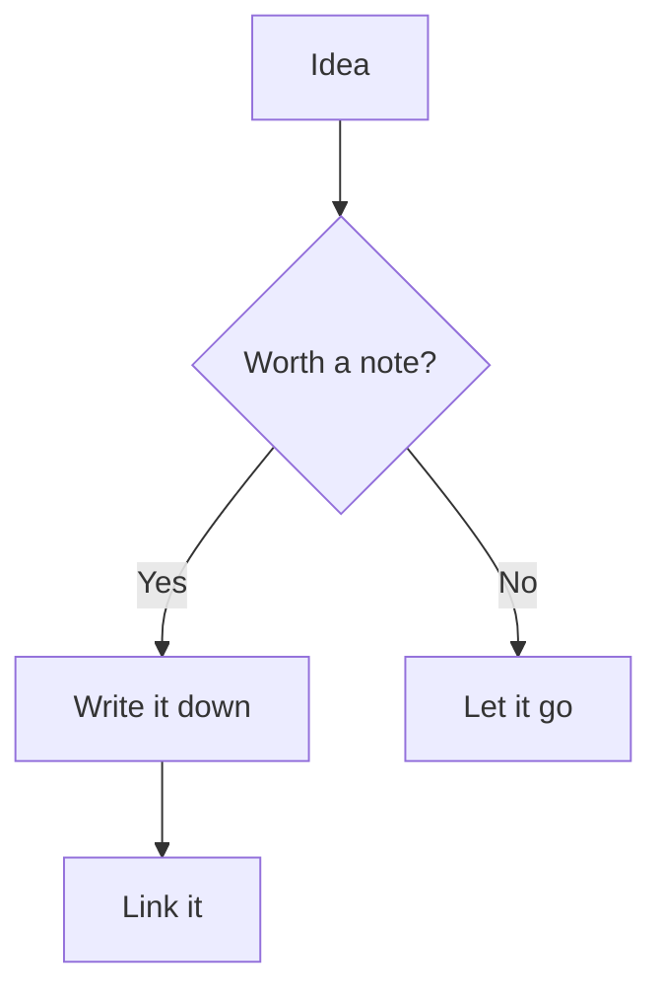
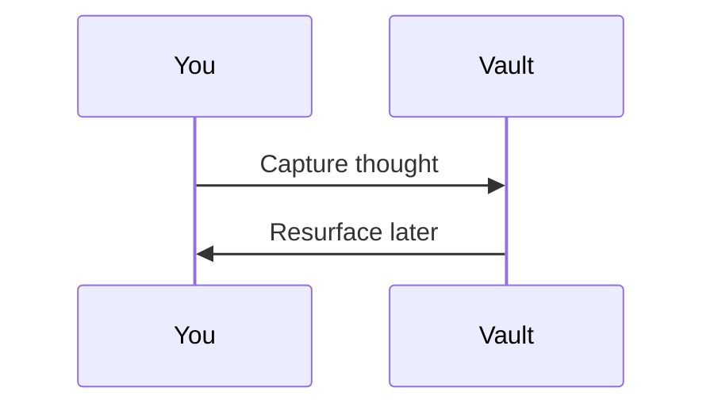

# 🎨 Obsidian Components Cheatsheet

> [!abstract] What is this?
> A one-stop reference of the built-in formatting components Obsidian gives you to make notes **beautiful and easy to read**. Switch to **Reading view** (or Live Preview) to see everything render.

---

## 1. Callouts (the star of the show)

Callouts are colored, icon-labeled boxes. Syntax: `> [!type] Optional Title`.

> [!note]
> Use callouts to make key information pop off the page.

> [!tip] You can rename the title
> Just add text after the `[!type]`.

> [!info]
> Neutral information or context.

> [!success] Done!
> Great for checklists and wins.

> [!question] Is this useful?
> Yes. Use it for FAQs and open questions.

> [!warning]
> Draws attention to something risky.

> [!failure] Don't do this
> Highlight mistakes or anti-patterns.

> [!danger] Critical
> For the truly important stuff.

> [!bug]
> Track known issues inline.

> [!example]
> Show a worked example.

> [!quote]
> "The palest ink is better than the best memory."

### Foldable callouts

Add `+` (open by default) or `-` (collapsed by default) after the type.

> [!tip]- Click me to expand
> This callout starts **collapsed**. Perfect for hiding long details, solutions, or spoilers.

> [!note]+ Starts open, but can collapse
> Add a `+` to make a callout foldable while keeping it open initially.

### Nested callouts

> [!question] Can callouts nest?
> > [!success] Yes!
> > Just add more `>` characters.

### Full list of callout types

`note` · `abstract`/`summary`/`tldr` · `info` · `todo` · `tip`/`hint`/`important` · `success`/`check`/`done` · `question`/`help`/`faq` · `warning`/`caution`/`attention` · `failure`/`fail`/`missing` · `danger`/`error` · `bug` · `example` · `quote`/`cite`

---

## 2. Text formatting

| Style | Syntax | Result |
|---|---|---|
| Bold | `**text**` | **text** |
| Italic | `*text*` | *text* |
| Bold + Italic | `***text***` | ***text*** |
| Strikethrough | `~~text~~` | ~~text~~ |
| Highlight | `==text==` | ==text== |
| Inline code | `` `code` `` | `code` |

Superscript & subscript (with HTML): X<sup>2</sup> and H<sub>2</sub>O.

---

## 3. Lists & tasks

### Bullet & numbered

- First level
  - Second level
    - Third level
1. Step one
2. Step two
3. Step three

### Task lists (checkboxes)

- [ ] Unchecked task
- [x] Completed task
- [ ] Another to-do

> [!tip] Custom checkbox states
> Many themes render these specially: `- [/]` in progress, `- [-]` cancelled, `- [?]` question, `- [!]` important, `- [*]` star.

---

## 4. Tables

| Feature | Reading | Editing |
|:--|:--:|--:|
| Left aligned | Center | Right aligned |
| Tables | render | nicely |
| Use `:` | to set | alignment |

---

## 5. Blockquotes & dividers

> A simple blockquote.
> — Spanning multiple lines.

Three dashes make a horizontal rule:

---

## 6. Code blocks

```python
def hello(name: str) -> str:
    return f"Hello, {name}!"
```

```bash
echo "Syntax highlighting works for many languages"
```

---

## 7. Math (LaTeX via MathJax)

Inline math: $e^{i\pi} + 1 = 0$

Block math:

$$
\int_{-\infty}^{\infty} e^{-x^2} \, dx = \sqrt{\pi}
$$

---

## 8. Diagrams (Mermaid)





---

## 9. Links & embeds

- Internal link: `[[Note Name]]`
- Link with alias: `[[Note Name|display text]]`
- Link to a heading: `[[Note Name#Heading]]`
- Link to a block: `[[Note Name#^blockid]]`
- External link: `[Obsidian](https://obsidian.md)`
- Embed a note: `![[Note Name]]`
- Embed an image: `![[image.png]]`
- Embed a section: `![[Note Name#Heading]]`

---

## 10. Footnotes

Here is a statement with a footnote.[^1] You can add several.[^note]

[^1]: This is the footnote text. Click the arrow to jump back.
[^note]: Named footnotes work too.

---

## 11. Comments (hidden in Reading view)

%% This text is a comment — it shows in edit mode but is hidden in Reading view. Great for private notes-to-self. %%

You won't see the comment above when reading. 👆

---

## 12. Headings for structure

Use `#` through `######` for H1–H6. Headings build the **outline** (Outline core plugin) and become link targets. Keep one H1 per note for clean navigation.

---

## 13. Block references

Add `^myblock` at the end of any paragraph to give it an ID you can link to from anywhere. ^example-block

Then reference it with `[[Obsidian Components Cheatsheet#^example-block]]`.

---

> [!success] You're all set
> Copy any pattern above into your own notes. Toggle **Reading view** (`Ctrl/Cmd + E`) to see the polished result.
