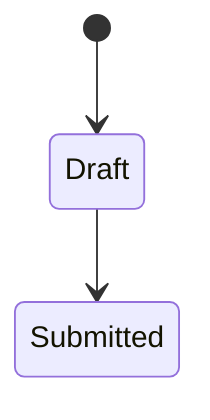
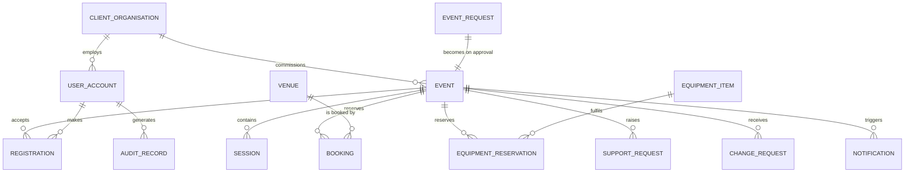

# Domain Entity Layer Implementation Plan

> **For agentic workers:** REQUIRED SUB-SKILL: Use superpowers:subagent-driven-development (recommended) or superpowers:executing-plans to implement this plan task-by-task. Steps use checkbox (`- [ ]`) syntax for tracking.

**Goal:** Add a `wiki/domain/` layer of 15 pages that documents the object model of the Event Planning and Venue Booking System — attributes, states, relationships, cardinality and deferred modelling decisions — and rewire the existing 15 concept pages to link to it rather than restate it.

**Architecture:** The wiki gains a fourth page type. `wiki/concepts/` keeps process ("what happens when…"); `wiki/domain/` owns structure ("what is a…"). Facts move to a single canonical home, so future ingests update one page, not four. A hub page assembles the first ER diagram either source document has ever had.

**Tech Stack:** Markdown, YAML frontmatter, Obsidian wikilinks, Obsidian-native callouts, Mermaid (`erDiagram`, `stateDiagram-v2`). No build step, no test runner — verification is by shell command over the file tree.

**Spec:** `docs/superpowers/specs/2026-09-02-domain-entity-layer-design.md`

## Global Constraints

- **Vault root:** `/Users/isaidchia/Desktop/spm-212-t6-brain`. All paths below are relative to it. Use absolute paths in tool calls.
- **`raw/` is immutable.** Read from it; never write to it.
- **Citation format:** `#n` for a discussion number, `brief §n` for a brief section. In prose, `(Source: is212-discussions-2026-08-31, #41)`.
- **Status vocabulary — exactly three values:** `✅ Specified` / `⚠️ Partial` / `🔶 Team decision`. No others.
- **Every `🔶` row must carry a `#n` or `brief §n` citation.** A `🔶` without one is a verification failure.
- **Callouts:** only the five types in `CLAUDE.md` — `question`, `warning`, `quote`, `info`, `success`. `[!question]` is always foldable (`-`) and always titled `Team decision required — <specific topic>`. Never nest callouts. Callouts mark exceptions; tables are the default.
- **Tone:** concise, structured, third-person. Headers, bullets, tables. No fluff, no preamble sentences.
- **Basename uniqueness:** Obsidian resolves `[[links]]` by basename. Before creating any page, confirm its basename does not already exist anywhere under `wiki/`.
- **Never delete a fact from a concept page before its replacement exists** on the domain page that now owns it.
- **Authoritative source:** `IS212 2026 Discussions Aug 31.md` supersedes the Aug 26 export. Cite Aug 31.

---

## File Structure

| Path | Responsibility |
|---|---|
| `CLAUDE.md` | Schema. Must be updated *first* — it defines the conventions every later task follows. |
| `wiki/domain/event.md` … `audit-record.md` | 14 object pages. One aggregate root each. |
| `wiki/domain/domain-model.md` | Hub: ER diagram, modelling-decision register, deferred-modelling register. Written last — depends on all 14. |
| `wiki/concepts/*.md` | 15 existing pages. Trimmed of structural enumerations, gain an `**Objects:**` line. Process narrative untouched. |
| `wiki/index.md` | Catalog. Gains a Domain objects section. |
| `wiki/log.md` | Append one entry. |

---

## Task 1: Schema — update CLAUDE.md

Must land before any page is written; every later task conforms to what this defines.

**Files:**
- Modify: `CLAUDE.md`

**Interfaces:**
- Consumes: nothing.
- Produces: the `domain-object` frontmatter type, the Status vocabulary, the basename rule, and the amended Ingest/Lint workflows that Tasks 2–10 follow.

- [ ] **Step 1: Add `wiki/domain/` to the Architecture section**

In the bulleted architecture list, after the `wiki/concepts/` line, add:

```markdown
  - `wiki/domain/` — Pages for domain objects: the nouns the system stores records about (Event, Venue, Booking, Equipment Item…). Structure, not process — attributes, states, relationships, cardinality. Concept pages describe what happens; domain pages describe what a thing *is*.
```

- [ ] **Step 2: Extend the Frontmatter convention**

Change the `type` enum in the Conventions section from
`(source-summary | concept | entity)` to
`(source-summary | concept | entity | domain-object)`.

- [ ] **Step 3: Add the Status vocabulary subsection**

After the Conventions section, add:

```markdown
## Attribute status

Domain object pages mark every attribute, rule and relationship with exactly one status. No other values.

| Marker | Meaning |
|---|---|
| `✅ Specified` | The customer stated it. Design to it; do not re-litigate. |
| `⚠️ Partial` | Stated but incomplete — a hedge word, a half-answered question, or a rule with an unspecified parameter. |
| `🔶 Team decision` | Explicitly left to the solution team. **Must** cite the `#n` where it was deferred. |

A `🔶` row with no citation is a lint failure.
```

- [ ] **Step 4: Add the page-naming rule**

Append to the Conventions section:

```markdown
- **Page names**: Obsidian resolves `[[wikilinks]]` by filename, so two pages sharing a basename in different folders make every link to that name ambiguous. Before creating a page, check the basename is unused across the whole wiki. Domain pages take the singular object noun (`booking`); concept pages take the process name (`venue-booking`).
```

- [ ] **Step 5: Amend the Ingest workflow**

Insert as a new step 5 (renumbering the rest):

```markdown
5. Create or update domain object pages in `wiki/domain/` for every object the source adds an attribute, state, relationship, cardinality or modelling decision to.
```

- [ ] **Step 6: Amend the Lint workflow**

Append two checks:

```markdown
6. Check every domain object page has a definition, an attribute table and a relationship table.
7. Check every `🔶 Team decision` row cites a discussion number or brief section.
```

- [ ] **Step 7: Verify**

```bash
cd /Users/isaidchia/Desktop/spm-212-t6-brain
grep -c 'domain' CLAUDE.md          # expect >= 5
grep -q 'domain-object' CLAUDE.md && echo "type OK"
grep -q '🔶 Team decision' CLAUDE.md && echo "status OK"
```

Expected: all three lines print; no errors.

---

## Task 2: Event cluster — 4 domain pages

**Files:**
- Create: `wiki/domain/event.md`, `wiki/domain/event-request.md`, `wiki/domain/session.md`, `wiki/domain/change-request.md`

**Interfaces:**
- Consumes: the schema from Task 1.
- Produces: `[[event]]`, `[[event-request]]`, `[[session]]`, `[[change-request]]` — linked by Tasks 3–9.

- [ ] **Step 1: Read the sources**

Read in full: `raw/Customer Brief no. 1.md`, `raw/IS212 2026 Discussions Aug 31.md`. Read for context: `wiki/concepts/event-request-workflow.md`, `event-lifecycle.md`, `event-readiness.md`, `change-impact-management.md`.

- [ ] **Step 2: Write the four pages using this exact template**

````markdown
---
title: Event
type: domain-object
sources:
  - "Customer Brief no. 1.md"
  - "IS212 2026 Discussions Aug 31.md"
tags: [domain, event]
---

# Event

One or two sentences. What the object is, why it exists. No preamble.

## Attributes

| Field | Meaning | Status | Ref |
|---|---|---|---|
| … | … | ✅ Specified | brief §4 |

## States



| State | Meaning | Entry / exit rule | Ref |
|---|---|---|---|

## Relationships

| Related object | Cardinality | Rule | Ref |
|---|---|---|---|
| [[session]] | 1 : many | … | #74 |

## Binding rules

- Short bullets. Stated constraints only, each with a ref.

## Open modelling questions

> [!question]- Team decision required — <specific topic>
> Body. Cite the #n where it was deferred.
````

- [ ] **Step 3: Content requirements — `event.md`**

Absorbs as sections: Event Category, Event Template / reuse, Readiness Item / Outstanding Action, Comment, Supporting Document.

Must include, at minimum:
- Attributes: name, description, purpose, type/category, preferred vs confirmed date and time, start/end time, expected attendance, event capacity, programme/agenda, room-layout preference, accessibility requirements, equipment requirements, registration-enabled flag, special arrangements, venue requirements, technical-support flag + description, assigned Event Coordinator, owning Event Organiser, client organisation, status, registration open/close dates, essential-arrangement set, operational notes, decision record.
- States: `draft`, `submitted`, `under review`, `approved`, `planning`, `awaiting arrangements`, `confirmed`, `completed`, `cancelled`, `rejected`, `returned`.
- Binding rules that must appear: approval commits ConnectSphere to nothing and is not confirmation (#80 pt 1); confirmation must be **blocked** while an essential arrangement is incomplete (#80 pt 4–5); confirmation is allowed with *non-essential* items outstanding (#80 pt 4); the essential set is **per event**, there is no fixed list (#80 pt 2–3); only the assigned Event Coordinator may cancel, at any stage (#68); auto-completes 7 days after end date if not closed manually (#71); **there is no Postponed status** — postponement with a new date is a reschedule, without one it releases bookings and retains the event record (#69); Singapore time only (#36); no change cut-off before the event date (#8).
- `🔶` rows: whether a formal Confirmed → Planning back-transition exists (#70); which fields are copied on reuse (#75); resubmission after rejection (#67); threaded vs flat comments (#15); document size/type limits (#18).
- Note under Supporting Document: **no versioning** — add/delete only (#21).

- [ ] **Step 4: Content requirements — `event-request.md`**

- State the modelling position explicitly: the request is the pre-approval artefact; approval converts it to a plannable Event; the two are separate records because approval commits nothing (#80).
- Add a `[!warning]` callout recording that the brief blurs the two — §4 lists Event Request Creation and Event Status Management separately, yet puts `draft` and `submitted` in the *Event*'s status list. Flag this as the single largest open modelling decision.
- Attributes are `⚠️ Partial` across the board: fields are not firmed up and the mandatory set is left to the team (#72); no field-length requirements (#72).
- Binding rules: created by Event Organiser **or** Event Coordinator (#78); no minimum lead time (#78); no contract or terms-acceptance step, contracts and payments are physical and outside the system (#24).
- `🔶`: resubmission after rejection (#67); the mandatory field set (#72).

- [ ] **Step 5: Content requirements — `session.md`**

- Lead with why it is first-class rather than a date range on Event: per #74 a session carries its **own venue, own equipment requirements, own timing and own attendance limit**.
- Relationships: Event 1 : many Session (#74); Session → Venue via its own booking (#74); Session → equipment requirements (#74).
- `🔶`: no attribute list, no states and no identity scheme are specified anywhere — record this as deferred, citing #74 as the only source.

- [ ] **Step 6: Content requirements — `change-request.md`**

- Attributes: requesting organiser, event, requested change, significance flag, fields affected, coordinator decision, impact assessment.
- Binding rule — the significance test: date/time, attendance, venue requirements, equipment requirements, or anything that could invalidate a confirmed arrangement counts as **significant** and triggers revalidation; ordinary edits do not (#4).
- Binding rules: a reschedule must follow the full event-change process and cannot bypass required checks or approvals (#3); a reschedule requires the equipment arrangement to be reviewed again (#16); no change cut-off period (#8).
- `🔶`: exact impact-analysis implementation (#4); the reschedule re-review workflow, status changes and UX (#16).

- [ ] **Step 7: Verify**

```bash
cd /Users/isaidchia/Desktop/spm-212-t6-brain
ls wiki/domain/                                          # expect 4 files
for f in wiki/domain/*.md; do grep -q '^type: domain-object$' "$f" || echo "BAD TYPE: $f"; done
grep -o '🔶[^|]*|[^|]*' wiki/domain/*.md | grep -vE '#[0-9]+|brief §' && echo "UNCITED 🔶 FOUND" || echo "citations OK"
```

Expected: 4 files, no `BAD TYPE`, `citations OK`.

- [ ] **Step 8: Commit**

```bash
cd /Users/isaidchia/Desktop/spm-212-t6-brain
git add CLAUDE.md wiki/domain/
git commit -m "feat(wiki): add event-cluster domain object pages"
```

---

## Task 3: Venue cluster — 2 domain pages

**Files:**
- Create: `wiki/domain/venue.md`, `wiki/domain/booking.md`

**Interfaces:**
- Consumes: template and Status vocabulary from Tasks 1–2.
- Produces: `[[venue]]`, `[[booking]]`.

- [ ] **Step 1: Read for context**

`wiki/concepts/venue-booking.md`, `wiki/concepts/venue-suitability.md`, plus the venue sections of both raw sources.

- [ ] **Step 2: Content requirements — `venue.md`**

Absorbs as sections: Room Layout, Venue Unavailability Block, the slot model.

- Attributes: location, capacity, facilities, accessibility, supported room layouts, operating hours, setup time, turnaround/reset time, availability.
- **The slot model is the headline.** Venues book in three discrete slots — AM, PM, Night; full day is all three (#50). Record it as `✅ Specified`, and add a `[!warning]` callout that the source text of #50 is garbled: three ranges are listed but only "AM" is labelled, leaving unexplained 12–1pm and 6–7pm gaps. Do not silently invent the missing labels.
- Binding rules: turnaround/setup is set **per venue**, not globally and not per event type (#43); operating hours have no day-of-week variation and no holiday calendar — "all days are equal for now" (#46); all venues are in Singapore (#36); Venue Staff access is **not** scoped by venue or location (#66); no venue data import (#12).
- Distinguish **filtering** (narrow the list by date, time, capacity, accessibility, layout, facilities) from **suitability checking** (evaluate whether an already-shortlisted venue meets the event's requirements) — two distinct concerns per #83.
- Room Layout section: named only as a filter criterion (#83); no attributes, states or cardinality specified anywhere. Mark `🔶`.
- Unavailability section: reasons are maintenance, renovation, safety restrictions, other internal activity, other operational reasons (brief §4).
- `🔶`: booking horizon — how far ahead a venue may be booked (#57); suitability-check presentation (#83).
- Add a `⚠️` note that the capacity rule still carries the brief's hedge word "normally" and was never tightened.

- [ ] **Step 3: Content requirements — `booking.md`**

Absorbs as sections: Tentative Hold, Booking Conflict.

- Open by stating the naming decision so a reader is not confused: this page is the **record**; `[[venue-booking]]` is the **process**.
- Modelling position: a Booking is distinct from the Event — bookings are released while the event record survives when an event is postponed without a new date (#69).
- **Tentative Hold is its own record** with its own lifecycle: it may later be confirmed or released (#41). Give it a `stateDiagram-v2`.
- Binding rules: only **one** active tentative hold **or** confirmed booking per venue and overlapping period (#41); double-booking is a **hard block**, not an overridable warning (#35); bookings are made against venue + slot (#50); effective occupancy ≠ published event times because of setup and turnaround padding (brief §4) — call this out, it is easy to miss; Venue Staff may reject and suggest an alternative, but that suggestion is **not** a formal counter-offer object — the Coordinator makes the change (#45).
- `🔶`: hold expiry duration, auto-release mechanism and configurability (#39, #41); automation when a venue becomes unavailable (#54); explicit state names are never given in the sources.

- [ ] **Step 4: Verify**

```bash
cd /Users/isaidchia/Desktop/spm-212-t6-brain
find wiki -name '*.md' -exec basename {} \; | sort | uniq -d      # expect empty
grep -o '🔶[^|]*|[^|]*' wiki/domain/venue.md wiki/domain/booking.md | grep -vE '#[0-9]+|brief §' && echo "UNCITED" || echo "citations OK"
```

Expected: empty duplicate list, `citations OK`.

- [ ] **Step 5: Commit**

```bash
git add wiki/domain/ && git commit -m "feat(wiki): add venue and booking domain object pages"
```

---

## Task 4: Equipment and support cluster — 3 domain pages

**Files:**
- Create: `wiki/domain/equipment-item.md`, `wiki/domain/equipment-reservation.md`, `wiki/domain/support-request.md`

**Interfaces:**
- Consumes: template from Task 2.
- Produces: `[[equipment-item]]`, `[[equipment-reservation]]`, `[[support-request]]`.

- [ ] **Step 1: Read for context**

`wiki/concepts/equipment-management.md`, `wiki/concepts/technical-support.md`, and the equipment sections of both raw sources including the 2026-08-31 follow-up on #2.

- [ ] **Step 2: Content requirements — `equipment-item.md`**

- Attributes: type, description, quantity, physical location, operational status, transfer/preparation time.
- States: `available`, `unavailable`, `damaged`, `under maintenance` (#23). Only Technical Support Staff may set status — Coordinators may not (#9).
- **The two availability rules coexist; they are not alternatives.** Document the lifecycle chain explicitly: current location → transfer/preparation to the event venue (transfer time governs **pre**-event availability, #2) → D-1 collection → event use → return → inspection → available again from **Return Day + 1** (governs **post**-event availability, #5). Add a `[!success] Resolved — #2` callout: T6 raised the apparent #2-vs-#5 contradiction and the 2026-08-31 follow-up resolved it as two rules at different lifecycle points.
- Binding rules: no same-day sharing between events (#5); no maximum or minimum reservation period (#82); no minimum notice period for requests (#25); the post-event health checklist is kept **outside** the system (#85); no equipment data import (#12); the maintenance workflow is **not** a functional requirement, recorded only as a consideration (#23).
- `🔶` — flag the pooled-vs-serialised decision as **the single highest-value deferral in the whole domain layer**: whether equipment is tracked as individually serialised units or as pooled quantities is explicitly left to the team, with one binding constraint — the system must know the quantity available (#13). Note that per-item location (#2) and per-item status (#23) both imply per-unit state, which pulls toward serialisation.
- Other `🔶`: expected return date for maintenance (#23); automatic pre-booking when equipment frees up (#23); how transfer time is represented (#2).

- [ ] **Step 3: Content requirements — `equipment-reservation.md`**

Absorbs as sections: the Equipment Requirement line, partial fulfilment, the Defect / return-inspection log.

- Modelling position: there is **no formal request→approval workflow** mirroring venue booking. The flow is: Coordinator records the requirement → Technical Support Staff review suitability and availability → available equipment is reserved (#19).
- **Partial fulfilment is allowed** (#90): available items may be reserved while others remain unavailable; TSS flag the gaps or suggest alternatives; the Coordinator then judges whether the shortfall affects readiness. Implication to state: a requirement line carries its own fulfilment state independent of the reservation as a whole.
- Defect log section: TSS record defects, damage or missing items found on return, and the item's operational status updates accordingly (#86). The assessment checklist itself is out of scope (#85).
- Binding rules: per-session equipment variation is supported (#74); reservations must be released when an event is cancelled (brief §4).
- `🔶`: the reschedule re-review workflow and its status changes (#16).

- [ ] **Step 4: Content requirements — `support-request.md`**

Absorbs as sections: Technical Staff Assignment, staff availability.

- Note this object is largely **left to the team** — say so plainly at the top rather than implying more specification exists than does.
- Binding rules: TSS record questions, comments and clarification needs against the event; the Coordinator remains the sole liaison to the Organiser; both clarification and response are retained with the event record (#87); technical support is optional per event (#80 pt 3); no minimum notice period (#25).
- `🔶`: no self-declaration of availability is required and how availability is maintained is left to the team (#89); no roster update frequency (#88); no requirement either way on system-assigned vs manual assignment (#88).
- Add a `[!warning]`: no manager role is named for rostering technical staff, unlike coordinator assignment which has the Event Operations Manager. This gap already appears in `[[technical-support]]` — keep the two consistent.

- [ ] **Step 5: Verify**

```bash
cd /Users/isaidchia/Desktop/spm-212-t6-brain
ls wiki/domain/ | wc -l                                   # expect 9
grep -l 'Resolved — #2' wiki/domain/equipment-item.md      # expect a match
```

- [ ] **Step 6: Commit**

```bash
git add wiki/domain/ && git commit -m "feat(wiki): add equipment and support domain object pages"
```

---

## Task 5: People and participation cluster — 3 domain pages

**Files:**
- Create: `wiki/domain/user-account.md`, `wiki/domain/client-organisation.md`, `wiki/domain/registration.md`

**Interfaces:**
- Consumes: template from Task 2.
- Produces: `[[user-account]]`, `[[client-organisation]]`, `[[registration]]`.

- [ ] **Step 1: Read for context**

`wiki/concepts/user-roles.md`, `access-control.md`, `attendee-registration.md`.

- [ ] **Step 2: Content requirements — `user-account.md`**

Absorbs as sections: Role, Attendee, multi-role, the role capability matrix.

- Attributes: name, organisation, contact details, communication preferences, department/responsibilities (internal users), role(s), credentials, availability.
- Include the **role capability matrix** as a table — role × established capabilities × refs — covering Event Organiser, Event Coordinator, Event Operations Manager, Venue Staff, Technical Support Staff, Attendee.
- Binding rules: a person may hold **multiple roles** (#56); Venue Staff and TSS access is by role and responsibility, **not** scoped by venue, equipment type or location (#66); delegation is **not** supported for Event Organisers — only a change of event organiser (#61, #59); organisers in the same client org get **view-only** access to each other's events and no access to unrelated clients' events (#81).
- Add a `[!warning]`: the **Event Operations Manager** appears in the discussions (#73, #93, #94, #95) but not in the brief's five-role table. Record as a gap, not a contradiction — consistent with `[[user-roles]]`.
- Coordinator assignment rules: coordinators may hold 2+ events concurrently (#92); selection criteria follow the EOM's own out-of-system SOP (#93); reassignment is EOM-only and the system assumes it is pre-approved (#94); there is **no acceptance step** — coordinators cannot decline (#95).
- `🔶`: authentication method — email/password, SSO, MFA (#62); account recovery and lockout (#64); onboarding and self-registration (#49, #53); admin role and system configuration (#52); field-level access-control design (#91).

- [ ] **Step 3: Content requirements — `client-organisation.md`**

- Note prominently: this carries two of the only three cardinalities the brief states explicitly — 1 organisation : many Event Organisers, and 1 organisation : many events (brief §4, #65, #81).
- Binding rules: same-org organisers may view but not edit each other's events; unrelated clients' events must be inaccessible (#81); no client database to import (#12).
- `🔶`: no primary-contact role (#65); no client-org administrator (#81).

- [ ] **Step 4: Content requirements — `registration.md`**

Absorbs as sections: Waiting List Entry, Attendance Record / check-in.

- Attributes: attendee, event, registration timestamp, status, waiting-list position, attendance flag, registration start/end dates, attendance limit.
- Binding rules: registration is only for **confirmed** events (brief §4); the period is set by the Event Coordinator and is separate from the event dates (#30); it may be re-opened or extended after closing (#42); no cap on how many events one attendee may register for (#48); attendees who do not self-register (e.g. VIPs) are supplied as a list to the Coordinator for processing — the Organiser cannot add them directly (#33).
- Waiting list: promotion is **FIFO with manual override** (#26); the acceptance window is **3 days** (#44). Give the entry a `stateDiagram-v2`: waiting → offered (3-day window) → accepted / expired → next.
- Attendance: **manual check-in at the counter**, by QR scan or by staff — not self-reported, not auto-marked (#38). Registration and attendance are distinct records (brief §4).
- `🔶`: what information attendees must supply is left to the team — name, dietary, accessibility all unresolved (#22).

- [ ] **Step 5: Verify**

```bash
cd /Users/isaidchia/Desktop/spm-212-t6-brain
ls wiki/domain/ | wc -l                                   # expect 12
grep -c 'stateDiagram-v2' wiki/domain/registration.md      # expect >= 1
```

- [ ] **Step 6: Commit**

```bash
git add wiki/domain/ && git commit -m "feat(wiki): add user, client and registration domain object pages"
```

---

## Task 6: Cross-cutting cluster — 2 domain pages

**Files:**
- Create: `wiki/domain/notification.md`, `wiki/domain/audit-record.md`

**Interfaces:**
- Consumes: template from Task 2.
- Produces: `[[notification]]`, `[[audit-record]]`.

- [ ] **Step 1: Content requirements — `notification.md`**

Absorbs Reminder as a section. Keep Notification (event-driven) and Reminder (time-driven) visibly distinct — the brief separates them.

- Include the **full 14-scenario trigger table** from brief §6, each row with its trigger and audience.
- Binding rules: **both** in-app and email channels, configurable **per notification type** (#37); delivery is **batch** — it need not be real-time, may be grouped, and the interval is configurable; real-time is acceptable if simpler; the underlying requirement is that there is **no hard delivery-time SLA** (#55); reminders for incomplete arrangements and pending approvals are required, batched and configurable (#47); a venue availability change affecting an upcoming event is a notification scenario (#54); email is a notification-channel requirement, **not** a general integration requirement (#79 pt 3).
- `🔶`: reminder lead times and their configurability (#40).

- [ ] **Step 2: Content requirements — `audit-record.md`**

Absorbs Change History as a section. Keep the two distinct — the brief separates Activity History (who did what, when) from Change History (how a field's value evolved).

- Binding rules: must capture **what changed, who changed it, and when** (#14, brief §8f); change history is access-restricted to users with appropriate rights (brief §4); records of completed and cancelled events remain available as historical records (#20).
- `🔶`: tamper-proofing — append-only store vs regular table — is a technical mechanism left to the team (#14).
- Add an `[!info]`: there is **no retention policy**, and archival and housekeeping are **out of scope** (#20). Easy to miss and it bounds the work.

- [ ] **Step 3: Verify**

```bash
cd /Users/isaidchia/Desktop/spm-212-t6-brain
ls wiki/domain/ | wc -l                                   # expect 14
```

- [ ] **Step 4: Commit**

```bash
git add wiki/domain/ && git commit -m "feat(wiki): add notification and audit domain object pages"
```

---

## Task 7: The hub — domain-model.md

Depends on all 14 object pages existing.

**Files:**
- Create: `wiki/domain/domain-model.md`

**Interfaces:**
- Consumes: all 14 `[[object]]` pages from Tasks 2–6.
- Produces: `[[domain-model]]` — the entry point linked from `index.md` in Task 9.

- [ ] **Step 1: Build the ER diagram**

A Mermaid `erDiagram` covering all 14 objects with cardinality. Skeleton to extend — every object must appear:

````markdown

````

Mark inferred cardinalities distinctly from the three the brief actually states. State in the surrounding prose that **only three cardinalities are stated in the sources** — two in brief §4 Client Management (line 125) and one in brief §4 Multi-Session Events (line 134); everything else is inferred by this wiki, and is therefore a proposal the team owns rather than a customer requirement.

> **Corrected during implementation.** This plan originally said "two", counting only the Client Management row. Brief §4 line 134 — "Some events may contain several sessions within the same day or across multiple days" — is the same table and the same pattern, and is equally a stated cardinality.

- [ ] **Step 2: Write the modelling-decision register**

A table of decisions the board **settled**, each with `#n` and a link to the page that owns it. Must include all 15:

| Decision | Ref |
|---|---|
| Equipment pooled vs serialised — deferred, but the system must know available quantity | #13 |
| Tentative Hold is its own record, confirm/release transitions | #41 |
| Booking is separate from Event — bookings release, event record survives | #69 |
| Venue availability is slotted AM/PM/Night, not continuous | #50 |
| Approval ≠ Confirmation; confirmation is blocked while an essential arrangement is incomplete | #80 |
| Equipment has two coexisting availability rules — transfer time pre-event, Return Day + 1 post-event | #2, #5 |
| Equipment reservation allows partial fulfilment | #90 |
| No formal equipment approval workflow | #19 |
| Session is a first-class child of Event | #74 |
| Venue suitability check is distinct from search/filtering | #83 |
| Completion has a dual trigger — manual, or automatic at end + 7 days | #71 |
| Coordinator assignment is push-only; no accept or decline | #93, #94, #95 |
| Venue Staff's alternative suggestion is not a counter-offer object | #45 |
| Double-booking is a hard block, not an overridable warning | #35 |
| No Postponed status — postponement is a reschedule or a booking release | #69 |

- [ ] **Step 3: Write the deferred-modelling register**

Collect every `🔶` across the 14 pages into one table: object, question, `#n`, owning page. Add a line distinguishing this from `[[open-questions]]` — that page registers open **requirements** questions; this one registers open **structural** questions.

- [ ] **Step 4: Verify all 14 objects are referenced**

```bash
cd /Users/isaidchia/Desktop/spm-212-t6-brain
for p in event event-request session venue booking equipment-item equipment-reservation \
         support-request registration user-account client-organisation change-request \
         notification audit-record; do
  grep -q "\[\[$p\]\]" wiki/domain/domain-model.md || echo "MISSING LINK: $p"
done
echo "link check done"
```

Expected: no `MISSING LINK` lines.

- [ ] **Step 5: Commit**

```bash
git add wiki/domain/ && git commit -m "feat(wiki): add domain model hub with ER diagram"
```

---

## Task 8: Rewire the concept pages

**Files:**
- Modify all 15 of: `wiki/concepts/access-control.md`, `attendee-registration.md`, `change-impact-management.md`, `equipment-management.md`, `event-lifecycle.md`, `event-readiness.md`, `event-request-workflow.md`, `non-functional-requirements.md`, `notifications.md`, `open-questions.md`, `reporting.md`, `technical-support.md`, `user-roles.md`, `venue-booking.md`, `venue-suitability.md`

**Interfaces:**
- Consumes: all 15 domain pages.
- Produces: inbound links satisfying the no-orphans check in Task 10.

- [ ] **Step 1: Add an Objects line to each concept page**

Directly under the H1, before the first section:

```markdown
**Objects:** [[event]] · [[booking]] · [[venue]]
```

List only the domain objects that page's process actually operates on.

- [ ] **Step 2: Trim structural enumerations, one page at a time**

For each page, find passages that enumerate an object's attributes, field lists or status values, and replace them with a link to the canonical domain page. Example — in `venue-booking.md`, replace a restatement of the slot definition with:

```markdown
Bookings are made against the AM / PM / Night slots defined on [[venue]].
```

**Rules:**
- Process narrative, workflow steps, sequencing, and all existing callouts stay untouched. This is trimming and linking, not rewriting.
- **Before deleting any fact, confirm it appears on the domain page that now owns it.** If it does not, add it there first. No fact may be lost.
- Where a concept page's framing of a fact adds process meaning the domain page lacks, keep it. Only remove pure restatement.

- [ ] **Step 3: Verify no fact was lost**

```bash
cd /Users/isaidchia/Desktop/spm-212-t6-brain
git diff --stat wiki/concepts/
# For each concept page, review deletions and confirm each deleted fact now lives in wiki/domain/:
git diff -U0 wiki/concepts/ | grep '^-' | grep -v '^---'
```

Read the deletions. For each, confirm the fact exists under `wiki/domain/`. Restore anything that does not.

- [ ] **Step 4: Commit**

```bash
git add wiki/concepts/ && git commit -m "refactor(wiki): link concept pages to canonical domain pages"
```

---

## Task 9: Update index.md and log.md

**Files:**
- Modify: `wiki/index.md`, `wiki/log.md`

- [ ] **Step 1: Add the Domain objects section to index.md**

Insert between the Concepts and Entities sections. Group the same way Concepts is grouped, and lead with the hub:

```markdown
## Domain objects

The object model — what each thing *is*, as opposed to what happens to it. Start at [[domain-model]] for the ER diagram and the register of settled and deferred modelling decisions.

### Event flow

| Page | Covers |
|---|---|
| [[event]] | The central aggregate; attributes, 11 statuses, essential arrangements, comments, documents |
| [[event-request]] | The pre-approval artefact; the request-vs-event modelling fork |
| [[session]] | First-class child of an event, with its own venue, equipment and attendance limit |
| [[change-request]] | Significant vs ordinary changes; the revalidation trigger |

### Resources

| Page | Covers |
|---|---|
| [[venue]] | AM/PM/Night slots, capacity, layouts, per-venue turnaround, unavailability |
| [[booking]] | The booking record, tentative holds, slot exclusivity, conflict blocking |
| [[equipment-item]] | Catalogue, statuses, the two availability rules, pooled-vs-serialised |
| [[equipment-reservation]] | Requirement lines, partial fulfilment, defect logging |
| [[support-request]] | Technical support requests and staff assignment |

### People and participation

| Page | Covers |
|---|---|
| [[user-account]] | Roles, multi-role, the capability matrix, coordinator assignment rules |
| [[client-organisation]] | The stated cardinalities; cross-organisation access |
| [[registration]] | Registration period, waiting list, 3-day window, check-in |

### Cross-cutting

| Page | Covers |
|---|---|
| [[notification]] | 14 trigger scenarios, channels, batch delivery, reminders |
| [[audit-record]] | Activity history vs change history; retention boundary |
```

- [ ] **Step 2: Update the page-count line**

Change `**21 pages** — 3 sources, 15 concepts, 3 entities.` to reflect 36 pages: 3 sources, 15 concepts, 15 domain objects, 3 entities.

- [ ] **Step 3: Update the Start here table**

Add a row: `| Understand the object model | [[domain-model]] |`.

- [ ] **Step 4: Append to log.md**

Under `## 2026-09-02`, append an entry in the existing style — a `###` heading, what was created, the four decisions taken (entity sense, folder, granularity, layer split), notable findings, and the integrity checks run. Follow the tone and table style of the existing entries.

- [ ] **Step 5: Commit**

```bash
git add wiki/index.md wiki/log.md && git commit -m "docs(wiki): catalog domain layer in index and log"
```

---

## Task 10: Full verification pass

**Files:** none modified unless a check fails.

- [ ] **Step 1: No broken wikilinks**

```bash
cd /Users/isaidchia/Desktop/spm-212-t6-brain
find wiki -name '*.md' -print0 | xargs -0 grep -oh '\[\[[^]|#]*' | sed 's/^\[\[//' | sed 's/[[:space:]]*$//' | sort -u > /tmp/targets.txt
find wiki -name '*.md' -exec basename {} .md \; | sort -u > /tmp/pages.txt
comm -23 /tmp/targets.txt /tmp/pages.txt
```

Expected: empty output. Any line printed is a link to a page that does not exist — fix it.

- [ ] **Step 2: No duplicate basenames**

```bash
find wiki -name '*.md' -exec basename {} \; | sort | uniq -d
```

Expected: empty.

- [ ] **Step 3: Frontmatter valid on all 15 new pages**

```bash
for f in wiki/domain/*.md; do
  head -1 "$f" | grep -q '^---$' || echo "NO FRONTMATTER: $f"
  grep -q '^title:' "$f" || echo "NO TITLE: $f"
  grep -q '^type: domain-object$' "$f" || echo "BAD TYPE: $f"
  grep -q '^tags:' "$f" || echo "NO TAGS: $f"
done
echo "frontmatter check done"
```

Expected: only `frontmatter check done`.

- [ ] **Step 4: No orphans**

```bash
for f in wiki/domain/*.md; do
  n=$(basename "$f" .md)
  c=$(grep -rl "\[\[$n\]\]" wiki --include='*.md' | grep -v "wiki/domain/$n.md" | wc -l)
  [ "$c" -eq 0 ] && echo "ORPHAN: $n"
done
echo "orphan check done"
```

Expected: only `orphan check done`.

- [ ] **Step 5: Every 🔶 carries a citation**

```bash
grep -n '🔶' wiki/domain/*.md | grep -vE '#[0-9]+|brief §'
```

Expected: empty.

- [ ] **Step 6: Only the five sanctioned callout types are used**

```bash
grep -roh '\[![a-z]*\]' wiki --include='*.md' | sort -u
```

Expected: only `[!question]`, `[!warning]`, `[!quote]`, `[!info]`, `[!success]`, and `[!important]` (which is confined to `index.md` — confirm with `grep -rl '\[!important\]' wiki`).

- [ ] **Step 7: Mermaid blocks are balanced**

```bash
for f in wiki/domain/*.md; do
  o=$(grep -c '^```mermaid' "$f"); t=$(grep -c '^```$' "$f")
  [ "$t" -lt "$o" ] && echo "UNBALANCED FENCE: $f"
done
echo "mermaid check done"
```

Expected: only `mermaid check done`.

- [ ] **Step 8: Report results**

Summarise: pages created, pages edited, every check and its outcome. Report failures honestly rather than claiming success — per `superpowers:verification-before-completion`, evidence before assertions.

---

## Self-Review

**Spec coverage:**

| Spec section | Task |
|---|---|
| `wiki/domain/` folder | 2 |
| 14 object pages + satellites absorbed | 2, 3, 4, 5, 6 |
| Naming constraint (`booking` not `venue-booking`) | 3 step 3, verified 3 step 4 and 10 step 2 |
| Page format / template | 2 step 2 |
| Status vocabulary | 1 step 3, enforced 10 step 5 |
| Citation format | Global Constraints |
| Hub: ER diagram, decision register, deferred register | 7 |
| Concept page ripple | 8 |
| `CLAUDE.md` changes | 1 |
| `index.md` changes | 9 steps 1–3 |
| `log.md` entry | 9 step 4 |
| All 7 verification checks | 10 |
| Non-goals (no Report/Dashboard/Calendar pages, no people pages, `raw/` untouched) | Global Constraints + inventory in File Structure |

No gaps.

**Placeholder scan:** No `TBD`, no "similar to Task N", no "add appropriate handling". Every content requirement names the specific facts and citations required.

**Consistency:** The 14 basenames are identical in Task 7 step 4, Task 9 step 1 and Task 10 — checked. Status markers are the same three glyphs throughout. `[[booking]]` never appears as `[[venue-booking]]` in a domain context.
