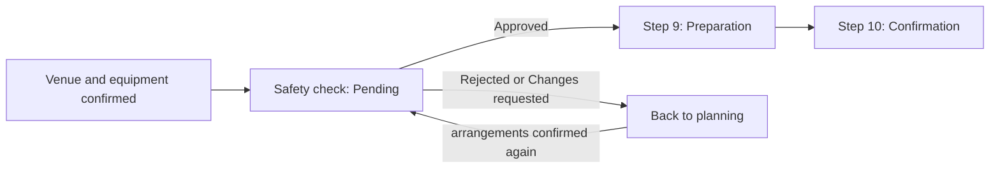

# Operational Safety Check

**Objects:** [[event]] · [[safety-check]] · [[booking]] · [[equipment-reservation]] · [[user-account]]

The review a **Safety Officer** performs after an event's venue and technical arrangements are confirmed and before the event may proceed to preparation. It is a mandatory gate in the [[event-lifecycle]]: the event "cannot proceed to preparation until the Safety Officer has approved it" ([[week-7-customer-changes|Week 7 C6]]). This page is the **process**; the record each review round writes is [[safety-check]], and the role is on [[user-roles]].

**Release 1 scope** ([[release-1-scope]]): 🎯 Release 1 — made mandatory by [[week-7-customer-changes|Week 7 C6]], not named in the Week 4 core 20. The customer's clarification calls it "a new role and requirement due to regulation" ([#128](https://github.com/SinYang13/IS212-2026/discussions/128)), so the check is **regulation-driven**, and the notice is one of the six changes that make up the customer's "26 core" (the 20 plus Week 7). Everything marked "customer" below comes from that notice or [#128](https://github.com/SinYang13/IS212-2026/discussions/128); everything marked 🔶 is a team reading, proposed in [[week-7-change-impact-review]] and **not applied** (no migration, no ticket edit).

## Where it sits

The brief's 14-step workflow ([[event-request-workflow]]) has Step 8 *Technical requirements*, Step 9 *Event preparation* and Step 10 *Event confirmation*. The check sits between Steps 8 and 9.

| Step | What happens | Safety check |
|---|---|---|
| 5 | Request approved; the [[event]] is created in `Planning` | Not yet reachable |
| 6–8 | Venue booking, equipment and technical requirements | The arrangements the check reviews |
| — | **Operational Safety Check** | Customer: "After the venue and technical arrangements have been confirmed… before the event can proceed to preparation" |
| 9 | Event preparation | Cannot start until Approved |
| 10 | Event confirmation ([#98](https://github.com/SinYang13/IS212-2026/discussions/98), [#80](https://github.com/SinYang13/IS212-2026/discussions/80)) | Follows Step 9, so it is also gated: the safety check must be Approved before an event can be confirmed |

"Venue and technical arrangements confirmed" is read here as **every live venue [[booking]] is `Confirmed` and the event's equipment is reserved** — *not* the event's own `Confirmed` status, which comes later at Step 10. That reading is the team's; the notice does not define the phrase ([[week-7-customer-changes|Week 7 C6]]).

## Inputs

The review "considers factors such as" the following ([[week-7-customer-changes|Week 7 C6]]). The list is introduced by "such as", so it is illustrative, not closed.

| Factor (customer) | Where the data lives today | Gap |
|---|---|---|
| Expected attendance | [[event]] — expected attendance, held once at event level ([#119](https://github.com/SinYang13/IS212-2026/discussions/119)) | None |
| Venue capacity and layout | [[venue]] per-layout capacity ([#112](https://github.com/SinYang13/IS212-2026/discussions/112)); the layout the booking assumes | A booking carries no layout reference in the deployed model — see [[booking]] |
| Accessibility requirements | [[event]] accessibility requirements and [[venue]] accessibility | None |
| Equipment placement | The event's [[equipment-reservation]] lines | **No placement data**; only what is reserved |
| Emergency access | — | **No data in the model** |
| Crowd movement | — | **No data in the model** |
| Any known venue restrictions | — | No dedicated field on [[venue]] |

> [!warning] Three factors have no data behind them
> Emergency access, crowd movement and known venue restrictions (and, in practice, equipment placement) are not stored anywhere. The team reading is that they are the **Officer's judgement, recorded in the check's notes**, not structured fields, unless the customer says otherwise — 🔶 Team decision ([[week-7-customer-changes|Week 7 C6]]; nearest recording rule [#96](https://github.com/SinYang13/IS212-2026/discussions/96)).

## Outcomes

The Safety Officer "may approve the event, reject the safety arrangement, or request changes", and "will always give a response (approve/reject/request)" ([[week-7-customer-changes|Week 7 C6]]).

| Outcome | Customer states | Team reading (🔶) |
|---|---|---|
| **Approve** | The event may proceed to preparation | `Approved` check; unlocks Step 9 |
| **Reject** the safety arrangement | The Officer can reject. Nothing says what follows | Event returns to planning, same as request changes; **not** a cancellation — only the assigned Event Coordinator may cancel, at any stage ([#68](https://github.com/SinYang13/IS212-2026/discussions/68)). Open: Q5 |
| **Request changes** | "If changes are required, the event returns to the relevant earlier planning stage and affected venue or technical arrangements may need to be reviewed again" | Event returns to `Planning`; the affected arrangements are flagged for re-review. Open: Q6 |

**Always responds.** Because the Officer always answers, the model needs **no timeout, escalation or auto-approval** path. A check stays `Pending` until the Officer decides, and that is acceptable (✅ from the notice).

## The loop-back

A `Rejected` or `Changes Requested` outcome sends the event back; once the affected arrangements are confirmed again the event re-enters the Officer's queue and a **new** check round begins. Each round is its own [[safety-check]] row, so earlier outcomes stay readable.

How the return maps onto event statuses is the proposal on [[event]]: add `Safety Review` and `Preparation`. The alternative is to keep `Planning` and derive the gate from the check rows alone. Under that alternative Step 9 has no status, though the notice names it.

## The gate

| Rule | Basis | Status |
|---|---|---|
| The event cannot proceed to preparation until the Safety Officer has approved it | [[week-7-customer-changes\|Week 7 C6]] | ✅ Specified |
| Confirmation (Step 10) cannot happen before preparation, so an event with no `Approved` check cannot be confirmed. SPM-50 "Confirm an event" must refuse it and name the pending or unapproved check | [[week-7-customer-changes\|Week 7 C6]], [#98](https://github.com/SinYang13/IS212-2026/discussions/98) | ✅ Specified (the rule); the mechanism is the team's |
| The gate reads "the event's **latest** check is `Approved`" | Team reading of the notice | 🔶 Team decision — [[week-7-customer-changes\|Week 7 C6]], [#98](https://github.com/SinYang13/IS212-2026/discussions/98) |
| The safety check is a mandatory gate for **every** event, not an arrangement type the Coordinator may mark non-essential | Team reading of "the event cannot proceed". The regulatory basis ([#128](https://github.com/SinYang13/IS212-2026/discussions/128)) strengthens this reading but does not state it, and the customer names no exemption | 🔶 Team decision — [[week-7-customer-changes\|Week 7 C6]], [#128](https://github.com/SinYang13/IS212-2026/discussions/128), [#80](https://github.com/SinYang13/IS212-2026/discussions/80), [#106](https://github.com/SinYang13/IS212-2026/discussions/106) |

The last row keeps the check apart from the essential-arrangement gate in [[event-readiness]]. That gate is per-event and Coordinator-decided ([#80](https://github.com/SinYang13/IS212-2026/discussions/80)); the safety gate is unconditional and rests with the Officer.

## The role

The **Safety Officer** is a new internal role ([[week-7-customer-changes|Week 7 C6]]) — see [[user-roles]] and [[user-account]]. The Officer decides safety outcomes and does nothing else in this process: the Officer cannot cancel the event ([#68](https://github.com/SinYang13/IS212-2026/discussions/68)) and does not edit its arrangements.

Visibility follows [[access-control]]. [#125](https://github.com/SinYang13/IS212-2026/discussions/125) says an outcome is visible to users with a legitimate relationship to the event who need it for their role, not to every role automatically. The team reading is that the Officer sees **only events that have reached the check**, not every event — 🔶 Team decision ([[week-7-customer-changes|Week 7 C6]], [#125](https://github.com/SinYang13/IS212-2026/discussions/125)).

## Notifications

The notice says the Officer "will always give a response" but never says how the Officer learns an event is ready, nor how the Coordinator learns the outcome. Both are 🔶 proposals, not customer statements — see [[notifications]] and [[notification]].

## Open questions

None of these has been put to the customer; the consolidated list is in [[open-questions]].

> [!question]- Team decision required — reject versus request changes (Q5)
> The notice lets the Officer "reject the safety arrangement" or "request changes", but only the second is said to return the event to planning. Whether a reject is terminal for the **arrangement** (for example, a venue that cannot be made safe) or for the **event**, and how it differs from a change request, is unstated ([[week-7-customer-changes|Week 7 C6]]). A reject cannot cancel the event, because only the assigned Event Coordinator may do that ([#68](https://github.com/SinYang13/IS212-2026/discussions/68)).

> [!question]- Team decision required — which earlier planning stage (Q6)
> "The relevant earlier planning stage" is not named. It may always be `Planning`, or depend on which arrangement is affected (venue or technical) ([[week-7-customer-changes|Week 7 C6]], [#80](https://github.com/SinYang13/IS212-2026/discussions/80)).

> [!question]- Team decision required — fresh check after a significant change (Q7)
> Whether a significant change after approval needs a new check is unstated. Attendance, venue and equipment are all safety factors, and equipment placement is named outright. They are also significant-change categories ([[week-7-customer-changes|Week 7 C6]], [#4](https://github.com/SinYang13/IS212-2026/discussions/4)). The recommended reading is yes, which would also withdraw approval and, for a confirmed event, lose confirmation — see [[event-lifecycle]] and [[change-impact-management]].

> [!question]- Team decision required — does the Organiser see the outcome (Q8)
> Whether the Event Organiser sees the safety status or outcome is unstated. [#125](https://github.com/SinYang13/IS212-2026/discussions/125) requires a legitimate relationship and a need for the role; it names no roles ([[week-7-customer-changes|Week 7 C6]], [#125](https://github.com/SinYang13/IS212-2026/discussions/125)).

| Further open item | Status | Ref |
|---|---|---|
| What counts as "technical arrangements confirmed" when the event has **no equipment lines**? | 🔶 Team decision — propose, do not assume. Natural reading: no equipment lines means the technical half is vacuously met | [[week-7-customer-changes\|Week 7 C6]], [#80](https://github.com/SinYang13/IS212-2026/discussions/80) |
| Emergency access and crowd movement have no stored data | 🔶 Team decision — Officer's judgement in notes | [[week-7-customer-changes\|Week 7 C6]], [#96](https://github.com/SinYang13/IS212-2026/discussions/96) |
| Event statuses `Safety Review` and `Preparation`, or a derived gate only | 🔶 Team decision — see [[event]] | [[week-7-customer-changes\|Week 7 C6]], [#98](https://github.com/SinYang13/IS212-2026/discussions/98), [#80](https://github.com/SinYang13/IS212-2026/discussions/80) |
