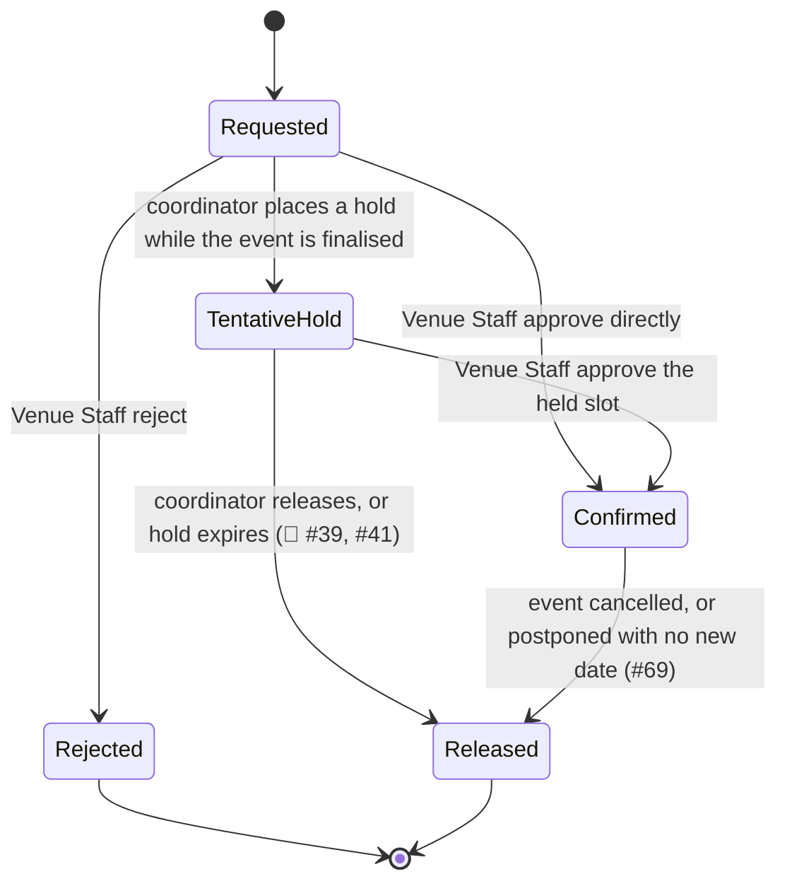

# Booking

> [!info] Naming — record vs. process
> This page (`booking`) is the **record**: the object created when a [[venue]] slot is reserved, tentatively or confirmed, for an [[event]] or [[session]]. [[venue-booking]] is the **process**: how that record gets requested, reviewed and approved. Obsidian resolves `[[wikilinks]]` by filename, so the two are kept as separate pages deliberately — do not conflate them.

A Booking is distinct from the Event it supports: the two are separate records, and a booking can be released while the event record survives — e.g. when an event is postponed with no new date yet known, current bookings are released but the event record is retained until a new date is provided (#69).

## Attributes

| Field | Meaning | Status | Ref |
|---|---|---|---|
| Venue | The [[venue]] being reserved | ✅ Specified | brief §4 |
| Slot(s) | AM / PM / Night; a full-day booking is all three | ✅ Specified | #50 |
| Event / session | The [[event]] or [[session]] the booking is made for | ✅ Specified | brief §4; #74 |
| Status | Tentative hold / confirmed / rejected / released — see States | ✅ Specified | #41 |
| Requested by | The [[user-account]] (Event Coordinator) who submitted the request | ✅ Specified | brief §4 |
| Decided by | The [[user-account]] (Venue Staff) who approved or rejected the request | ✅ Specified | brief §4 |
| Rejection note / suggested alternative | Free-text reason and/or a suggested alternative venue or arrangement; **not** a formal counter-offer object | ✅ Specified | #45 |
| Effective occupancy window | Published event start/end **plus** the venue's setup time before and turnaround/reset time after — not the same as the published event times | ✅ Specified | brief §4 |
| Hold expiry | When and how a tentative hold auto-releases | 🔶 Team decision | #39, #41 |

> [!warning] Effective occupancy ≠ published event times
> The published event start/end is not what actually occupies the venue. Setup time before, and turnaround/reset time after, pad the occupied window (brief §4, *Setup and Turnaround Time*). Conflict detection, and any capacity/schedule report, must reason about this padded window, not the bare event times — easy to overlook.

## States

Neither source names an explicit set of booking states — the labels below (Requested, Tentative hold, Confirmed, Rejected, Released) are this wiki's proposal for a record whose *behaviour* is specified even though its state names are not: a hold may later be confirmed or released (#41), a request may be approved or rejected with a suggested alternative (#45), and double-booking is blocked outright (#35). Treat the diagram as a structural aid, not a customer-confirmed state machine.

| State | Meaning | Entry / exit rule | Ref |
|---|---|---|---|
| Requested | Booking request submitted by the Event Coordinator, awaiting Venue Staff review | Entry: coordinator submits. Exit: held, approved, or rejected | brief §4 |
| Tentative hold | Venue slot held while the event/session is still being finalised; a lighter commitment than a confirmed booking | Entry: hold placed. Exit: confirmed or released — expiry/auto-release mechanism unspecified (🔶) | #41 |
| Confirmed | Venue Staff approved the booking for the slot | Entry: Venue Staff approve. Exit: released on cancellation or on postponement without a new date | brief §4; #69 |
| Rejected | Venue Staff declined the request; may carry a suggested alternative, which is informal, not a counter-offer | Entry: Venue Staff reject. Terminal — the coordinator must submit a new request incorporating the suggestion | #45 |
| Released | Slot freed — hold expired/released, or a confirmed booking was cancelled/postponed without a new date | Entry: various (see Binding rules). Terminal | #41; #69 |

## Relationships

| Related object | Cardinality | Rule | Ref |
|---|---|---|---|
| [[venue]] | many : 1 | Each booking reserves exactly one venue, at one or more slots; a venue accumulates many bookings over time | brief §4 |
| [[event]] | many : 1 | A booking supports one event (directly, or via a session); an event may go through several bookings over its life as holds are released, rejected-and-resubmitted, or rebooked | brief §4; #69 |
| [[session]] | 1 : 1 (own) | Each session of a multi-session event books its own venue, independent of sibling sessions | #74 |
| [[user-account]] | many : 1 (×2) | Requesting Event Coordinator and deciding Venue Staff member | brief §4 |

## Binding rules

- Only **one** active tentative hold **or** confirmed booking may exist for the same venue and overlapping time period (#41).
- Double-booking prevention is a **hard block** — the system identifies and blocks incompatible or overlapping bookings; a soft-warning-with-override option was explicitly offered to the customer and **not** taken up (#35).
- Bookings are made against **venue + slot** (AM / PM / Night), not against arbitrary start/end times (#50).
- Effective venue occupancy is the published event window **plus** setup and turnaround/reset padding, not the published event times alone (brief §4) — see warning above.
- Venue Staff may reject a request and suggest an alternative venue or arrangement, but that suggestion is **not** a formal counter-offer object in the system; the Event Coordinator makes the resulting change and re-submits (#45).
- When an event is postponed with no new date known, its current bookings are released while the event record is retained (#69).

## Open modelling questions

> [!question]- Team decision required — tentative hold expiry and auto-release
> How long a tentative hold lasts, whether it auto-releases, and whether that duration is configurable are all left to the team to propose. This matters operationally: a hold that never expires functions as a de facto confirmed booking and silently blocks the venue (#39, #41).

> [!question]- Team decision required — automation on post-confirmation venue loss
> When a venue becomes unavailable after a booking is already confirmed, Venue Staff are responsible for updating availability and the affected Event Coordinator is notified and must act — but whether any part of that response (auto-release, auto-flag, auto-suggested alternatives) is automated is left to the team to propose (#54).

> [!question]- Team decision required — explicit booking state names
> No source gives a named state set for the booking record itself. The states used on this page (Requested, Tentative hold, Confirmed, Rejected, Released) are inferred from confirmed *behaviour* (#35, #41, #45) rather than customer-specified labels.

See [[domain-model]] for the full object catalogue.
