# Booking

> [!info] Naming — record vs. process
> This page (`booking`) is the **record**: the object created when a [[venue]] is reserved for a time window, tentatively or confirmed, for an [[event]] or [[session]]. [[venue-booking]] is the **process**: how that record gets requested, reviewed and approved. Obsidian resolves `[[wikilinks]]` by filename, so the two are kept as separate pages deliberately — do not conflate them.

A Booking is distinct from the Event it supports: the two are separate records, and a booking can be released while the event record survives — e.g. when an event is postponed with no new date yet known, current bookings are released but the event record is retained until a new date is provided ([#69](https://github.com/SinYang13/IS212-2026/discussions/69)).

## Attributes

`Scope` is the Release 1 marker from [[release-1-scope]].

| Field | Meaning | Status | Scope | Ref |
|---|---|---|---|---|
| Venue | The [[venue]] being reserved | ✅ Specified | 🎯 Release 1 | [[event-planning-venue-booking-system\|brief §4]] |
| Start and end time | The booking's own start and end time, at **15-minute granularity** — the smallest unit of booking. Replaces the AM / PM / Night slot selection (see Superseded below) | ✅ Specified | 🎯 Release 1 ([[week-7-customer-changes\|Week 7 C1]]) | [[week-7-customer-changes\|Week 7 C1]]; [#128](https://github.com/SinYang13/IS212-2026/discussions/128) |
| Event / session | The [[event]] or [[session]] the booking is made for. **An event may hold several bookings at once**, one per venue, each independent ([[week-7-customer-changes\|Week 7 C3]]) | ✅ Specified | 🎯 Release 1 | [[event-planning-venue-booking-system\|brief §4]]; [#74](https://github.com/SinYang13/IS212-2026/discussions/74); [[week-7-customer-changes\|Week 7 C3]] |
| Requested room layout | Which of the venue's supported layouts the booking assumes — the layout that selects the capacity figure suitability compares expected attendance against ([#112](https://github.com/SinYang13/IS212-2026/discussions/112)). **The booking record carries no layout reference**: the requested layout survives only as free text on the [[event]] / [[event-request]], so nothing joins a booking to the venue↔layout pairing whose capacity applies — the system knows a venue's per-layout capacities but not which one a given booking assumes. See [[schema]] and [[venue-suitability]] | ⚠️ Partial | 🧩 Adjacent (feature 11) | [#112](https://github.com/SinYang13/IS212-2026/discussions/112) |
| Status | Requested / tentative hold / confirmed / rejected / released / expired (proposed) — see States | ✅ Specified | 🎯 Release 1 (hold and expiry: [[week-7-customer-changes\|Week 7 C4]]) | [#41](https://github.com/SinYang13/IS212-2026/discussions/41); [[week-7-customer-changes\|Week 7 C4]] |
| Requested by | The [[user-account]] (Event Coordinator) who submitted the request | ✅ Specified | 🎯 Release 1 | [[event-planning-venue-booking-system\|brief §4]] |
| Decided by | The [[user-account]] (Venue Staff) who approved or rejected the request | ✅ Specified | 🎯 Release 1 | [[event-planning-venue-booking-system\|brief §4]] |
| Rejection note / suggested alternative | Free-text reason and/or a suggested alternative venue or arrangement; **not** a formal counter-offer object, and not an approve-with-amendments path | ✅ Specified | 🎯 Release 1 | [#45](https://github.com/SinYang13/IS212-2026/discussions/45); [#110](https://github.com/SinYang13/IS212-2026/discussions/110) |
| Effective occupancy window | The event's time **plus the venue's configured setup time before and turnaround time after** — not the published event times. Example: 10:00–12:00 with 30 min setup and 45 min turnaround occupies 9:30–12:45. Used for availability checks and conflict detection | ✅ Specified | 🎯 Release 1 ([[week-7-customer-changes\|Week 7 C1]]) | [[event-planning-venue-booking-system\|brief §4]]; [[week-7-customer-changes\|Week 7 C1]] |
| Occupancy window — unit | The setup and turnaround values are **minutes**, per the worked example only. Whether they must be multiples of 15 is not stated (the example's 30 and 45 are — inference only) | ⚠️ Partial | 🎯 Release 1 ([[week-7-customer-changes\|Week 7 C1]]) | [[week-7-customer-changes\|Week 7 C1]]; [#128](https://github.com/SinYang13/IS212-2026/discussions/128) |
| Occupancy window — computation | The padded window `[start − setup, end + turnaround)` on the 15-minute grid: whether it is stored on the booking (snapshotted) or derived from the venue's current values, and what a buffer does at the edge of operating hours ([#46](https://github.com/SinYang13/IS212-2026/discussions/46)). The interval notation and the store-or-derive choice are a **team proposal**; [#126](https://github.com/SinYang13/IS212-2026/discussions/126) (booking between 12nn and 1pm, unanswered) is likely moot, unconfirmed | 🔶 Team decision | 🎯 Release 1 ([[week-7-customer-changes\|Week 7 C1]]) | [#46](https://github.com/SinYang13/IS212-2026/discussions/46); [#50](https://github.com/SinYang13/IS212-2026/discussions/50) |
| Hold expiry (date/time) | Every tentative hold **must** carry an expiry date/time. If the required action is not completed before it, the hold expires, the venue becomes available to other requests, and the hold is never treated as a confirmed booking | ✅ Specified | 🎯 Release 1 ([[week-7-customer-changes\|Week 7 C4]]) | [[week-7-customer-changes\|Week 7 C4]] |
| Hold duration, ownership, extension, warning lead time | How long a hold lasts, who sets the expiry, whether it can be extended, and how long before expiry the Event Coordinator is warned ("before or when" — no lead time stated) | 🔶 Team decision | 🎯 Release 1 ([[week-7-customer-changes\|Week 7 C4]]) | [#39](https://github.com/SinYang13/IS212-2026/discussions/39); [#41](https://github.com/SinYang13/IS212-2026/discussions/41) |
| Placed by (hold) | Venue Staff place holds while the Coordinator finalises. The Coordinator-side confirm/release flow is unchanged | ✅ Specified | 🎯 Release 1 ([[week-7-customer-changes\|Week 7 C4]]) | [[week-7-customer-changes\|Week 7 C4]] |
| Status after an upstream venue change | A venue-attribute change ([#120](https://github.com/SinYang13/IS212-2026/discussions/120)), unavailability ([#54](https://github.com/SinYang13/IS212-2026/discussions/54), [[week-7-customer-changes\|Week 7 C2]]), retirement ([#122](https://github.com/SinYang13/IS212-2026/discussions/122)) or a change to the venue's setup/turnaround time ([[week-7-customer-changes\|Week 7 C1]]) flags the affected booking for review and informs the Event Coordinator. Which status (if any) it moves to is not stated. **Proposed, not decided:** a review flag (`review_reason` / `review_flagged_at`) alongside the existing status, not a new status | 🔶 Team decision | 🎯 Release 1 ([[week-7-customer-changes\|Week 7 C1]], [[week-7-customer-changes\|Week 7 C2]]) | [#120](https://github.com/SinYang13/IS212-2026/discussions/120); [#122](https://github.com/SinYang13/IS212-2026/discussions/122) |
| Replacement link and original's end state | A replacement for a booking lost to unavailability is a **new ordinary booking request linked to the original**; the original event information is preserved. **Team decision (2026-10-18):** the original becomes `Released` once its replacement is confirmed, with a "replaced by" link and no new state; a same-venue replacement ignores the booking it replaces in the clash check. The same re-request now answers every flag reason, and a flag is a review marker added on top of the booking's status (SPM-251, SPM-105) | 🔶 Team decision | 🎯 Release 1 ([[week-7-customer-changes\|Week 7 C2]]) | [#54](https://github.com/SinYang13/IS212-2026/discussions/54); [#120](https://github.com/SinYang13/IS212-2026/discussions/120); [#122](https://github.com/SinYang13/IS212-2026/discussions/122) |

> [!warning] Contradiction — [[week-7-customer-changes|Week 7 C1]] vs [#50](https://github.com/SinYang13/IS212-2026/discussions/50)/[#107](https://github.com/SinYang13/IS212-2026/discussions/107)/[#108](https://github.com/SinYang13/IS212-2026/discussions/108)/[#123](https://github.com/SinYang13/IS212-2026/discussions/123)
> The standing slot rules — booking by AM / PM / Night slot ([#50](https://github.com/SinYang13/IS212-2026/discussions/50)), whole-slot consumption ([#107](https://github.com/SinYang13/IS212-2026/discussions/107)), a slot as the smallest unit of setup and turnaround ([#108](https://github.com/SinYang13/IS212-2026/discussions/108)) and at most one adjacent slot per buffer ([#123](https://github.com/SinYang13/IS212-2026/discussions/123)) — are contradicted by [[week-7-customer-changes|Week 7 C1]] (per-venue configurable times; example 9:30–12:45) and by [#128](https://github.com/SinYang13/IS212-2026/discussions/128), which replaces the three slots with a 15-minute smallest unit of booking. Week 7 is later and explicitly Release 1, so this page follows it. See [[venue-booking]] and [[week-7-customer-changes]].

> [!info] Effective occupancy ≠ published event times
> The published event start/end is not what occupies the venue. The venue's setup before, and turnaround after, pad the occupied window ([[event-planning-venue-booking-system|brief §4]], *Setup and Turnaround Time*; [[week-7-customer-changes|Week 7 C1]]). Conflict detection, and any capacity/schedule report, must reason about this padded window, not the bare event times, on the 15-minute grid. The padding is a hard-blocked resource like any other ([#35](https://github.com/SinYang13/IS212-2026/discussions/35)).

### Superseded — slot attributes

Kept as history; replaced by [[week-7-customer-changes|Week 7 C1]] and [#128](https://github.com/SinYang13/IS212-2026/discussions/128).

| Field | Was | Replaced by | Ref |
|---|---|---|---|
| ~~Slot(s)~~ | ~~AM / PM / Night; a full-day booking is all three; an event spanning two slots takes both in full~~ | Start and end time at 15-minute granularity | [#50](https://github.com/SinYang13/IS212-2026/discussions/50); [#107](https://github.com/SinYang13/IS212-2026/discussions/107) |
| ~~Effective occupancy window (slot form)~~ | ~~The booking's slot(s) plus one adjacent setup slot and one adjacent turnaround slot, crossing midnight; a whole number of slots~~ | `[start − setup, end + turnaround)` using the venue's configured minutes | [#108](https://github.com/SinYang13/IS212-2026/discussions/108); [#123](https://github.com/SinYang13/IS212-2026/discussions/123) |

## States

Neither source names an explicit set of booking states — the labels below (Requested, Tentative hold, Confirmed, Rejected, Released, Expired) are this wiki's proposal for a record whose *behaviour* is specified even though its state names are not: a hold may later be confirmed or released ([#41](https://github.com/SinYang13/IS212-2026/discussions/41)), a hold that is not acted on before its deadline expires ([[week-7-customer-changes\|Week 7 C4]]), a request may be approved or rejected with a suggested alternative ([#45](https://github.com/SinYang13/IS212-2026/discussions/45)), and double-booking is blocked outright ([#35](https://github.com/SinYang13/IS212-2026/discussions/35)). Treat the diagram as a structural aid, not a customer-confirmed state machine.

Requested, Confirmed and Rejected sit under the `🎯 Release 1` booking request/approval flow (features 12–13). Tentative hold and its expiry are `🎯 Release 1` ([[week-7-customer-changes\|Week 7 C4]]); the [#41](https://github.com/SinYang13/IS212-2026/discussions/41) exclusivity rule now binds in full, with "active" meaning unexpired. [#109](https://github.com/SinYang13/IS212-2026/discussions/109) still holds that placing several *candidate* venues on hold at once while shortlisting is not required. Released is `🧩 Adjacent`, pulled in by cancellation as a feature 6 status and a feature 20 notification trigger. See [[release-1-scope]].

```mermaid
stateDiagram-v2
    [*] --> Requested
    Requested --> TentativeHold : Venue Staff place a hold while the event is finalised
    Requested --> Confirmed : Venue Staff approve directly
    TentativeHold --> Confirmed : Venue Staff approve the held time
    TentativeHold --> Released : coordinator releases the hold
    TentativeHold --> Expired : expiry date/time passes unconfirmed (Week 7 C4; state name 🔶 proposal)
    Requested --> Rejected : Venue Staff reject
    Confirmed --> Released : event cancelled, or postponed with no new date (#69)
    Rejected --> [*]
    Released --> [*]
    Expired --> [*]
```

| State | Meaning | Entry / exit rule | Ref |
|---|---|---|---|
| Requested | Booking request submitted by the Event Coordinator, awaiting Venue Staff review | Entry: coordinator submits. Exit: held, approved, or rejected | [[event-planning-venue-booking-system\|brief §4]] |
| Tentative hold | Venue held by Venue Staff while the event is still being finalised; a lighter commitment than a confirmed booking. **Always carries an expiry date/time.** Holding several *candidate* venues simultaneously while shortlisting is not required for Release 1 | Entry: hold placed with an expiry. Exit: confirmed, released, or expired. Blocks the venue only while unexpired | [#41](https://github.com/SinYang13/IS212-2026/discussions/41); [#109](https://github.com/SinYang13/IS212-2026/discussions/109); [[week-7-customer-changes\|Week 7 C4]] |
| Confirmed | Venue Staff approved the booking | Entry: Venue Staff approve. Exit: released on cancellation or on postponement without a new date | [[event-planning-venue-booking-system\|brief §4]]; [#69](https://github.com/SinYang13/IS212-2026/discussions/69) |
| Rejected | Venue Staff declined the request; may carry a suggested alternative, which is informal, not a counter-offer | Entry: Venue Staff reject. Terminal — the coordinator must review, update the request and resubmit; Venue Staff cannot approve amended details themselves | [#45](https://github.com/SinYang13/IS212-2026/discussions/45); [#110](https://github.com/SinYang13/IS212-2026/discussions/110) |
| Released | A person gave the booking up — a hold released by the coordinator, or a confirmed booking cancelled/postponed without a new date | Entry: various (see Binding rules). Terminal | [#41](https://github.com/SinYang13/IS212-2026/discussions/41); [#69](https://github.com/SinYang13/IS212-2026/discussions/69) |
| Expired | A tentative hold reached its expiry date/time without the required action. **Never treated as a confirmed booking**; the venue is available again. Distinct from Released, which means a person acted. The name `Expired` is a **🔶 team proposal**; the need for a separate terminal outcome follows from [[week-7-customer-changes\|Week 7 C4]] | Entry: expiry passes (the booking path must treat a past-due hold as expired even before any sweep). Terminal | [[week-7-customer-changes\|Week 7 C4]]; [#39](https://github.com/SinYang13/IS212-2026/discussions/39) |

## Relationships

| Related object | Cardinality | Rule | Ref |
|---|---|---|---|
| [[venue]] | many : 1 | Each booking reserves exactly one venue; a venue accumulates many bookings over time | [[event-planning-venue-booking-system\|brief §4]] |
| [[event]] | many : 1 | A booking supports one event (directly, or via a session). An event may hold **several live bookings at once** — one per venue, each checked independently for suitability, availability and conflicts — and may also go through several bookings over its life as holds are released, expired, rejected-and-resubmitted, or rebooked. Changing or cancelling one booking does not automatically affect the event's others. ~~At most one is normally confirmed per event/session~~ — retired | [[event-planning-venue-booking-system\|brief §4]]; [#69](https://github.com/SinYang13/IS212-2026/discussions/69); [[week-7-customer-changes\|Week 7 C3]] |
| [[session]] | 1 : 1 (own) | Each session of a multi-session event books its own venue, independent of sibling sessions (`📋 Backlog`; [[week-7-customer-changes\|Week 7 C3]] is simultaneous spaces under one event, not sessions) | [#74](https://github.com/SinYang13/IS212-2026/discussions/74); [[week-7-customer-changes\|Week 7 C3]] |
| [[user-account]] | many : 1 (×2) | Requesting Event Coordinator and deciding Venue Staff member (or placing Venue Staff, for a hold) | [[event-planning-venue-booking-system\|brief §4]]; [[week-7-customer-changes\|Week 7 C4]] |
| [[venue-unavailability]] | many : many (derived, not stored) | A booking whose occupancy window overlaps an unlifted unavailability period is identified for review, never cancelled. A new request into an unavailable period is not available (the venue is unavailable) | [[week-7-customer-changes\|Week 7 C2]] |
| [[booking]] (replacement link) | 0..1 : 1 (self) | A replacement request is linked to the booking it replaces. **Proposed** link; the original's end state is the 🔶 row above | [[week-7-customer-changes\|Week 7 C2]]; [#54](https://github.com/SinYang13/IS212-2026/discussions/54); [#120](https://github.com/SinYang13/IS212-2026/discussions/120); [#122](https://github.com/SinYang13/IS212-2026/discussions/122) |

## Binding rules

- Only **one** active tentative hold **or** confirmed booking may exist for the same venue and overlapping period ([#41](https://github.com/SinYang13/IS212-2026/discussions/41)). "Active" means **unexpired**: an expired hold no longer counts ([[week-7-customer-changes\|Week 7 C4]]). The comparison runs over each booking's padded occupancy window.
- Double-booking prevention is a **hard block** — the system identifies and blocks incompatible or overlapping bookings; a soft-warning-with-override option was explicitly offered to the customer and **not** taken up ([#35](https://github.com/SinYang13/IS212-2026/discussions/35)).
- Bookings are made against a **venue and a start/end time on a 15-minute grid** — the smallest unit of booking ([#128](https://github.com/SinYang13/IS212-2026/discussions/128)). ~~Venue + slot (AM / PM / Night), indivisible, an event across two slots consuming both in full~~ is superseded ([#50](https://github.com/SinYang13/IS212-2026/discussions/50), [#107](https://github.com/SinYang13/IS212-2026/discussions/107)).
- **Setup and turnaround are the venue's configured times**, included when checking availability and detecting conflicts ([[week-7-customer-changes|Week 7 C1]]). Effective venue occupancy is the event time plus those times, not the published event times alone ([[event-planning-venue-booking-system|brief §4]]) — see the info callout above.
- ~~Setup and turnaround each need at most one full slot, the one immediately adjacent to the booking, including across days; one slot is the smallest unit; no sub-slot padding~~ — **superseded** by [[week-7-customer-changes|Week 7 C1]] ([#123](https://github.com/SinYang13/IS212-2026/discussions/123), [#108](https://github.com/SinYang13/IS212-2026/discussions/108)).
- Existing bookings that become problematic under a changed setup/turnaround time are **identified, not silently removed** ([[week-7-customer-changes|Week 7 C1]]).
- **Every tentative hold must have an expiry date/time.** On expiry the venue becomes available to other requests, the Event Coordinator is informed before or when it expires, and the expired hold is never treated as a confirmed booking ([[week-7-customer-changes|Week 7 C4]]). Holds are placed by Venue Staff.
- An event may have **more than one venue booking at the same time**; each is checked independently and stays associated with the event. Changing or cancelling one must not automatically remove the others unless explicitly required ([[week-7-customer-changes|Week 7 C3]]). Placing several *candidate* venues on tentative hold at once while shortlisting is still **not** required for Release 1 ([#109](https://github.com/SinYang13/IS212-2026/discussions/109)).
- Venue Staff may reject a request and suggest an alternative venue or arrangement, but that suggestion is **not** a formal counter-offer object in the system; the Event Coordinator makes the resulting change and re-submits ([#45](https://github.com/SinYang13/IS212-2026/discussions/45)). There is correspondingly no approve-with-amendments action ([#110](https://github.com/SinYang13/IS212-2026/discussions/110)).
- A change to venue master data does **not** automatically revert dependent bookings to Requested. Where the change affects a booking's suitability or availability, the booking is identified for review and the Event Coordinator notified ([#120](https://github.com/SinYang13/IS212-2026/discussions/120)); see [[change-impact-management]].
- **Venue unavailability does not cancel bookings** even where events are already booked. Affected bookings are identified, the relevant Event Coordinators informed that alternative arrangements are required, and the original event information is preserved while the Coordinator searches for and requests a replacement ([[week-7-customer-changes|Week 7 C2]]).
- **Retiring a venue does not cancel or auto-reschedule** its future bookings. They are identified for review and the relevant Event Coordinators notified; the Coordinator and Venue Staff agree an alternative (possibly outside the system), and the Coordinator then updates the booking ([#122](https://github.com/SinYang13/IS212-2026/discussions/122)).
- When an event is postponed with no new date known, its current bookings are released while the event record is retained ([#69](https://github.com/SinYang13/IS212-2026/discussions/69)).

## Open modelling questions

> [!question]- Team decision required — hold duration, ownership, extension and warning lead time
> The notice makes an expiry mandatory but does not say how long a hold lasts, who sets the expiry, whether it can be extended, or how long before expiry the Coordinator is warned ([[week-7-customer-changes\|Week 7 C4]]; deferred in [#39](https://github.com/SinYang13/IS212-2026/discussions/39), [#41](https://github.com/SinYang13/IS212-2026/discussions/41)). The before-expiry warning is the first time-triggered notification — see [[notifications]].

> [!question]- Team decision required — status transition after an upstream venue change
> This now has **five** triggers — an attribute update ([#120](https://github.com/SinYang13/IS212-2026/discussions/120)), unavailability ([#54](https://github.com/SinYang13/IS212-2026/discussions/54), extended by [[week-7-customer-changes|Week 7 C2]]), retirement ([#122](https://github.com/SinYang13/IS212-2026/discussions/122)) and a buffer-configuration change ([[week-7-customer-changes|Week 7 C1]]) — feeding one undefined destination. [#120](https://github.com/SinYang13/IS212-2026/discussions/120) rules out auto-reverting to Requested and specifies only "identified for review and the Event Coordinator notified". Whether the booking changes status, gains a review flag alongside its status (the schema review's proposal), or is left untouched is for the team to propose ([#120](https://github.com/SinYang13/IS212-2026/discussions/120)). The same question governs what status the **original** booking ends in once a replacement is confirmed.

> [!question]- Team decision required — padded occupancy window mechanics
> The padded window `[start − setup, end + turnaround)` on the 15-minute grid: stored or derived, and what a buffer does at the edge of operating hours ([#46](https://github.com/SinYang13/IS212-2026/discussions/46)). Whether AM / PM / Night survive as a display grouping or operating windows, and whether setup/turnaround must be multiples of 15, are also open ([#128](https://github.com/SinYang13/IS212-2026/discussions/128) is silent). Full list on [[venue-booking]].

> [!question]- Team decision required — explicit booking state names
> No source gives a named state set for the booking record itself. The states used on this page (Requested, Tentative hold, Confirmed, Rejected, Released, Expired) are inferred from confirmed *behaviour* ([#35](https://github.com/SinYang13/IS212-2026/discussions/35), [#41](https://github.com/SinYang13/IS212-2026/discussions/41), [#45](https://github.com/SinYang13/IS212-2026/discussions/45), [[week-7-customer-changes\|Week 7 C4]]) rather than customer-specified labels.

**Unanswered, not yet put to the customer** ([[week-7-customer-changes\|Week 7 C3]]): is each venue booking of a multi-venue event judged against the event's **whole attendance or a portion**? Does each booking carry a **purpose label** (e.g. "Breakout A")? Both are team proposals pending an answer. See [[venue-suitability]].

> [!question]- Team decision required — automation on post-confirmation venue loss
> Whether any part of the response to a venue becoming unavailable after confirmation (auto-release, auto-flag, auto-suggested alternatives) is automated is left to the team ([#54](https://github.com/SinYang13/IS212-2026/discussions/54)). [[week-7-customer-changes|Week 7 C2]] fixes the minimum: identify, inform, preserve the event information, support an in-system replacement request.

See [[domain-model]] for the full object catalogue.
