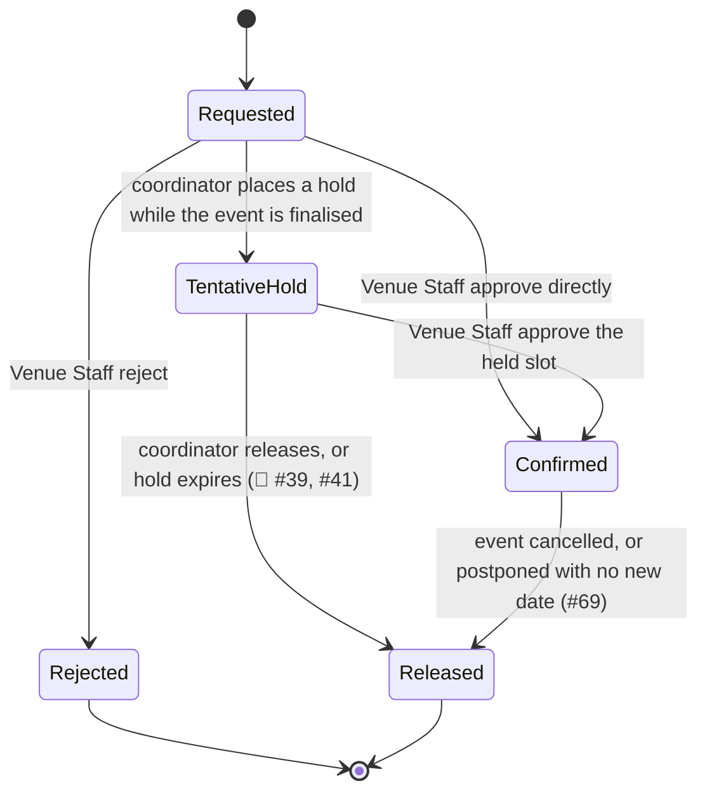

# Booking

> [!info] Naming — record vs. process
> This page (`booking`) is the **record**: the object created when a [[venue]] slot is reserved, tentatively or confirmed, for an [[event]] or [[session]]. [[venue-booking]] is the **process**: how that record gets requested, reviewed and approved. Obsidian resolves `[[wikilinks]]` by filename, so the two are kept as separate pages deliberately — do not conflate them.

A Booking is distinct from the Event it supports: the two are separate records, and a booking can be released while the event record survives — e.g. when an event is postponed with no new date yet known, current bookings are released but the event record is retained until a new date is provided ([#69](https://github.com/SinYang13/IS212-2026/discussions/69)).

## Attributes

`Scope` is the Release 1 marker from [[release-1-scope]].

| Field | Meaning | Status | Scope | Ref |
|---|---|---|---|---|
| Venue | The [[venue]] being reserved | ✅ Specified | 🎯 Release 1 | [[event-planning-venue-booking-system\|brief §4]] |
| Slot(s) | AM / PM / Night; a full-day booking is all three. Slots are consumed whole — an event spanning two slots takes **both in full** | ✅ Specified | 🎯 Release 1 | [#50](https://github.com/SinYang13/IS212-2026/discussions/50); [#107](https://github.com/SinYang13/IS212-2026/discussions/107) |
| Event / session | The [[event]] or [[session]] the booking is made for | ✅ Specified | 🎯 Release 1 | [[event-planning-venue-booking-system\|brief §4]]; [#74](https://github.com/SinYang13/IS212-2026/discussions/74) |
| Requested room layout | Which of the venue's supported layouts the booking assumes — the layout that selects the capacity figure suitability compares expected attendance against ([#112](https://github.com/SinYang13/IS212-2026/discussions/112)). **The booking record carries no layout reference**: the requested layout survives only as free text on the [[event]] / [[event-request]], so nothing joins a booking to the venue↔layout pairing whose capacity applies — the system knows a venue's per-layout capacities but not which one a given booking assumes. See [[schema]] and [[venue-suitability]] | ⚠️ Partial | 🧩 Adjacent (feature 11) | [#112](https://github.com/SinYang13/IS212-2026/discussions/112) |
| Status | Tentative hold / confirmed / rejected / released — see States | ✅ Specified | 🎯 / 📋 — see States below | [#41](https://github.com/SinYang13/IS212-2026/discussions/41) |
| Requested by | The [[user-account]] (Event Coordinator) who submitted the request | ✅ Specified | 🎯 Release 1 | [[event-planning-venue-booking-system\|brief §4]] |
| Decided by | The [[user-account]] (Venue Staff) who approved or rejected the request | ✅ Specified | 🎯 Release 1 | [[event-planning-venue-booking-system\|brief §4]] |
| Rejection note / suggested alternative | Free-text reason and/or a suggested alternative venue or arrangement; **not** a formal counter-offer object, and not an approve-with-amendments path | ✅ Specified | 🎯 Release 1 | [#45](https://github.com/SinYang13/IS212-2026/discussions/45); [#110](https://github.com/SinYang13/IS212-2026/discussions/110) |
| Effective occupancy window | The booking's own slot(s) **plus** one adjacent setup slot before and one adjacent turnaround slot after, crossing midnight where needed (AM setup → previous Night; Night turnaround → next AM) — not the published event times, and always a whole number of slots. Whether a given booking consumes each buffer is not stated — see the open question below | ✅ Specified | 🧩 Adjacent (feature 14) | [[event-planning-venue-booking-system\|brief §4]]; [#108](https://github.com/SinYang13/IS212-2026/discussions/108); [#123](https://github.com/SinYang13/IS212-2026/discussions/123) |
| Hold expiry | When and how a tentative hold auto-releases | 🔶 Team decision | 📋 Backlog | [#39](https://github.com/SinYang13/IS212-2026/discussions/39), [#41](https://github.com/SinYang13/IS212-2026/discussions/41) |
| Status after an upstream venue change | Where a venue-attribute change ([#120](https://github.com/SinYang13/IS212-2026/discussions/120)) or a venue **retirement** ([#122](https://github.com/SinYang13/IS212-2026/discussions/122)) affects a booking, the booking is flagged for review and the Event Coordinator notified — but which status (if any) it moves to is not stated | 🔶 Team decision | 🧩 Adjacent (feature 14) | [#120](https://github.com/SinYang13/IS212-2026/discussions/120); [#122](https://github.com/SinYang13/IS212-2026/discussions/122) |

> [!warning] Effective occupancy ≠ published event times
> The published event start/end is not what actually occupies the venue. Setup before, and turnaround after, pad the occupied window ([[event-planning-venue-booking-system|brief §4]], *Setup and Turnaround Time*). Conflict detection, and any capacity/schedule report, must reason about this padded window, not the bare event times — easy to overlook. For Release 1 the padding is **at most one slot each side, the immediately adjacent slot** ([#123](https://github.com/SinYang13/IS212-2026/discussions/123), refining [#108](https://github.com/SinYang13/IS212-2026/discussions/108)), so a single-slot event occupies up to three slots and a two-slot event ([#107](https://github.com/SinYang13/IS212-2026/discussions/107)) up to four. **The padding is a hard-blocked resource like any other** ([#35](https://github.com/SinYang13/IS212-2026/discussions/35)): with both buffers required, an AM event's turnaround takes the PM slot, so a PM booking at the same venue that day is refused.

## States

Neither source names an explicit set of booking states — the labels below (Requested, Tentative hold, Confirmed, Rejected, Released) are this wiki's proposal for a record whose *behaviour* is specified even though its state names are not: a hold may later be confirmed or released ([#41](https://github.com/SinYang13/IS212-2026/discussions/41)), a request may be approved or rejected with a suggested alternative ([#45](https://github.com/SinYang13/IS212-2026/discussions/45)), and double-booking is blocked outright ([#35](https://github.com/SinYang13/IS212-2026/discussions/35)). Treat the diagram as a structural aid, not a customer-confirmed state machine.

Requested, Confirmed and Rejected sit under the `🎯 Release 1` booking request/approval flow (features 12–13). Tentative hold is `📋 Backlog` — only the confirmed-booking half of the [#41](https://github.com/SinYang13/IS212-2026/discussions/41) exclusivity rule binds in Release 1; the hold half is deferred, and [#109](https://github.com/SinYang13/IS212-2026/discussions/109) confirms that holding several candidate venues at once is not required for the release either. Released is `🧩 Adjacent`, pulled in by cancellation as a feature 6 status and a feature 20 notification trigger. See [[release-1-scope]].

| State | Meaning | Entry / exit rule | Ref |
|---|---|---|---|
| Requested | Booking request submitted by the Event Coordinator, awaiting Venue Staff review | Entry: coordinator submits. Exit: held, approved, or rejected | [[event-planning-venue-booking-system\|brief §4]] |
| Tentative hold | Venue slot held while the event/session is still being finalised; a lighter commitment than a confirmed booking. Holding several candidate venues for one event simultaneously is not required for Release 1 | Entry: hold placed. Exit: confirmed or released — expiry/auto-release mechanism unspecified (🔶) | [#41](https://github.com/SinYang13/IS212-2026/discussions/41); [#109](https://github.com/SinYang13/IS212-2026/discussions/109) |
| Confirmed | Venue Staff approved the booking for the slot | Entry: Venue Staff approve. Exit: released on cancellation or on postponement without a new date | [[event-planning-venue-booking-system\|brief §4]]; [#69](https://github.com/SinYang13/IS212-2026/discussions/69) |
| Rejected | Venue Staff declined the request; may carry a suggested alternative, which is informal, not a counter-offer | Entry: Venue Staff reject. Terminal — the coordinator must review, update the request and resubmit; Venue Staff cannot approve amended details themselves | [#45](https://github.com/SinYang13/IS212-2026/discussions/45); [#110](https://github.com/SinYang13/IS212-2026/discussions/110) |
| Released | Slot freed — hold expired/released, or a confirmed booking was cancelled/postponed without a new date | Entry: various (see Binding rules). Terminal | [#41](https://github.com/SinYang13/IS212-2026/discussions/41); [#69](https://github.com/SinYang13/IS212-2026/discussions/69) |

## Relationships

| Related object | Cardinality | Rule | Ref |
|---|---|---|---|
| [[venue]] | many : 1 | Each booking reserves exactly one venue, at one or more slots; a venue accumulates many bookings over time | [[event-planning-venue-booking-system\|brief §4]] |
| [[event]] | many : 1 | A booking supports one event (directly, or via a session); an event may go through several bookings over its life as holds are released, rejected-and-resubmitted, or rebooked. At most one is normally *confirmed* per event/session, unless the event requires multiple venues | [[event-planning-venue-booking-system\|brief §4]]; [#69](https://github.com/SinYang13/IS212-2026/discussions/69); [#109](https://github.com/SinYang13/IS212-2026/discussions/109) |
| [[session]] | 1 : 1 (own) | Each session of a multi-session event books its own venue, independent of sibling sessions | [#74](https://github.com/SinYang13/IS212-2026/discussions/74) |
| [[user-account]] | many : 1 (×2) | Requesting Event Coordinator and deciding Venue Staff member | [[event-planning-venue-booking-system\|brief §4]] |

## Binding rules

- Only **one** active tentative hold **or** confirmed booking may exist for the same venue and overlapping time period ([#41](https://github.com/SinYang13/IS212-2026/discussions/41)).
- Double-booking prevention is a **hard block** — the system identifies and blocks incompatible or overlapping bookings; a soft-warning-with-override option was explicitly offered to the customer and **not** taken up ([#35](https://github.com/SinYang13/IS212-2026/discussions/35)).
- Bookings are made against **venue + slot** (AM / PM / Night), not against arbitrary start/end times ([#50](https://github.com/SinYang13/IS212-2026/discussions/50)). A slot is indivisible: an event running across two slots consumes **both in full**, so conflict-blocking operates on whole slots and a partially-used slot is not available to anyone else ([#107](https://github.com/SinYang13/IS212-2026/discussions/107)).
- One slot is also the smallest unit of setup and turnaround time; Release 1 need not support sub-slot padding ([#108](https://github.com/SinYang13/IS212-2026/discussions/108)).
- Setup and turnaround each need **at most one full slot**, the one **immediately adjacent** to the booking, including across days; multi-slot buffers are not required and the user does not pick the buffer slot ([#123](https://github.com/SinYang13/IS212-2026/discussions/123)). Conflict checking must reflect this.
- Effective venue occupancy is the booking's slot(s) **plus** those buffer slots, not the published event times alone ([[event-planning-venue-booking-system|brief §4]]) — see warning above.
- Venue Staff may reject a request and suggest an alternative venue or arrangement, but that suggestion is **not** a formal counter-offer object in the system; the Event Coordinator makes the resulting change and re-submits ([#45](https://github.com/SinYang13/IS212-2026/discussions/45)). There is correspondingly no approve-with-amendments action: the Coordinator reviews and updates the request, and approval follows on the updated request ([#110](https://github.com/SinYang13/IS212-2026/discussions/110)).
- An Event Coordinator may identify and consider several candidate venues for one event, but placing multiple venues on tentative hold at once is **not** required for Release 1, and only one final booking is normally confirmed per event/session unless the event requires multiple venues ([#109](https://github.com/SinYang13/IS212-2026/discussions/109)).
- A change to venue master data does **not** automatically revert dependent bookings to Requested. Where the change affects a booking's suitability or availability, the booking is identified for review and the Event Coordinator notified ([#120](https://github.com/SinYang13/IS212-2026/discussions/120)); see [[change-impact-management]].
- **Retiring a venue does not cancel or auto-reschedule** its future bookings. They are identified for review and the relevant Event Coordinators notified; the Coordinator and Venue Staff agree an alternative (possibly outside the system), and the Coordinator then updates the booking and reconsiders suitability, availability and requirements ([#122](https://github.com/SinYang13/IS212-2026/discussions/122)).
- When an event is postponed with no new date known, its current bookings are released while the event record is retained ([#69](https://github.com/SinYang13/IS212-2026/discussions/69)).

## Open modelling questions

> [!question]- Team decision required — tentative hold expiry and auto-release
> How long a tentative hold lasts, whether it auto-releases, and whether that duration is configurable are all left to the team to propose. This matters operationally: a hold that never expires functions as a de facto confirmed booking and silently blocks the venue ([#39](https://github.com/SinYang13/IS212-2026/discussions/39), [#41](https://github.com/SinYang13/IS212-2026/discussions/41)).

> [!question]- Team decision required — automation on post-confirmation venue loss
> When a venue becomes unavailable after a booking is already confirmed, Venue Staff are responsible for updating availability and the affected Event Coordinator is notified and must act — but whether any part of that response (auto-release, auto-flag, auto-suggested alternatives) is automated is left to the team to propose ([#54](https://github.com/SinYang13/IS212-2026/discussions/54)).

> [!question]- Team decision required — status transition after an upstream venue change
> This now has **three** triggers — an attribute update ([#120](https://github.com/SinYang13/IS212-2026/discussions/120)), unavailability ([#54](https://github.com/SinYang13/IS212-2026/discussions/54)) and retirement ([#122](https://github.com/SinYang13/IS212-2026/discussions/122)) — feeding one undefined destination. [#120](https://github.com/SinYang13/IS212-2026/discussions/120) rules out the obvious answer — a venue-attribute update must **not** auto-revert existing bookings to Requested — and specifies the required behaviour only as far as "identified for review and the Event Coordinator notified". Whether the booking then changes status at all, gains a review flag alongside its existing status, or is left untouched pending the coordinator's action is explicitly for the team to propose ([#120](https://github.com/SinYang13/IS212-2026/discussions/120)). Note this is narrower than [#54](https://github.com/SinYang13/IS212-2026/discussions/54) above, which concerns the venue becoming *unavailable*; [#120](https://github.com/SinYang13/IS212-2026/discussions/120) covers ordinary attribute edits.

> [!question]- Team decision required — buffer consumption and sharing
> [#123](https://github.com/SinYang13/IS212-2026/discussions/123) fixes the buffer's size and position but not (a) whether **every** booking consumes a setup and turnaround slot or only some, (b) whether two neighbouring events may **share** one buffer slot — an AM event's turnaround and a Night event's setup both name the PM slot, and a PM event's turnaround and the next day's AM setup both name the Night slot — (c) what happens when the buffer slot is Blocked or outside operating hours, and (d) whether buffer slots are stored on the booking or derived. See [[venue-booking]] and the schema note E3 in [[schema]].

> [!question]- Team decision required — explicit booking state names
> No source gives a named state set for the booking record itself. The states used on this page (Requested, Tentative hold, Confirmed, Rejected, Released) are inferred from confirmed *behaviour* ([#35](https://github.com/SinYang13/IS212-2026/discussions/35), [#41](https://github.com/SinYang13/IS212-2026/discussions/41), [#45](https://github.com/SinYang13/IS212-2026/discussions/45)) rather than customer-specified labels.

See [[domain-model]] for the full object catalogue.
