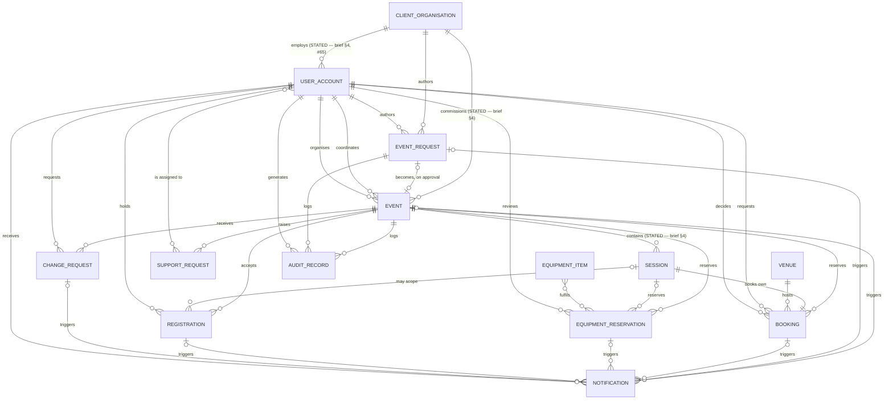

# Domain Model

The hub for the fourteen domain-object pages in `wiki/domain/`. Neither source document contains an ER diagram, a class diagram, a data dictionary, or a glossary — this page is the first place the object model is assembled anywhere in the project. It exists to answer three questions in one place: what are the objects and how do they relate (ER diagram, below), which structural decisions has the customer actually settled (modelling-decision register), and which structural decisions remain open for the team (deferred-modelling register).

Each object's own page remains the authority for its attributes, states, relationships and binding rules, with full citations. This page indexes and cross-references; it does not restate their detail.

**Release 1 scope**: this hub spans every domain object at every scope level — 🎯 Release 1, 🧩 Adjacent and 📋 Backlog attributes and relationships sit side by side here, sometimes on the same object page (e.g. [[registration]], [[audit-record]]). It carries no scope marker of its own; check [[release-1-scope]] for any given object's or attribute's actual Release 1 status.

## Object catalogue

| Object | What it is | Page |
|---|---|---|
| Client Organisation | The external organisation an Event Organiser acts on behalf of | [[client-organisation]] |
| User Account | A person who interacts with the system, internal or external, carrying identity, contact and role information | [[user-account]] |
| Event Request | The pre-approval artefact an Event Organiser submits; becomes an Event on approval | [[event-request]] |
| Event | The plannable record of a confirmed-or-confirmable occasion | [[event]] |
| Session | A first-class unit of a multi-session event, with its own venue, equipment, timing and attendance limit | [[session]] |
| Venue | A physical event space catalogued by Venue Staff | [[venue]] |
| Booking | The record created when a venue slot is reserved, tentatively or confirmed | [[booking]] |
| Equipment Item | A unit (or type/pool) of technical equipment maintained by Technical Support Staff | [[equipment-item]] |
| Equipment Reservation | The record created when a coordinator-recorded equipment requirement is reviewed and committed | [[equipment-reservation]] |
| Support Request | An event's need for technical support and its staffing | [[support-request]] |
| Registration | A user account (Attendee)'s registration for a confirmed event | [[registration]] |
| Change Request | A record of a change an Event Organiser requests against an event | [[change-request]] |
| Notification | A message sent to a user when something relevant to them changes | [[notification]] |
| Audit Record | Activity History and Change History captured for auditability | [[audit-record]] |

## ER diagram

> [!warning] Everything except three edges below is this wiki's inference, not a customer deliverable
> Exactly **three** cardinalities are stated by the customer, in so many words, anywhere in the source material. Two are in [[client-organisation]]'s domain ([[event-planning-venue-booking-system|brief §4]] *Client Management*): "Multiple Event Organisers may belong to the same organisation, and an organisation may have several past and upcoming events" — one client organisation has many Event Organisers, and one client organisation has many events ([[event-planning-venue-booking-system|brief §4]]; reaffirmed at [#65](https://github.com/SinYang13/IS212-2026/discussions/65) and [#81](https://github.com/SinYang13/IS212-2026/discussions/81)). The third is in [[session]]'s domain ([[event-planning-venue-booking-system|brief §4]] *Multi-Session Events*): "Some events may contain several sessions within the same day or across multiple days" — one event has many sessions. All three are marked `(STATED — ...)` on their edges below. **Every other edge, and every other cardinality figure, in this diagram is this wiki's structural inference from the two sources' prose** — a proposal the team owns and may revise, not a requirement the customer handed down. Individual object pages already flag which of their own Relationships-table rows are read this way; this diagram is the first place all fourteen are drawn together, and inherits the same caveat wholesale. Do not present this diagram to the customer, or read it back into a requirements document, as if it were confirmed.

Notes on specific edges, where this wiki resolved a disagreement or a gap between two object pages' own Relationships tables (see the task report for the full account):

- **`EQUIPMENT_ITEM` ↔ `EQUIPMENT_RESERVATION` is drawn many-to-many.** [[equipment-item]]'s Relationships table states `1 : many`; [[equipment-reservation]]'s Relationships table states `many : many` and explains "a reservation may cover one or more items/types and quantities." The two pages disagree; many-to-many is the more conservative reading (it does not rule out anything either page documents), so that is what this diagram draws.
- **`USER_ACCOUNT` ↔ `EQUIPMENT_RESERVATION` is drawn many-to-one (reviews), not many-to-many.** [[user-account]]'s Relationships table labels this edge `many : many`, but its own description ("A Technical Support Staff account reviews and reserves many equipment reservations") and [[equipment-reservation]]'s Relationships table (`many : 1`, "the Technical Support Staff member who reviewed and reserved") both describe a single reviewing account per reservation, with no source supporting the reverse (several accounts on one reservation). This diagram follows the more specific, better-cited page.
- **`SESSION` ↔ `REGISTRATION`** is drawn from [[registration]]'s Relationships table (`many : 1 (0..1)`, [#74](https://github.com/SinYang13/IS212-2026/discussions/74)); [[session]]'s own Relationships table does not reciprocate this edge. This is an omission on the session page, not a contradiction — no source disputes the relationship, session.md simply doesn't list it.
- **`SESSION` ↔ `EQUIPMENT_RESERVATION` is drawn optional on the session side, and this is an unreconciled disagreement, not a clean match.** [[equipment-reservation]]'s Relationships table states `many : 1 (optional)` for this edge in so many words. [[session]]'s own Relationships table states `1 : many (own)` for the same edge — no optionality qualifier, the same no-qualifier convention this page reads as *mandatory* everywhere else (see the `SESSION ↔ BOOKING` fix below, drawn `||--||` for exactly that reason). The two owning pages genuinely disagree on this one edge; the diagram cannot match both simultaneously. This page follows [[equipment-reservation]]'s explicit `(optional)` qualifier as the more specific statement, over [[session]]'s unqualified, terser row — but the disagreement itself is not resolved at the source, only worked around here.
- The `EVENT_REQUEST ↔ EVENT` edge is drawn as optional–optional (zero-or-one both sides). [[event]] states `1 : 0..1` and [[event-request]] states `0..1 : 1`; read together (each side describing the same link from its own vantage point) these are consistent, not contradictory, and both resolve to an optional one-to-one.
- `USER_ACCOUNT ↔ EVENT` and `USER_ACCOUNT ↔ BOOKING` are drawn as two separate labelled edges each (coordinates/organises; requests/decides), following [[event]] and [[booking]]'s own `(×2)` notation, rather than the single aggregated `many : many` row [[user-account]] uses for the same pairs — the split form is more precise about which of the two roles is which.
- **A second `USER_ACCOUNT` ↔ `REGISTRATION` relationship is deliberately not drawn.** [[registration]]'s Relationships table has a second row beyond the Attendee-owns-Registration edge already in the diagram: `[[user-account]] (Event Coordinator) | many : 1`, citing [#33](https://github.com/SinYang13/IS212-2026/discussions/33) — "Attendees who do not self-register (e.g. VIPs) are supplied as a list to the Event Coordinator for processing, rather than added directly by the Event Organiser." This is omitted from the ER diagram, not overlooked: [#33](https://github.com/SinYang13/IS212-2026/discussions/33) and registration.md's own attribute table describe a procedural, input-provenance role (the Coordinator processes a supplied list) rather than a stored field or ownership relationship on the Registration record itself — no "processed by" or "entered by" attribute appears anywhere in [[registration]]'s Attributes table. This is the same reasoning already applied to omitting [[support-request]] ↔ [[equipment-reservation]] ("loose", [[event-planning-venue-booking-system|brief §4]]) from the diagram: a page-documented relationship that is explicitly procedural rather than structural is disclosed here, not drawn as an edge.

## Modelling-decision register

Decisions the customer **settled**, verified against `raw/IS212 2026 Discussions Aug 31.md`. Each is already recorded, with full context, on the domain page that owns it — this table is the index.

| Decision | Ref | Owning page |
|---|---|---|
| Equipment pooled vs serialised is deferred, but the system must always know available quantity | [#13](https://github.com/SinYang13/IS212-2026/discussions/13) | [[equipment-item]] |
| Tentative Hold is its own record, with confirm/release transitions | [#41](https://github.com/SinYang13/IS212-2026/discussions/41) | [[booking]] |
| Booking is separate from Event — bookings release, the event record survives | [#69](https://github.com/SinYang13/IS212-2026/discussions/69) | [[booking]] |
| Venue availability is slotted AM/PM/Night, not continuous | [#50](https://github.com/SinYang13/IS212-2026/discussions/50) | [[venue]] |
| Approval ≠ Confirmation; confirmation is blocked while an essential arrangement is incomplete | [#80](https://github.com/SinYang13/IS212-2026/discussions/80) | [[event]] |
| Equipment has two coexisting availability rules — transfer time governs pre-event availability, Return Day + 1 governs post-event availability | [#2](https://github.com/SinYang13/IS212-2026/discussions/2), [#5](https://github.com/SinYang13/IS212-2026/discussions/5) | [[equipment-item]] |
| Equipment reservation allows partial fulfilment, line by line | [#90](https://github.com/SinYang13/IS212-2026/discussions/90) | [[equipment-reservation]] |
| No formal equipment approval workflow — coordinator records, TSS reviews and reserves directly | [#19](https://github.com/SinYang13/IS212-2026/discussions/19) | [[equipment-reservation]] |
| Session is a first-class child of Event, with its own venue, equipment, timing and attendance limit | [#74](https://github.com/SinYang13/IS212-2026/discussions/74) | [[session]] |
| Venue suitability checking is distinct from search/filtering | [#83](https://github.com/SinYang13/IS212-2026/discussions/83) | [[venue]] |
| Completion has a dual trigger — manual, or automatic at end date + 7 days if still open | [#71](https://github.com/SinYang13/IS212-2026/discussions/71) | [[event]] |
| Coordinator assignment (and reassignment) is push-only by the Event Operations Manager; no accept/decline step | [#93](https://github.com/SinYang13/IS212-2026/discussions/93), [#94](https://github.com/SinYang13/IS212-2026/discussions/94), [#95](https://github.com/SinYang13/IS212-2026/discussions/95) | [[user-account]] |
| Venue Staff's alternative suggestion on rejection is not a formal counter-offer object | [#45](https://github.com/SinYang13/IS212-2026/discussions/45) | [[booking]] |
| Double-booking is a hard block, not an overridable warning | [#35](https://github.com/SinYang13/IS212-2026/discussions/35) | [[booking]] |
| No Postponed status — postponement is either a reschedule or a booking release with the event record retained | [#69](https://github.com/SinYang13/IS212-2026/discussions/69) | [[event]] |

All fifteen rows were checked against the customer's **Answer** text in `raw/IS212 2026 Discussions Aug 31.md` (not merely the question that prompted it) before inclusion; see the task report for the verification detail on each. Two rows share `[#69](https://github.com/SinYang13/IS212-2026/discussions/69)` because that single answer settles two independent structural facts — that a booking and its event are separate records, and that there is no separate Postponed status — each owned by a different part of the model.

## Deferred-modelling register

Every "Team decision required" callout across the fourteen domain-object pages, collected into one worklist. This is a structural register, not a requirements one.

> [!info] How this differs from [[open-questions]]
> [[open-questions]] registers open **requirements** questions — gaps in what the system must do, organised by feature area, with the customer's position and the resulting team obligation. This register is narrower and more mechanical: it collects only the `🔶 Team decision required` callouts already recorded on the fourteen domain-object pages — decisions about how the **data model itself** is shaped (fields, identity, state machines, record boundaries) once the requirements gap is accepted as a gap. The two overlap where a requirements gap and a structural gap are the same thing (e.g. [#74](https://github.com/SinYang13/IS212-2026/discussions/74)'s session identity scheme), and diverge everywhere else (e.g. Release 1 scope, in [[open-questions]], has no structural-modelling counterpart here).

| Object | Question | Ref | Page |
|---|---|---|---|
| Audit Record | Tamper-proofing: append-only store vs. an ordinary editable table | [#14](https://github.com/SinYang13/IS212-2026/discussions/14) | [[audit-record]] |
| Audit Record | Whether Activity History rolls up to the event or every object type carries its own trail | [[event-planning-venue-booking-system\|brief §4]] | [[audit-record]] |
| Audit Record | Which specific actions count as "significant" for Activity History | [[event-planning-venue-booking-system\|brief §4]] | [[audit-record]] |
| Audit Record | Whether attaching/removing a supporting document is itself logged, and how | [#21](https://github.com/SinYang13/IS212-2026/discussions/21) | [[audit-record]] |
| Booking | Tentative hold expiry and auto-release duration/mechanism | [#39](https://github.com/SinYang13/IS212-2026/discussions/39), [#41](https://github.com/SinYang13/IS212-2026/discussions/41) | [[booking]] |
| Booking | Whether any response to post-confirmation venue loss is automated | [#54](https://github.com/SinYang13/IS212-2026/discussions/54) | [[booking]] |
| Booking | Explicit booking state names — inferred from behaviour, not customer-named | [#35](https://github.com/SinYang13/IS212-2026/discussions/35), [#41](https://github.com/SinYang13/IS212-2026/discussions/41), [#45](https://github.com/SinYang13/IS212-2026/discussions/45) | [[booking]] |
| Change Request | Whether the record needs its own status field, separate from the coordinator-decision attribute | [[event-planning-venue-booking-system\|brief §4]] | [[change-request]] |
| Change Request | How the significance test is technically implemented (static config vs. evaluated against bookings; auto vs. coordinator-initiated) | [#4](https://github.com/SinYang13/IS212-2026/discussions/4) | [[change-request]] |
| Change Request | How a reschedule's re-review workflow is sequenced and what status changes it produces | [#16](https://github.com/SinYang13/IS212-2026/discussions/16) | [[change-request]] |
| Client Organisation | Whether a primary-contact or organisation-administrator role exists | [#65](https://github.com/SinYang13/IS212-2026/discussions/65), [#81](https://github.com/SinYang13/IS212-2026/discussions/81) | [[client-organisation]] |
| Client Organisation | What fields the organisation record carries beyond membership and event history | [[event-planning-venue-booking-system\|brief §4]] | [[client-organisation]] |
| Equipment Item | Pooled vs. serialised inventory model (quantity must always be known) | [#13](https://github.com/SinYang13/IS212-2026/discussions/13) | [[equipment-item]] |
| Equipment Item | How transfer time, preparation time and current location are represented | [#2](https://github.com/SinYang13/IS212-2026/discussions/2) | [[equipment-item]] |
| Equipment Item | Whether a maintenance record carries an expected-return date, and re-availability automation | [#23](https://github.com/SinYang13/IS212-2026/discussions/23) | [[equipment-item]] |
| Equipment Reservation | How the reschedule re-review workflow is implemented, sequenced and status-tracked | [#16](https://github.com/SinYang13/IS212-2026/discussions/16) | [[equipment-reservation]] |
| Event | Whether a major post-confirmation change formally returns the event to Planning, or is represented some other way | [#70](https://github.com/SinYang13/IS212-2026/discussions/70) | [[event]] |
| Event | Which fields are copied when an event is created by reuse | [#75](https://github.com/SinYang13/IS212-2026/discussions/75) | [[event]] |
| Event | Whether a Rejected event can be resubmitted | [#67](https://github.com/SinYang13/IS212-2026/discussions/67) | [[event]] |
| Event | Comment threading model (threaded vs. flat) | [#15](https://github.com/SinYang13/IS212-2026/discussions/15) | [[event]] |
| Event | Supporting-document size/type limits | [#18](https://github.com/SinYang13/IS212-2026/discussions/18) | [[event]] |
| Event Request | Whether an Event Coordinator may also create a request on an Organiser's behalf | [#78](https://github.com/SinYang13/IS212-2026/discussions/78) | [[event-request]] |
| Event Request | Whether a rejected request can be resubmitted | [#67](https://github.com/SinYang13/IS212-2026/discussions/67) | [[event-request]] |
| Event Request | The mandatory field set for submission | [#72](https://github.com/SinYang13/IS212-2026/discussions/72) | [[event-request]] |
| Notification | Recipient matrix — which role(s) receive each of the fourteen §6 trigger scenarios | [[notifications\|brief §6]] | [[notification]] |
| Notification | How a per-user channel preference interacts with the per-type channel configuration | [#37](https://github.com/SinYang13/IS212-2026/discussions/37) | [[notification]] |
| Notification | Reminder lead time and its configurability | [#40](https://github.com/SinYang13/IS212-2026/discussions/40) | [[notification]] |
| Notification | Mechanism linking a venue/equipment availability change to the affected upcoming event(s) | [#54](https://github.com/SinYang13/IS212-2026/discussions/54) | [[notification]] |
| Registration | What information an Attendee must supply when registering | [#22](https://github.com/SinYang13/IS212-2026/discussions/22) | [[registration]] |
| Registration | What happens to a freed waiting-list spot once the 3-day acceptance window lapses | [#44](https://github.com/SinYang13/IS212-2026/discussions/44) | [[registration]] |
| Registration | Whether attendance is a field on Registration or a separate linked record | [[event-planning-venue-booking-system\|brief §4]] | [[registration]] |
| Registration | Whether Registration is scoped to the event as a whole or to an individual session | [#74](https://github.com/SinYang13/IS212-2026/discussions/74) | [[registration]] |
| Session | Session attribute set, identity/naming/ordering scheme, and whether it has its own lifecycle | [#74](https://github.com/SinYang13/IS212-2026/discussions/74) | [[session]] |
| Support Request | How Technical Support Staff availability is represented and maintained | [#89](https://github.com/SinYang13/IS212-2026/discussions/89) | [[support-request]] |
| Support Request | How often the support roster is updated | [#88](https://github.com/SinYang13/IS212-2026/discussions/88) | [[support-request]] |
| Support Request | Whether staff assignment is system-assigned, manual, or hybrid | [#88](https://github.com/SinYang13/IS212-2026/discussions/88) | [[support-request]] |
| User Account | Authentication method | [#62](https://github.com/SinYang13/IS212-2026/discussions/62) | [[user-account]] |
| User Account | Account recovery and lockout handling | [#64](https://github.com/SinYang13/IS212-2026/discussions/64) | [[user-account]] |
| User Account | Onboarding / self-registration process for external users | [#49](https://github.com/SinYang13/IS212-2026/discussions/49), [#53](https://github.com/SinYang13/IS212-2026/discussions/53) | [[user-account]] |
| User Account | Whether an admin role above the five briefed stakeholders exists | [#52](https://github.com/SinYang13/IS212-2026/discussions/52) | [[user-account]] |
| User Account | Field-level access-control design (categories given, no matrix) | [#91](https://github.com/SinYang13/IS212-2026/discussions/91) | [[user-account]] |
| Venue | Booking horizon — how far in advance a venue may be booked | [#57](https://github.com/SinYang13/IS212-2026/discussions/57) | [[venue]] |
| Venue | Suitability-check presentation (inline indicator, post-selection check, or both) | [#83](https://github.com/SinYang13/IS212-2026/discussions/83) | [[venue]] |
| Venue | Whether Room Layout is a first-class modelled object or an enum attribute | [#83](https://github.com/SinYang13/IS212-2026/discussions/83) | [[venue]] |

Forty-four distinct items. [[equipment-item]] states the pooled-vs-serialised question twice in its own text (once as a callout in the Binding Rules section, repeated in Open Modelling Questions "for visibility") — counted once here, not twice.

See [[open-questions]] for the requirements-level register, and the individual domain pages linked above for full citation and context on each item.
