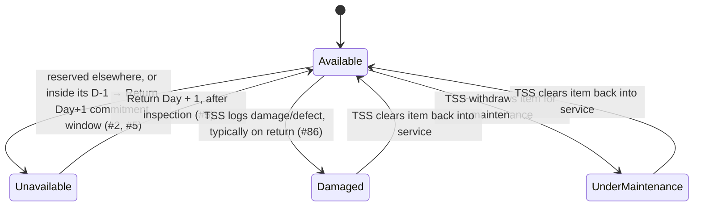

# Equipment Item

A unit (or type/pool — see Open modelling questions) of technical equipment maintained by [[technical-support]], carrying its own location and operational status, and reserved against events through [[equipment-reservation]]. Process detail lives in [[equipment-management]] and [[technical-support]]; this page is the structural reference.

## Attributes

| Field | Meaning | Status | Ref |
|---|---|---|---|
| Type | e.g. projector, microphone, VC unit | ✅ Specified | brief §4 |
| Description | Free-form technical detail / specification | ✅ Specified | brief §4 |
| Quantity | Number of units available; the system must know this regardless of how the item is modelled internally | ✅ Specified | #13 |
| Physical location | The item's current location | ✅ Specified | #2 |
| Operational status | One of: available, unavailable, damaged, under maintenance | ✅ Specified | #23 |
| Transfer / preparation time | Time required to move the item from its current location to the event venue; factored into pre-event availability | ✅ Specified | #2 |
| Expected return date (while under maintenance) | Whether a maintenance record carries a target return date | 🔶 Team decision | #23 |

Operational status is an explicit, TSS-maintained attribute (see Binding rules); it is a different concept from an item being transiently unavailable because it is already committed to another event's D-1 → Return Day + 1 window (see Availability lifecycle, below). Neither source distinguishes the two by separate field names — treating them as two layers on top of the same "available/not available" question is this wiki's structural proposal, not a customer-specified data model.

## States

### Availability lifecycle (pre/post event)

> [!success] Resolved — #2
> T6 flagged an apparent contradiction between #2 (transfer/preparation time governs availability) and #5 (equipment is only available again from Return Day + 1) on 2026-08-28. The customer resolved this on 2026-08-31: **both rules apply, at different points in the equipment lifecycle — they are not alternatives.** Transfer time affects *pre*-event availability; the Return Day + 1 rule governs *post*-event availability.

The lifecycle chain, as given by the customer (#2 follow-up, 2026-08-31):

```
Current equipment location
→ transfer/preparation to event venue        (governs PRE-event availability — #2)
→ D-1 collection / event commitment period
→ event use
→ return to ConnectSphere
→ inspection/preparation
→ available again from Return Day +1          (governs POST-event availability — #5)
```

The return leg goes back **to ConnectSphere**, not directly to the next venue — transfer time is consumed on the outbound leg of every reservation, measured from wherever the item currently sits (#2 follow-up). How transfer time, preparation time and current location are represented in the solution is left to the team (#2 follow-up) — see Open modelling questions.

### Operational status



| State | Meaning | Entry / exit rule | Ref |
|---|---|---|---|
| Available | Free to be reserved | Entry: newly catalogued, or cleared back into service. Exit: reserved, or TSS marks damaged/under maintenance | #23 |
| Unavailable | Not currently reservable — committed to another event or inside its commitment window | Entry: reserved for an event / within the D-1 → Return Day+1 window. Exit: Return Day + 1, after inspection | #2; #5 |
| Damaged | Found damaged, typically at return inspection | Entry: TSS logs a defect/damage (#86). Exit: not specified — trigger and process for clearing damaged status back to available are left to the team (🔶) | #23; #86 |
| Under maintenance | Withdrawn for repair or maintenance | Entry: TSS places item under maintenance. Exit: not specified — no expected-return-date field, and the maintenance workflow itself is not a functional requirement (🔶) | #23 |

The four values above are customer-specified (#23); the transition edges between them are this wiki's structural placeholder, not a specified process — the customer explicitly stated the equipment maintenance workflow is not currently listed as a functional requirement and is recorded only as a consideration (#23).

## Relationships

| Related object | Cardinality | Rule | Ref |
|---|---|---|---|
| [[equipment-reservation]] | 1 : many | An item (or type/pool) is reserved against events through reservation records | brief §4; #19 |
| [[event]] | many : many (via equipment-reservation) | Indirect — an event's equipment need is expressed through its reservations, not a direct link | brief §4 |
| [[session]] | many : many (via equipment-reservation) | Multi-session events may reserve different equipment per session | #74 |
| [[venue]] | — (transient) | The event venue is the destination of the pre-event transfer, not a persistent ownership relationship | #2 |

## Binding rules

- Technical Support Staff are responsible for maintaining equipment operational status (#9). ⚠️ Partial: the question that prompted this answer also asked whether Event Coordinators can flag status themselves; the answer affirms TSS's responsibility but does not explicitly rule out a Coordinator-initiated flag — treat "Coordinators may not set status" as an inference, not a confirmed exclusion (#9).
- No same-day sharing between events: equipment may be collected from D-1 and, after return and inspection, is only available again from Return Day + 1 (#5).
- No maximum reservation period is specified (#82). ⚠️ Partial: the same question also asked about a minimum period, but the answer ("No maximum reservation period.") addressed only the maximum — no minimum-period statement exists in the source (#82).
- No minimum notice period for equipment requests is specified; propose an approach if the solution requires one (#25).
- The post-event equipment health checklist is kept outside the system — "we do not need to keep track in the system" (#85).
- No equipment data import: no data migration, import, or system-integration requirement for now (#12).
- The equipment maintenance workflow is not currently listed as a potential functional requirement; it is recorded only as a consideration (#23).

> [!question]- Team decision required — pooled vs serialised inventory
> Whether equipment is modelled as individually serialised units or as a pooled quantity counter is explicitly left to the team: "How you model equipment individually or as pooled quantities in the database or UX is for you to propose." The one binding constraint is that **the system must know the quantity of equipment available** (#13). This is the single highest-value deferral in the whole domain layer — per-item **location** (#2) and per-item **operational status** (#23) both imply state that lives at the unit level, which pulls toward serialisation even though the customer did not mandate it; a pooled model would still need per-unit sub-state to honour #2 and #23.

## Open modelling questions

> [!question]- Team decision required — pooled vs serialised inventory
> See the callout above — repeated here for visibility in this section. Quantity must always be known (#13); unit-level modelling is not required but is implied by #2 and #23.

> [!question]- Team decision required — representing transfer time and location
> "How the system represents transfer time, preparation time and the equipment's current location is for the solution team to propose" (#2 follow-up). Options include a per-item location field with a transfer-duration matrix, a flat buffer per venue pair, or folding transfer time into the existing D-1 window.

> [!question]- Team decision required — maintenance return date and re-availability
> Whether a maintenance record carries an expected-return-date field, and whether the system should automatically flag or pre-book equipment once it becomes available again, are both unspecified; propose if appropriate (#23).

See [[domain-model]] for the full object catalogue.
