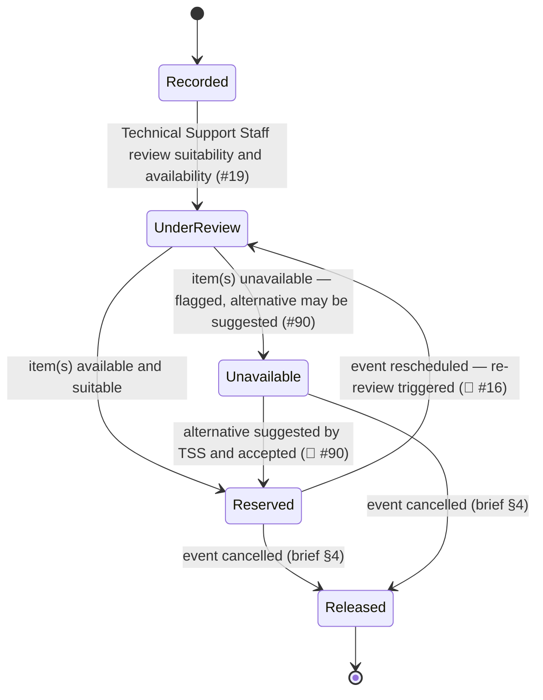

# Equipment Reservation

The record created when a Coordinator-recorded equipment requirement for an [[event]] (or [[session]]) is reviewed by Technical Support Staff and available [[equipment-item]]s are committed to it. Unlike [[booking]], there is **no formal request → approval workflow** behind this record ([#19](https://github.com/SinYang13/IS212-2026/discussions/19)). Process detail lives in [[equipment-management]] and [[technical-support]]; this page is the structural reference.

## Attributes

| Field | Meaning | Status | Ref |
|---|---|---|---|
| Equipment requirement line | Item/type, quantity, and technical requirements as recorded by the Event Coordinator | ✅ Specified | [[event-planning-venue-booking-system\|brief §4]] |
| Reserved equipment | The specific item(s)/type(s) and quantity committed | ✅ Specified | [[event-planning-venue-booking-system\|brief §4]] |
| Event / session | The event or session the reservation is made against | ✅ Specified | [[event-planning-venue-booking-system\|brief §4]]; [#74](https://github.com/SinYang13/IS212-2026/discussions/74) |
| Reviewed / reserved by | The Technical Support Staff [[user-account]] who reviewed suitability and availability | ✅ Specified | [#19](https://github.com/SinYang13/IS212-2026/discussions/19) |
| Requirement fulfilment flag | Whether this line is met, or unavailable and flagged (with an optional suggested alternative) | ✅ Specified | [#90](https://github.com/SinYang13/IS212-2026/discussions/90) |
| Defect / return-inspection log | Defects, damage, or missing items TSS record when the equipment is returned | ✅ Specified | [#86](https://github.com/SinYang13/IS212-2026/discussions/86) |

A requirement line's fulfilment is per-line, not all-or-nothing for the reservation as a whole: TSS may reserve the items that are available and suitable while flagging others as unavailable, and the Event Coordinator then judges whether the shortfall affects overall readiness ([#90](https://github.com/SinYang13/IS212-2026/discussions/90)). Treating fulfilment as a property of each line rather than of the reservation record is this wiki's structural reading of that answer, not a directly named field.

## States

No source names a state set for the equipment reservation record itself, unlike the operational-status field on [[equipment-item]] ([#23](https://github.com/SinYang13/IS212-2026/discussions/23)). The labels below are this wiki's structural proposal, inferred from confirmed behaviour: the coordinator-records → TSS-reviews → reserve flow ([#19](https://github.com/SinYang13/IS212-2026/discussions/19)), partial fulfilment ([#90](https://github.com/SinYang13/IS212-2026/discussions/90)), a reschedule triggering re-review (🔶 [#16](https://github.com/SinYang13/IS212-2026/discussions/16)), and release on cancellation ([[event-planning-venue-booking-system|brief §4]]). Treat the diagram as a structural aid, not a customer-confirmed state machine.

| State | Meaning | Entry / exit rule | Ref |
|---|---|---|---|
| Recorded | Event Coordinator has recorded the equipment requirement line | Entry: coordinator records requirement. Exit: TSS review begins | [#19](https://github.com/SinYang13/IS212-2026/discussions/19) |
| Under review | Technical Support Staff assessing suitability and availability | Entry: review begins. Exit: reserved, or flagged unavailable | [#19](https://github.com/SinYang13/IS212-2026/discussions/19) |
| Reserved | Available, suitable equipment committed to the event | Entry: TSS reserve. Exit: released on cancellation, or returned to review on reschedule (🔶) | [#90](https://github.com/SinYang13/IS212-2026/discussions/90); [[event-planning-venue-booking-system\|brief §4]] |
| Unavailable | This requirement line cannot currently be fulfilled; flagged, alternative may be suggested | Entry: TSS review finds no suitable/available item. Exit: coordinator judges impact on readiness; resolution path unspecified (🔶) | [#90](https://github.com/SinYang13/IS212-2026/discussions/90) |
| Released | Reservation released because the event was cancelled | Entry: event cancelled. Terminal | [[event-planning-venue-booking-system\|brief §4]] |

## Relationships

| Related object | Cardinality | Rule | Ref |
|---|---|---|---|
| [[event]] | many : 1 | A reservation is made against an event directly, or against one of its sessions | [[event-planning-venue-booking-system\|brief §4]]; [#74](https://github.com/SinYang13/IS212-2026/discussions/74) |
| [[session]] | many : 1 (optional) | Per-session equipment variation is supported for multi-session events | [#74](https://github.com/SinYang13/IS212-2026/discussions/74) |
| [[equipment-item]] | many : many | A reservation may cover one or more items/types and quantities | [[event-planning-venue-booking-system\|brief §4]] |
| [[user-account]] | many : 1 | The Technical Support Staff member who reviewed and reserved | [#19](https://github.com/SinYang13/IS212-2026/discussions/19) |
| [[change-request]] | indirect | A reschedule (a change) triggers re-review of existing reservations | [#16](https://github.com/SinYang13/IS212-2026/discussions/16) |

## Binding rules

- There is no formal equipment request → approval workflow like venue booking: the Event Coordinator records the requirement, Technical Support Staff review suitability and availability, and available equipment is then reserved ([#19](https://github.com/SinYang13/IS212-2026/discussions/19)).
- Partial fulfilment is allowed: available items may be reserved while others remain unavailable; Technical Support Staff flag the gaps or suggest alternatives, and the Event Coordinator determines whether the outstanding requirement affects overall event readiness ([#90](https://github.com/SinYang13/IS212-2026/discussions/90)).
- Per-session equipment variation is supported for multi-session events ([#74](https://github.com/SinYang13/IS212-2026/discussions/74)).
- Reservations must be released when an event is cancelled — related equipment reservations "should no longer remain committed to a cancelled event, subject to the applicable business rules" ([[event-planning-venue-booking-system|brief §4]]).
- On return, Technical Support Staff record defects, damage, or missing items, and the operational status of the affected equipment is updated accordingly ([#86](https://github.com/SinYang13/IS212-2026/discussions/86)). The post-event assessment checklist itself is out of scope — it is kept outside the system ([#85](https://github.com/SinYang13/IS212-2026/discussions/85)).

## Open modelling questions

> [!question]- Team decision required — reschedule re-review workflow
> A reschedule may affect equipment availability, so the equipment arrangement needs to be reviewed again — but "how you implement that workflow is for you to propose," including any status changes and sequencing ([#16](https://github.com/SinYang13/IS212-2026/discussions/16)).

See [[domain-model]] for the full object catalogue.
