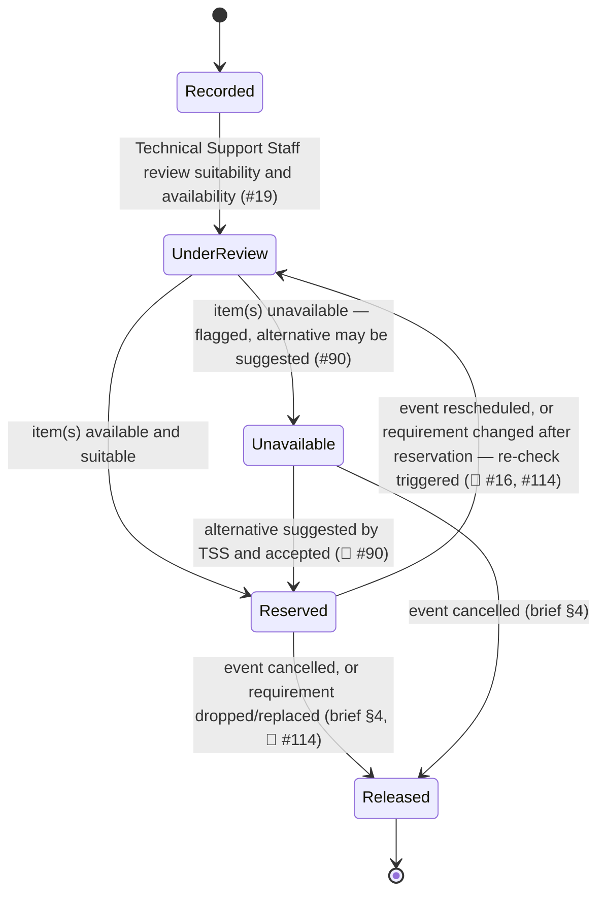

# Equipment Reservation

The record created when a Coordinator-recorded equipment requirement for an [[event]] (or [[session]]) is reviewed by Technical Support Staff and available [[equipment-item]]s are committed to it. Unlike [[booking]], there is **no formal request → approval workflow** behind this record ([#19](https://github.com/SinYang13/IS212-2026/discussions/19)). Process detail lives in [[equipment-management]] and [[technical-support]]; this page is the structural reference.

## Attributes

`Scope` is the Release 1 marker from [[release-1-scope]].

| Field | Meaning | Status | Scope | Ref |
|---|---|---|---|---|
| Equipment requirement line | Item/type, quantity, and technical requirements as recorded by the Event Coordinator | ✅ Specified | 🎯 Release 1 (feature 15) | [[event-planning-venue-booking-system\|brief §4]] |
| Reserved equipment | The specific item(s)/type(s) and quantity committed | ✅ Specified | 🎯 Release 1 (feature 17) | [[event-planning-venue-booking-system\|brief §4]] |
| Event / session | The event or session the reservation is made against | ✅ Specified | 🎯 Release 1 (features 15, 17) | [[event-planning-venue-booking-system\|brief §4]]; [#74](https://github.com/SinYang13/IS212-2026/discussions/74) |
| Reviewed / reserved by | The Technical Support Staff [[user-account]] who reviewed suitability and availability | ✅ Specified | 🎯 Release 1 (features 16–17) | [#19](https://github.com/SinYang13/IS212-2026/discussions/19) |
| Requirement fulfilment flag | Whether this line is met, or unavailable and flagged (with an optional suggested alternative). **Team decision (2026-10-07):** no partial reservation *within* a line — a line is reserved in full or marked unfulfilled with a comment, and the coordinator adjusts the request (SPM-274) | ✅ Specified | 🎯 Release 1 (feature 17) | [#90](https://github.com/SinYang13/IS212-2026/discussions/90) |
| Return date | The day the reserved equipment comes back to ConnectSphere. Stored on the reservation as a **nullable** `return_date` (migration D1, 2026-09-09 — see [[schema]]), so the Return Day + 1 window is representable. **There is no fixed default return day**; the open question was the *population mechanism* — automatically populated or manually entered — not the representation. **Team decision (2026-10-07):** set automatically to the event's date, and changed with it if the event's date changes; nobody enters it (SPM-275) | 🔶 Team decision | 🎯 Release 1 (features 16–17) | [#113](https://github.com/SinYang13/IS212-2026/discussions/113) |
| Defect / return-inspection log | Defects, damage, or missing items TSS record when the equipment is returned | ✅ Specified | 🧩 Adjacent (feature 16) | [#86](https://github.com/SinYang13/IS212-2026/discussions/86) |

A requirement line's fulfilment is per-line, not all-or-nothing for the reservation as a whole: TSS may reserve the items that are available and suitable while flagging others as unavailable, and the Event Coordinator then judges whether the shortfall affects overall readiness — a judgement the coordinator makes **together with the relevant Technical Support Staff** where the question is whether an incomplete requirement is essential ([#90](https://github.com/SinYang13/IS212-2026/discussions/90), [#106](https://github.com/SinYang13/IS212-2026/discussions/106)). Treating fulfilment as a property of each line rather than of the reservation record is this wiki's structural reading of that answer, not a directly named field. [#90](https://github.com/SinYang13/IS212-2026/discussions/90) *permits* partial reservation across lines ("even if some **other** requested equipment is unavailable") but does not require it within one; the team decided on 2026-10-07 that a single line is all-or-nothing (SPM-274).

**The return date is the reservation's load-bearing unknown — but the gap has moved.** The D-1 / Return Day + 1 rule is `✅ Specified` and non-negotiable ([#5](https://github.com/SinYang13/IS212-2026/discussions/5), restated in the [#2](https://github.com/SinYang13/IS212-2026/discussions/2) follow-up), and since migration D1 the schema holds the date it computes from: `equipment_reservation.return_date` (see [[schema]]). So the rule is now **representable**, and feature 16 has a column to read. What it does not have is a guarantee that the column is filled — `return_date` is nullable and [#113](https://github.com/SinYang13/IS212-2026/discussions/113) fixes no default, so the open question is *how a row acquires a return date*, not where the date lives. Concretely: a commitment window whose reservation has a null `return_date` has no computable end, and every downstream availability answer for that item is undefined until one is supplied. Whatever mechanism is chosen (event end date + n, explicit coordinator entry, TSS entry at collection) becomes a de facto business rule and should be recorded as one — a `not null` constraint or a default follows from that choice, and neither can be added before it. **The team chose on 2026-10-07:** the return date is the event's date, set automatically (SPM-275). An event has a single date, and one with no date cannot be reserved for (SPM-274), so every reservation has a return date.

## States

No source names a state set for the equipment reservation record itself, unlike the operational-status field on [[equipment-item]] ([#23](https://github.com/SinYang13/IS212-2026/discussions/23)). The labels below are this wiki's structural proposal, inferred from confirmed behaviour: the coordinator-records → TSS-reviews → reserve flow ([#19](https://github.com/SinYang13/IS212-2026/discussions/19)), partial fulfilment ([#90](https://github.com/SinYang13/IS212-2026/discussions/90)), a reschedule triggering re-review (🔶 [#16](https://github.com/SinYang13/IS212-2026/discussions/16)), a post-reservation requirement change triggering a TSS re-check (🔶 [#114](https://github.com/SinYang13/IS212-2026/discussions/114)), and release on cancellation ([[event-planning-venue-booking-system|brief §4]]). Treat the diagram as a structural aid, not a customer-confirmed state machine.

| State | Meaning | Entry / exit rule | Ref |
|---|---|---|---|
| Recorded | Event Coordinator has recorded the equipment requirement line | Entry: coordinator records requirement. Exit: TSS review begins | [#19](https://github.com/SinYang13/IS212-2026/discussions/19) |
| Under review | Technical Support Staff assessing suitability and availability | Entry: review begins. Exit: reserved, or flagged unavailable | [#19](https://github.com/SinYang13/IS212-2026/discussions/19) |
| Reserved | Available, suitable equipment committed to the event | Entry: TSS reserve. Exit: released on cancellation or on the requirement being dropped/replaced, or returned to review on reschedule or on a post-reservation requirement change (🔶) | [#90](https://github.com/SinYang13/IS212-2026/discussions/90); [#114](https://github.com/SinYang13/IS212-2026/discussions/114); [[event-planning-venue-booking-system\|brief §4]] |
| Unavailable | This requirement line cannot currently be fulfilled; flagged, alternative may be suggested | Entry: TSS review finds no suitable/available item. Exit: coordinator, together with the relevant TSS, judges whether the gap is essential; resolution path unspecified (🔶) | [#90](https://github.com/SinYang13/IS212-2026/discussions/90); [#106](https://github.com/SinYang13/IS212-2026/discussions/106) |
| Released | Reservation released because the event was cancelled, or because the requirement it served was dropped or replaced | Entry: event cancelled, or a post-reservation requirement change releases the line (🔶). Terminal | [[event-planning-venue-booking-system\|brief §4]]; [#114](https://github.com/SinYang13/IS212-2026/discussions/114) |

**The release / replace / add operations of [#114](https://github.com/SinYang13/IS212-2026/discussions/114) need no new states.** *Release* is the existing `Released` state reached by a second trigger; *replace* is a release plus a new line entering at `Recorded`; *add* is a new line entering at `Recorded`. The re-check is the existing `Reserved → Under review` edge, already present for reschedules ([#16](https://github.com/SinYang13/IS212-2026/discussions/16)). What [#114](https://github.com/SinYang13/IS212-2026/discussions/114) leaves open is the *workflow* — sequencing, and whether a replacement reuses the original line or supersedes it — not the vocabulary. **Team decision (2026-10-18):** there is no separate replace action — a change of type is handled by Technical Support Staff, and add is the ordinary new-line path (SPM-41, SPM-274). Technical Support act on an `Under review` line by releasing it (SPM-108), re-reserving it (SPM-316) or keeping it as reserved (SPM-317), per [#114](https://github.com/SinYang13/IS212-2026/discussions/114).

## Relationships

| Related object | Cardinality | Rule | Ref |
|---|---|---|---|
| [[event]] | many : 1 | A reservation is made against an event directly, or against one of its sessions | [[event-planning-venue-booking-system\|brief §4]]; [#74](https://github.com/SinYang13/IS212-2026/discussions/74) |
| [[session]] | many : 1 (optional) | Per-session equipment variation is supported for multi-session events | [#74](https://github.com/SinYang13/IS212-2026/discussions/74) |
| [[equipment-item]] | many : many | A reservation may cover one or more items/types and quantities | [[event-planning-venue-booking-system\|brief §4]] |
| [[user-account]] | many : 1 | The Technical Support Staff member who reviewed and reserved | [#19](https://github.com/SinYang13/IS212-2026/discussions/19) |
| [[change-request]] | indirect | A reschedule (a change) triggers re-review of existing reservations | [#16](https://github.com/SinYang13/IS212-2026/discussions/16) |

## Binding rules

- There is no formal equipment request → approval workflow like venue booking: the Event Coordinator records the requirement, Technical Support Staff review suitability and availability, and available equipment is then reserved ([#19](https://github.com/SinYang13/IS212-2026/discussions/19)).
- Partial fulfilment is allowed: available items may be reserved while others remain unavailable; Technical Support Staff flag the gaps or suggest alternatives, and the Event Coordinator determines whether the outstanding requirement affects overall event readiness ([#90](https://github.com/SinYang13/IS212-2026/discussions/90)). Whether an incomplete requirement is **essential** is determined by the Event Coordinator *together with the relevant Technical Support Staff*; if it is essential, the event must not be confirmed until it is resolved ([#106](https://github.com/SinYang13/IS212-2026/discussions/106)). Within a single line there is no partial reservation (team decision, 2026-10-07, SPM-274).
- Equipment requirements **may be changed after equipment has been reserved**. Where the change affects an existing reservation, the affected arrangements are reviewed and updated, and Technical Support Staff re-check suitability and availability where necessary ([#114](https://github.com/SinYang13/IS212-2026/discussions/114)).
- No default return day is fixed; the return date's capture mechanism is a team decision ([#113](https://github.com/SinYang13/IS212-2026/discussions/113)) even though the D-1 / Return Day + 1 window that consumes it is not ([#5](https://github.com/SinYang13/IS212-2026/discussions/5)). The date itself has a home — a nullable `return_date` on the reservation ([[schema]]) — so the deferral is about population, not storage. The team decided on 2026-10-07: set automatically to the event's date (SPM-275).
- Per-session equipment variation is supported for multi-session events ([#74](https://github.com/SinYang13/IS212-2026/discussions/74)).
- Reservations must be released when an event is cancelled — related equipment reservations "should no longer remain committed to a cancelled event, subject to the applicable business rules" ([[event-planning-venue-booking-system|brief §4]]).
- On return, Technical Support Staff record defects, damage, or missing items, and the operational status of the affected equipment is updated accordingly ([#86](https://github.com/SinYang13/IS212-2026/discussions/86)). The post-event assessment checklist itself is out of scope — it is kept outside the system ([#85](https://github.com/SinYang13/IS212-2026/discussions/85)).

## Open modelling questions

> [!question]- Team decision required — reschedule re-review workflow
> A reschedule may affect equipment availability, so the equipment arrangement needs to be reviewed again — but "how you implement that workflow is for you to propose," including any status changes and sequencing ([#16](https://github.com/SinYang13/IS212-2026/discussions/16)). [#114](https://github.com/SinYang13/IS212-2026/discussions/114) extends the same deferral to a change of the requirement itself: "the exact workflow for releasing, replacing, or adding equipment may be proposed by the team." Design the two as one mechanism — both end in a TSS re-check of suitability and availability.

> [!success] Resolved — [#113](https://github.com/SinYang13/IS212-2026/discussions/113)
> **Team decision (2026-10-07):** the return date is derived automatically from the event's date and follows it when the date changes; there is no manual entry or override (SPM-275). Equipment is therefore committed from D-1 through the event's date and available again the day after. The original question follows.
>
> "There is currently no fixed default return day. The team may propose how the return date is captured or determined, whether automatically populated or entered manually" ([#113](https://github.com/SinYang13/IS212-2026/discussions/113)). Storage is settled — migration D1 added a nullable `return_date` to the reservation ([[schema]]) — so what is open is purely how that column gets a value. This is not a cosmetic field: the `✅ Specified` Return Day + 1 availability rule ([#5](https://github.com/SinYang13/IS212-2026/discussions/5)) cannot be evaluated while the column is null, so feature 16's availability check inherits whatever the team picks. Candidates: derive from the event's (or session's) end date plus a fixed offset; require the Event Coordinator to enter it with the requirement; or have TSS set it at collection. A derived default with manual override satisfies the answer's "automatically populated or entered manually" framing.

See [[domain-model]] for the full object catalogue.
