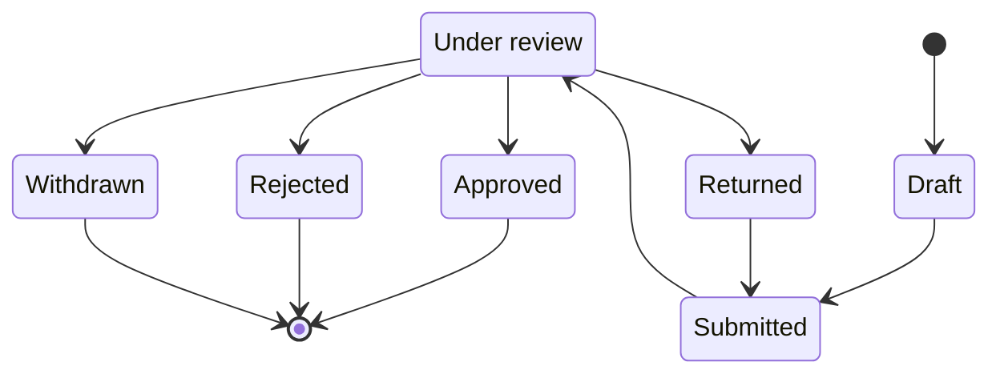

# Event Request

The pre-approval artefact an Event Organiser creates and submits to ConnectSphere. Approval converts a request into a plannable [[event]]; the two are modelled as **separate records** because approval commits ConnectSphere to nothing — no venue, equipment, technical support, registration setup, or delivery ([#80](https://github.com/SinYang13/IS212-2026/discussions/80)). The request exists to be reviewed and, if accepted, to seed an Event; it is not itself a plannable object.

**Release 1 scope:** Per [[release-1-scope]], event request creation and draft event requests are 🎯 Release 1 (core features 2–3); the Approved/Rejected/Returned states below belong to event review and approval, also 🎯 Release 1 (core feature 4).

> [!info] The request/event status split is settled in the schema
> [[event-planning-venue-booking-system|brief §4]] lists *Event Request Creation* and *Event Status Management* as separate functionality areas, implying two distinct records — yet offers a single example status list spanning both ("draft, submitted, under review, approved, planning, awaiting arrangements, confirmed, completed, cancelled, or rejected"). The brief never draws the boundary explicitly. The team has now allocated those statuses **one per table**: Draft/Submitted/Under review/Approved/Rejected/Returned to `event_request`, and Planning/Blocked/Confirmed/Completed/Cancelled to [[event]]. No value is duplicated across the two, and [[schema]]'s check constraints enforce it. A seventh request state, `Withdrawn`, was added by [#103](https://github.com/SinYang13/IS212-2026/discussions/103) and is now enumerated in [[schema]]'s `event_request_status_chk` as well (migration D3, 2026-09-09) — see States. `Returned` comes from [[event-request-workflow|brief §5]] ("An event request is approved, rejected, or returned"), which names the request explicitly. This is the team's resolution of a genuine ambiguity in the brief, not a customer-confirmed data model.

## Attributes

Every field below is `⚠️ Partial` unless marked otherwise: the mandatory field set for submission has **not been firmed up**, and is explicitly left to the team to propose; there are also no field-length requirements ([#72](https://github.com/SinYang13/IS212-2026/discussions/72)).

| Field | Meaning | Status | Ref |
|---|---|---|---|
| Event name | Working title of the proposed event | ⚠️ Partial | [[event-planning-venue-booking-system\|brief §4]]; [#72](https://github.com/SinYang13/IS212-2026/discussions/72) |
| Description | Free-text description | ⚠️ Partial | [[event-planning-venue-booking-system\|brief §4]]; [#72](https://github.com/SinYang13/IS212-2026/discussions/72) |
| Purpose | Why the event is being held | ⚠️ Partial | [[connectsphere-event-services\|brief §2]]; [#72](https://github.com/SinYang13/IS212-2026/discussions/72) |
| Preferred dates / time | Organiser's requested date and time | ⚠️ Partial | [[connectsphere-event-services\|brief §2]]; [#72](https://github.com/SinYang13/IS212-2026/discussions/72) |
| Expected attendance | Organiser's attendance estimate. A **separate event-level field**, not nested inside Venue requirements — though it is still used when evaluating venue suitability, capacity and booking decisions | ⚠️ Partial | [[connectsphere-event-services\|brief §2]]; [#72](https://github.com/SinYang13/IS212-2026/discussions/72); [#119](https://github.com/SinYang13/IS212-2026/discussions/119) |
| Venue requirements | Capacity, layout, accessibility, facilities sought | ⚠️ Partial | [[event-planning-venue-booking-system\|brief §4]]; [#72](https://github.com/SinYang13/IS212-2026/discussions/72) |
| Accessibility needs | Organiser-stated accessibility requirements | ⚠️ Partial | [[connectsphere-event-services\|brief §2]]; [#72](https://github.com/SinYang13/IS212-2026/discussions/72) |
| Equipment requirements | Organiser-stated equipment needs | ⚠️ Partial | [[connectsphere-event-services\|brief §2]]; [#72](https://github.com/SinYang13/IS212-2026/discussions/72) |
| Registration requirements | Whether/how the event should support Attendee registration | ⚠️ Partial | [[connectsphere-event-services\|brief §2]]; [#72](https://github.com/SinYang13/IS212-2026/discussions/72) |
| Room-layout preferences | Preferred layout(s) | ⚠️ Partial | [[connectsphere-event-services\|brief §2]]; [#72](https://github.com/SinYang13/IS212-2026/discussions/72) |
| General programme | Draft agenda/programme information | ⚠️ Partial | [[connectsphere-event-services\|brief §2]]; [#72](https://github.com/SinYang13/IS212-2026/discussions/72) |
| Other special arrangements | Anything else the Organiser flags | ⚠️ Partial | [[connectsphere-event-services\|brief §2]]; [#72](https://github.com/SinYang13/IS212-2026/discussions/72) |
| Requesting Event Organiser | The [[user-account]] who authored the request | ⚠️ Partial | [[connectsphere-event-services\|brief §2]]; [#72](https://github.com/SinYang13/IS212-2026/discussions/72) |
| Client organisation | The [[client-organisation]] the requester belongs to | ⚠️ Partial | [[event-planning-venue-booking-system\|brief §4]]; [#72](https://github.com/SinYang13/IS212-2026/discussions/72) |
| Status | Draft / submitted / under review / approved / rejected / returned / **withdrawn** — see States | ⚠️ Partial | [[event-planning-venue-booking-system\|brief §4]]; [[event-request-workflow\|brief §5]]; [#103](https://github.com/SinYang13/IS212-2026/discussions/103); [[schema]] |
| Assigned Event Coordinator | The [[user-account]] assigned by the Event Operations Manager as this request's reviewer, set at Step 3 — after submission, before review and approval. Null while `Draft`/`Submitted`. Frozen once `Approved`; the live, reassignable copy then lives on the resulting [[event]] — see [[schema]] | ✅ Specified | [[event-request-workflow\|brief §5]]; [#73](https://github.com/SinYang13/IS212-2026/discussions/73); [#94](https://github.com/SinYang13/IS212-2026/discussions/94) |
| Decision record | Retained record of the coordinator's approve/reject/return decision | ⚠️ Partial | [[event-request-workflow\|brief §5]] (step 5); [#72](https://github.com/SinYang13/IS212-2026/discussions/72) |
| Withdrawal record | Record of a withdrawal the coordinator processed on the Organiser's behalf. Where it is stored — on the decision record, as a separate field, or as an [[audit-record]] entry — is for the team | 🔶 Team decision | [#103](https://github.com/SinYang13/IS212-2026/discussions/103) |

## States

The request's own status set covers only the **pre-approval** stages; the post-approval stages live on [[event]]. The two sets are disjoint. `In Progress` is grounded in no source — it appeared in an earlier schema draft and has been removed — but a request-level `Withdrawn` **is** now grounded: [#103](https://github.com/SinYang13/IS212-2026/discussions/103) has the coordinator record a withdrawal in the system, and requires the withdrawn request to "remain distinguishable from draft, submitted, approved, rejected, or other request states". That makes **seven** states, and [[schema]]'s `event_request_status_chk` now enumerates all seven — see the callout below for how the reversal came about.

A request enters at `Draft` when the Organiser starts one and moves to `Submitted` and then `Under review` as the coordinator picks it up. `Approved` is terminal for this record — approval converts the request into a plannable [[event]], whose own (disjoint) status set takes over from there ([#80](https://github.com/SinYang13/IS212-2026/discussions/80)). `Returned` is not terminal: [[event-request-workflow|brief §5]] has the Organiser amend and resubmit, modelled here as a return to `Submitted` since resubmission is the same act as the original submission.

`Rejected` is drawn as terminal, matching the plain reading of [[event-request-workflow|brief §5]]; whether a rejected request may instead be resubmitted was explicitly left open by the customer ("Please propose an appropriate approach if needed" — [#67](https://github.com/SinYang13/IS212-2026/discussions/67)), so no `Rejected → Draft`/`Submitted` edge is drawn until the team settles that open question (see Open modelling questions below).

`Withdrawn` is drawn only from `Under review`, because that is the only state [#103](https://github.com/SinYang13/IS212-2026/discussions/103)'s answer names ("withdraw a submitted event request **while it is under review**"). The question it answers was phrased "before it is reviewed", which would imply a `Submitted → Withdrawn` edge as well, but the customer's answer does not confirm that reading and the brief says nothing — so, as with `Rejected`, the unsourced edge is left undrawn rather than guessed at. Whether a `Draft` may be withdrawn is moot: an unsubmitted draft has nothing to withdraw from. `Withdrawn` is drawn as terminal because nothing in the source revives it; whether a withdrawn request may later be resubmitted is as unspecified as resubmission after rejection.

Note what [#103](https://github.com/SinYang13/IS212-2026/discussions/103) does **not** say. The Organiser does not self-withdraw: the *request* to withdraw is made to the coordinator **outside the system**, and only the coordinator performs and records the withdrawal inside it. There is therefore no Organiser-facing withdraw action to build, and the transition is a coordinator write like approve, reject and return.

| State | Meaning | Entry / exit rule | Ref |
|---|---|---|---|
| Draft | Saved before submission; the only state in which the Organiser may edit | Entry: Organiser creates. Exit: submit — after which the Organiser loses direct edit rights and changes route through the coordinator | [[event-planning-venue-booking-system\|brief §4]]; [#102](https://github.com/SinYang13/IS212-2026/discussions/102) |
| Submitted | Sent to ConnectSphere, awaiting coordinator assignment | Entry: Organiser submits, assignment still null. Exit: the Event Operations Manager assigns a coordinator (Step 3), writing that assignment onto the request itself, and that coordinator picks the request up | [[event-request-workflow\|brief §5]]; [#73](https://github.com/SinYang13/IS212-2026/discussions/73) |
| Under review | Assigned coordinator reviewing, may request clarification | Entry: review begins — the request already names its reviewer, assigned between `Submitted` and here. Exit: approve / reject / return / withdraw | [[event-request-workflow\|brief §5]]; [#73](https://github.com/SinYang13/IS212-2026/discussions/73); [#103](https://github.com/SinYang13/IS212-2026/discussions/103) |
| Approved | Sufficient information for planning to proceed; the request becomes an [[event]] | Entry: coordinator approves. Terminal for this record — see [[event]] | [#80](https://github.com/SinYang13/IS212-2026/discussions/80) |
| Rejected | Declined at review; decision record retained | Entry: coordinator rejects. Terminal, unless resubmission is permitted (🔶 [#67](https://github.com/SinYang13/IS212-2026/discussions/67)) | [[event-request-workflow\|brief §5]] |
| Returned | Sent back to the Organiser for amendment or clarification | Entry: coordinator requests amendment. Exit: Organiser resubmits | [[event-request-workflow\|brief §5]] |
| Withdrawn | Pulled out of review at the Organiser's request; must stay distinguishable from draft, submitted, approved and rejected | Entry: coordinator processes and records a withdrawal the Organiser asked for outside the system, while the request is under review. Terminal — no revival path is specified | [#103](https://github.com/SinYang13/IS212-2026/discussions/103) |

> [!success] Resolved — [#103](https://github.com/SinYang13/IS212-2026/discussions/103)
> `Withdrawn` was once recorded here and in [[schema]] as "grounded in no source" and struck from the model, and [[current-schema-scrutiny]] flagged the invented value as a critical defect. That reading was correct on the evidence then available — no source before 2026-09-08 mentioned withdrawal at all. [#103](https://github.com/SinYang13/IS212-2026/discussions/103) reversed it: the customer requires the withdrawal to be recorded in the system and to stay distinguishable from the other request states. The state was restored above, and the deployed DDL caught up on 2026-09-09 (migration D3) — `event_request_status_chk` and [[schema]]'s status-enumeration table now both carry all seven values. Source, page and schema agree; nothing is outstanding.

## Relationships

| Related object | Cardinality | Rule | Ref |
|---|---|---|---|
| [[event]] | 0..1 : 1 | Approval converts the request into a plannable Event; the request does not carry planning-stage data (venue, equipment, confirmation) itself | [#80](https://github.com/SinYang13/IS212-2026/discussions/80) |
| [[user-account]] | many : 1 | Created by the requesting Event Organiser | [[connectsphere-event-services\|brief §2]] |
| [[user-account]] | many : 1 | Assigned Event Coordinator, distinct from the requesting Organiser — assigned by the Event Operations Manager after submission | [#73](https://github.com/SinYang13/IS212-2026/discussions/73) |
| [[client-organisation]] | many : 1 | Requester's client organisation | [[event-planning-venue-booking-system\|brief §4]] |
| [[audit-record]] | 1 : many | Decision record and activity history | [[event-request-workflow\|brief §5]]; [[non-functional-requirements\|brief §8]] |

## Binding rules

- **Editing stops at submission.** After submission the Event Organiser may **not** directly edit the submitted request — not even non-significant fields. Any required change is communicated to or requested through the Event Coordinator, who processes the update in the system ([#102](https://github.com/SinYang13/IS212-2026/discussions/102)). `Draft` is therefore the only state in which the Organiser holds write access, with one unresolved edge: [[event-request-workflow|brief §5]] has the Organiser amend and resubmit a **`Returned`** request, which [#102](https://github.com/SinYang13/IS212-2026/discussions/102) neither authorises nor forbids — its answer addresses the request while it sits with ConnectSphere. Reading `Returned` as handing the pen back is the only reading that keeps §5's amend-and-resubmit loop workable, but it is a reading, not a confirmed rule. The significant/non-significant distinction survives this rule but now governs only whether existing arrangements must be reviewed again — it never governs who may edit ([#102](https://github.com/SinYang13/IS212-2026/discussions/102)). See [[change-impact-management]].
- **The coordinator assignment is held on the request, then frozen at approval.** The request carries its own assigned-coordinator column, because the Event Operations Manager assigns at Step 3 — after submission, before review and approval ([#73](https://github.com/SinYang13/IS212-2026/discussions/73)) — and at that point no [[event]] record exists to hold the assignment. Without it nothing would record who was reviewing a request between `Submitted` and `Approved`. At approval the value is copied onto the newly created [[event]]; from then the two are independent, and reassignment ([#94](https://github.com/SinYang13/IS212-2026/discussions/94)) writes only to the event, never back to the request. The request's copy is therefore a historical record of who reviewed it, not a live pointer — read the [[event]] to find the current coordinator, including for the only-the-assigned-coordinator-may-cancel rule ([#68](https://github.com/SinYang13/IS212-2026/discussions/68)). This mirrors the request/event split already used for preferred date, expected attendance, venue requirements, equipment requirements and accessibility needs; see [[schema]].
- **Withdrawal is coordinator-performed.** The Organiser asks for a withdrawal outside the system; the coordinator processes and records it, and the withdrawn request stays distinguishable from the other request states ([#103](https://github.com/SinYang13/IS212-2026/discussions/103)).
- Expected attendance is an event-level field in its own right and is not duplicated inside the venue-requirements structure, though venue suitability, capacity and booking decisions still consume it. The exact data model is for the team, subject to the constraint that the value is not maintained in two conflicting places ([#119](https://github.com/SinYang13/IS212-2026/discussions/119)).
- No minimum lead time is required between request creation and the event date ([#78](https://github.com/SinYang13/IS212-2026/discussions/78)).
- No contract or terms-acceptance step exists in the system — contracts and payments are handled physically, outside the system ([#24](https://github.com/SinYang13/IS212-2026/discussions/24)).
- No field-length requirements are specified for any request field ([#72](https://github.com/SinYang13/IS212-2026/discussions/72)).

## Open modelling questions

> [!question]- Team decision required — who may create an event request
> The brief itself assigns request creation to the Event Organiser ([[connectsphere-event-services|brief §2]], §5 step 1: "An Event Organiser creates a draft request..."). Discussion [#78](https://github.com/SinYang13/IS212-2026/discussions/78)'s question was phrased "...where an Event Organiser or Coordinator must create the event request?", presupposing both roles may create a request — but the customer's answer addressed only minimum lead time and never confirmed or denied that presupposition. Whether an Event Coordinator may also create a request on an Organiser's behalf is therefore unconfirmed and left to the team to decide ([#78](https://github.com/SinYang13/IS212-2026/discussions/78)).

> [!question]- Team decision required — resubmission after rejection
> Whether a rejected request can be resubmitted, or whether rejection is final, was left to the team: "Please propose an appropriate approach if needed." ([#67](https://github.com/SinYang13/IS212-2026/discussions/67)).

> [!question]- Team decision required — mandatory field set
> Which fields are mandatory for a request to be submittable has not been firmed up by the customer; the team must propose an appropriate set ([#72](https://github.com/SinYang13/IS212-2026/discussions/72)).

See [[domain-model]] for the full object catalogue.
