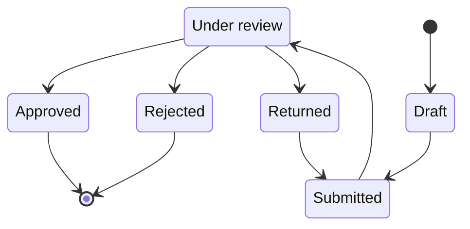

# Event Request

The pre-approval artefact an Event Organiser creates and submits to ConnectSphere. Approval converts a request into a plannable [[event]]; the two are modelled as **separate records** because approval commits ConnectSphere to nothing — no venue, equipment, technical support, registration setup, or delivery ([#80](https://github.com/SinYang13/IS212-2026/discussions/80)). The request exists to be reviewed and, if accepted, to seed an Event; it is not itself a plannable object.

**Release 1 scope:** Per [[release-1-scope]], event request creation and draft event requests are 🎯 Release 1 (core features 2–3); the Approved/Rejected/Returned states below belong to event review and approval, also 🎯 Release 1 (core feature 4).

> [!info] The request/event status split is settled in the schema
> [[event-planning-venue-booking-system|brief §4]] lists *Event Request Creation* and *Event Status Management* as separate functionality areas, implying two distinct records — yet offers a single example status list spanning both ("draft, submitted, under review, approved, planning, awaiting arrangements, confirmed, completed, cancelled, or rejected"). The brief never draws the boundary explicitly. The team has now allocated those statuses **one per table**: the six below to `event_request`, and Planning/Blocked/Confirmed/Completed/Cancelled to [[event]]. No value is duplicated across the two, and [[schema]]'s check constraints enforce it. `Returned` comes from [[event-request-workflow|brief §5]] ("An event request is approved, rejected, or returned"), which names the request explicitly. This is the team's resolution of a genuine ambiguity in the brief, not a customer-confirmed data model.

## Attributes

Every field below is `⚠️ Partial`: the mandatory field set for submission has **not been firmed up**, and is explicitly left to the team to propose; there are also no field-length requirements ([#72](https://github.com/SinYang13/IS212-2026/discussions/72)).

| Field | Meaning | Status | Ref |
|---|---|---|---|
| Event name | Working title of the proposed event | ⚠️ Partial | [[event-planning-venue-booking-system\|brief §4]]; [#72](https://github.com/SinYang13/IS212-2026/discussions/72) |
| Description | Free-text description | ⚠️ Partial | [[event-planning-venue-booking-system\|brief §4]]; [#72](https://github.com/SinYang13/IS212-2026/discussions/72) |
| Purpose | Why the event is being held | ⚠️ Partial | [[connectsphere-event-services\|brief §2]]; [#72](https://github.com/SinYang13/IS212-2026/discussions/72) |
| Preferred dates / time | Organiser's requested date and time | ⚠️ Partial | [[connectsphere-event-services\|brief §2]]; [#72](https://github.com/SinYang13/IS212-2026/discussions/72) |
| Expected attendance | Organiser's attendance estimate | ⚠️ Partial | [[connectsphere-event-services\|brief §2]]; [#72](https://github.com/SinYang13/IS212-2026/discussions/72) |
| Venue requirements | Capacity, layout, accessibility, facilities sought | ⚠️ Partial | [[event-planning-venue-booking-system\|brief §4]]; [#72](https://github.com/SinYang13/IS212-2026/discussions/72) |
| Accessibility needs | Organiser-stated accessibility requirements | ⚠️ Partial | [[connectsphere-event-services\|brief §2]]; [#72](https://github.com/SinYang13/IS212-2026/discussions/72) |
| Equipment requirements | Organiser-stated equipment needs | ⚠️ Partial | [[connectsphere-event-services\|brief §2]]; [#72](https://github.com/SinYang13/IS212-2026/discussions/72) |
| Registration requirements | Whether/how the event should support Attendee registration | ⚠️ Partial | [[connectsphere-event-services\|brief §2]]; [#72](https://github.com/SinYang13/IS212-2026/discussions/72) |
| Room-layout preferences | Preferred layout(s) | ⚠️ Partial | [[connectsphere-event-services\|brief §2]]; [#72](https://github.com/SinYang13/IS212-2026/discussions/72) |
| General programme | Draft agenda/programme information | ⚠️ Partial | [[connectsphere-event-services\|brief §2]]; [#72](https://github.com/SinYang13/IS212-2026/discussions/72) |
| Other special arrangements | Anything else the Organiser flags | ⚠️ Partial | [[connectsphere-event-services\|brief §2]]; [#72](https://github.com/SinYang13/IS212-2026/discussions/72) |
| Requesting Event Organiser | The [[user-account]] who authored the request | ⚠️ Partial | [[connectsphere-event-services\|brief §2]]; [#72](https://github.com/SinYang13/IS212-2026/discussions/72) |
| Client organisation | The [[client-organisation]] the requester belongs to | ⚠️ Partial | [[event-planning-venue-booking-system\|brief §4]]; [#72](https://github.com/SinYang13/IS212-2026/discussions/72) |
| Status | Draft / submitted / under review / approved / rejected / returned — see States | ⚠️ Partial | [[event-planning-venue-booking-system\|brief §4]]; [[event-request-workflow\|brief §5]]; [[schema]] |
| Decision record | Retained record of the coordinator's approve/reject/return decision | ⚠️ Partial | [[event-request-workflow\|brief §5]] (step 5); [#72](https://github.com/SinYang13/IS212-2026/discussions/72) |

## States

The request's own status set covers only the **pre-approval** stages; the post-approval stages live on [[event]]. The two sets are disjoint, and [[schema]]'s `event_request_status_chk` enforces exactly the six below with `Draft` as the default. Neither `In Progress` nor a request-level `Withdrawn` is grounded in any source; both appeared in earlier schema drafts and have been removed.

A request enters at `Draft` when the Organiser starts one and moves to `Submitted` and then `Under review` as the coordinator picks it up. `Approved` is terminal for this record — approval converts the request into a plannable [[event]], whose own (disjoint) status set takes over from there ([#80](https://github.com/SinYang13/IS212-2026/discussions/80)). `Returned` is not terminal: [[event-request-workflow|brief §5]] has the Organiser amend and resubmit, modelled here as a return to `Submitted` since resubmission is the same act as the original submission.

`Rejected` is drawn as terminal, matching the plain reading of [[event-request-workflow|brief §5]]; whether a rejected request may instead be resubmitted was explicitly left open by the customer ("Please propose an appropriate approach if needed" — [#67](https://github.com/SinYang13/IS212-2026/discussions/67)), so no `Rejected → Draft`/`Submitted` edge is drawn until the team settles that open question (see Open modelling questions below).

| State | Meaning | Entry / exit rule | Ref |
|---|---|---|---|
| Draft | Saved before submission; Organiser may keep editing | Entry: Organiser creates. Exit: submit | [[event-planning-venue-booking-system\|brief §4]] |
| Submitted | Sent to ConnectSphere, awaiting coordinator assignment | Entry: Organiser submits. Exit: coordinator reviews | [[event-request-workflow\|brief §5]] |
| Under review | Assigned coordinator reviewing, may request clarification | Entry: review begins. Exit: approve / reject / return | [[event-request-workflow\|brief §5]] |
| Approved | Sufficient information for planning to proceed; the request becomes an [[event]] | Entry: coordinator approves. Terminal for this record — see [[event]] | [#80](https://github.com/SinYang13/IS212-2026/discussions/80) |
| Rejected | Declined at review; decision record retained | Entry: coordinator rejects. Terminal, unless resubmission is permitted (🔶 [#67](https://github.com/SinYang13/IS212-2026/discussions/67)) | [[event-request-workflow\|brief §5]] |
| Returned | Sent back to the Organiser for amendment or clarification | Entry: coordinator requests amendment. Exit: Organiser resubmits | [[event-request-workflow\|brief §5]] |

## Relationships

| Related object | Cardinality | Rule | Ref |
|---|---|---|---|
| [[event]] | 0..1 : 1 | Approval converts the request into a plannable Event; the request does not carry planning-stage data (venue, equipment, confirmation) itself | [#80](https://github.com/SinYang13/IS212-2026/discussions/80) |
| [[user-account]] | many : 1 | Created by the requesting Event Organiser | [[connectsphere-event-services\|brief §2]] |
| [[client-organisation]] | many : 1 | Requester's client organisation | [[event-planning-venue-booking-system\|brief §4]] |
| [[audit-record]] | 1 : many | Decision record and activity history | [[event-request-workflow\|brief §5]], §8f |

## Binding rules

- No minimum lead time is required between request creation and the event date ([#78](https://github.com/SinYang13/IS212-2026/discussions/78)).
- No contract or terms-acceptance step exists in the system — contracts and payments are handled physically, outside the system ([#24](https://github.com/SinYang13/IS212-2026/discussions/24)).
- No field-length requirements are specified for any request field ([#72](https://github.com/SinYang13/IS212-2026/discussions/72)).

## Open modelling questions

> [!question]- Team decision required — who may create an event request
> The brief itself assigns request creation to the Event Organiser ([[connectsphere-event-services|brief §2]], §5 step 1: "An Event Organiser creates a draft request..."). Discussion [#78](https://github.com/SinYang13/IS212-2026/discussions/78)'s question was phrased "...where an Event Organiser or Coordinator must create the event request?", presupposing both roles may create a request — but the customer's answer addressed only minimum lead time and never confirmed or denied that presupposition. Whether an Event Coordinator may also create a request on an Organiser's behalf is therefore unconfirmed and left to the team to decide ([#78](https://github.com/SinYang13/IS212-2026/discussions/78)).

> [!question]- Team decision required — resubmission after rejection
> Whether a rejected request can be resubmitted, or whether rejection is final, was left to the team: "Please propose an appropriate approach if needed." ([#67](https://github.com/SinYang13/IS212-2026/discussions/67)).

> [!question]- Team decision required — mandatory field set
> Which fields are mandatory for a request to be submittable has not been firmed up by the customer; the team must propose an appropriate set ([#72](https://github.com/SinYang13/IS212-2026/discussions/72)).

See [[domain-model]] for the full object catalogue.
