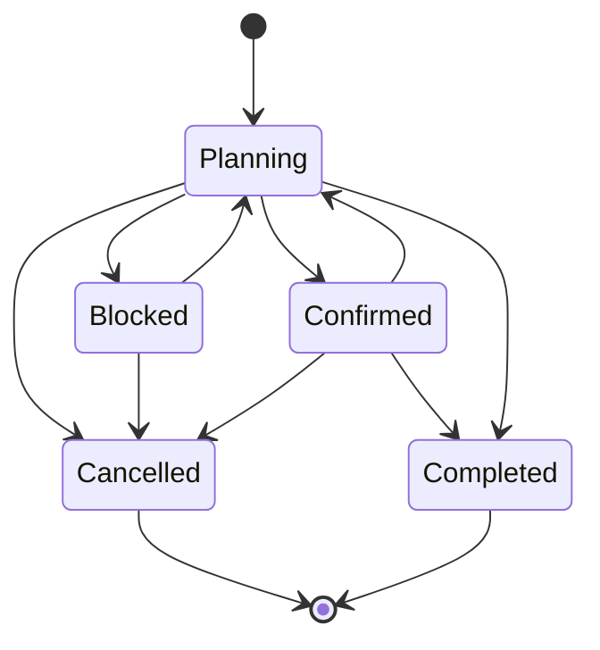
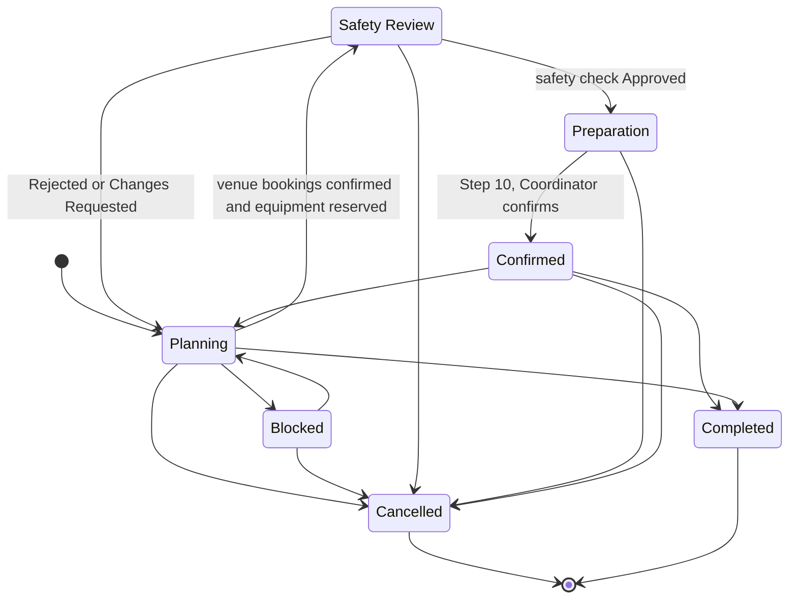

# Event

The plannable record of a confirmed-or-confirmable occasion at [[connectsphere-event-services]], created when an [[event-request]] is approved. Carries the requirements, arrangements, assignments and status that the rest of the system (session, booking, equipment-reservation, registration) attaches to. Process detail lives in [[event-request-workflow]], [[event-lifecycle]], [[event-readiness]], [[operational-safety-check]] and [[change-impact-management]]; this page is the structural reference.

**Release 1 scope:** Per [[release-1-scope]], event status management and event information management are 🎯 Release 1 (core features 6–7); event confirmation and event readiness tracking (the essential-arrangement gate below) are 🧩 Adjacent — inherited from feature 6's status requirements and the [#80](https://github.com/SinYang13/IS212-2026/discussions/80) blocking rule respectively. Two [[week-7-customer-changes|Week 7]] changes add to this: an event may hold **several concurrent venue bookings** (🎯 Release 1, [[week-7-customer-changes|Week 7 C3]]), and an **Operational Safety Check** gates the event before preparation and so before confirmation (🎯 Release 1, [[week-7-customer-changes|Week 7 C6]]; see [[safety-check]]). Multi-session support ([[session]]) remains 📋 Backlog.

## Attributes

| Field                                | Meaning                                                                                                                                          | Status           | Ref                |
| ------------------------------------ | ------------------------------------------------------------------------------------------------------------------------------------------------ | ---------------- | ------------------ |
| Name                                 | Event title                                                                                                                                      | ✅ Specified      | [[event-planning-venue-booking-system\|brief §4]]           |
| Description                          | Free-text description                                                                                                                            | ✅ Specified      | [[event-planning-venue-booking-system\|brief §4]]           |
| Purpose                              | Why the event is being held                                                                                                                      | ✅ Specified      | [[connectsphere-event-services\|brief §2]]           |
| Category / type                      | Conference, workshop, training session, exhibition, meeting, seminar, networking event — the brief's examples, explicitly **not an exhaustive list**; the team may adopt a reasonable set based on them | ⚠️ Partial | [[event-planning-venue-booking-system\|brief §4]]; [#100](https://github.com/SinYang13/IS212-2026/discussions/100) |
| Preferred date & time                | Date/time as originally requested; may diverge from what is ultimately arranged                                                                  | ✅ Specified      | [[connectsphere-event-services\|brief §2]]           |
| Start time / end time                | Event timing                                                                                                                                     | ✅ Specified      | [[event-planning-venue-booking-system\|brief §4]]           |
| Expected attendance                  | Organiser's stated attendance estimate. A **separate event-level requirement**, not duplicated inside Venue requirements, but still consumed when evaluating venue suitability, capacity and booking decisions | ✅ Specified | [[connectsphere-event-services\|brief §2]]; [#119](https://github.com/SinYang13/IS212-2026/discussions/119) |
| Event capacity                       | Capacity ceiling used to gate registration                                                                                                       | ✅ Specified      | [[event-planning-venue-booking-system\|brief §4]]           |
| Programme / agenda                   | Sessions, breaks, presentations, scheduled activities                                                                                            | ✅ Specified      | [[event-planning-venue-booking-system\|brief §4]]           |
| Room-layout preference               | Classroom, theatre, boardroom, banquet, exhibition, other                                                                                        | ✅ Specified      | [[event-planning-venue-booking-system\|brief §4]]           |
| Accessibility requirements           | Organiser-stated accessibility needs                                                                                                             | ✅ Specified      | [[connectsphere-event-services\|brief §2]]           |
| Equipment requirements               | Organiser-stated equipment needs                                                                                                                 | ✅ Specified      | [[connectsphere-event-services\|brief §2]]           |
| Registration-enabled flag            | Whether Attendees may register for this event                                                                                                    | ⚠️ Partial       | [[event-planning-venue-booking-system\|brief §4]]           |
| Special arrangements                 | Any other planning need not otherwise captured                                                                                                   | ✅ Specified      | [[connectsphere-event-services\|brief §2]]           |
| Venue requirements                   | Capacity, layout, accessibility, facilities the venue must satisfy. Does **not** carry its own copy of expected attendance — that field is held once, at event level | ✅ Specified | [[event-planning-venue-booking-system\|brief §4]]; [#119](https://github.com/SinYang13/IS212-2026/discussions/119) |
| Technical-support flag + description | Whether the event needs technical support, and what is required                                                                                  | ✅ Specified      | [[event-planning-venue-booking-system\|brief §4]]           |
| Assigned Event Coordinator           | The [[user-account]] acting as main internal point of contact. Copied from [[event-request]]'s assignment at approval (the creation event), then independently reassignable ([#94](https://github.com/SinYang13/IS212-2026/discussions/94)) — see [[schema]] | ✅ Specified      | [[event-planning-venue-booking-system\|brief §4]]; [#73](https://github.com/SinYang13/IS212-2026/discussions/73)          |
| Owning Event Organiser               | The [[user-account]] responsible for the event on the client side                                                                                | ✅ Specified      | [[connectsphere-event-services\|brief §2]]           |
| Client organisation                  | The [[client-organisation]] the Event Organiser represents                                                                                       | ✅ Specified      | [[event-planning-venue-booking-system\|brief §4]]           |
| Status                               | Post-approval lifecycle stage as deployed: Planning / Blocked / Confirmed / Completed / Cancelled — see States below                                          | ✅ Specified      | [[event-planning-venue-booking-system\|brief §4]]; [[schema]] |
| Proposed statuses `Safety Review`, `Preparation` | **Not in the deployed set above or in [[schema]]; proposed only.** `Safety Review`: the event awaits the Safety Officer. `Preparation`: Step 9, after safety approval and before confirmation. The alternative is to keep `Planning` and derive the safety gate from [[safety-check]] rows alone, which leaves Step 9 with no status although the notice names it | 🔶 Team decision | [[week-7-customer-changes\|Week 7 C6]]; [#98](https://github.com/SinYang13/IS212-2026/discussions/98); [#80](https://github.com/SinYang13/IS212-2026/discussions/80) |
| Registration open / close dates      | Registration period, separate from the event date, set by the Event Coordinator                                                                  | ✅ Specified      | [#30](https://github.com/SinYang13/IS212-2026/discussions/30)                |
| Essential-arrangement set            | Which arrangements (venue, equipment, technical support, programme, registration, etc.) are required for *this* event before it can be confirmed. For equipment, the Coordinator decides essentiality **together with the relevant Technical Support Staff** | 🔶 Team decision | [#80](https://github.com/SinYang13/IS212-2026/discussions/80); [#106](https://github.com/SinYang13/IS212-2026/discussions/106) |
| Reused-from / template source        | Reference to a previous event this one was seeded from, when created via reuse                                                                   | ⚠️ Partial       | [#75](https://github.com/SinYang13/IS212-2026/discussions/75)                |
| Comments                             | Thread of comments, questions and updates retained with the event record                                                                         | ✅ Specified      | [[event-planning-venue-booking-system\|brief §4]]           |
| Supporting documents                 | Attached files (programmes, floor plans, presentation requirements, other materials)                                                             | ✅ Specified      | [[event-planning-venue-booking-system\|brief §4]]           |
| Outstanding actions                  | Planning matters incomplete or requiring action before confirmation/delivery                                                                     | ✅ Specified      | [[event-planning-venue-booking-system\|brief §4]]           |
| Operational notes                    | Notes recorded at/after completion                                                                                                               | ✅ Specified      | [[event-request-workflow\|brief §5]] (step 14) |
| Decision record                      | Retained record of an approve/reject/return decision                                                                                             | ✅ Specified      | [[event-request-workflow\|brief §5]] (step 5)  |

> [!info] No versioning on supporting documents
> Documents are not legal documents, so the system does not need to keep versions ([#21](https://github.com/SinYang13/IS212-2026/discussions/21)).

The comment-thread model (threaded vs flat) and document size/type limits are UI/UX and constraint decisions the customer left open — see Open modelling questions.

## States

The Event's status set covers the **post-approval** lifecycle only. The six pre-approval states (Draft, Submitted, Under Review, Approved, Rejected, Returned) belong to [[event-request]] and are not reachable here — see the callout below.

That diagram is the **deployed** set and matches [[schema]]. The Week 7 safety gate would add two statuses between `Planning` and `Confirmed`. This diagram is a **proposal** (🔶, not applied):

An Event enters at `Planning` the moment its [[event-request]] is approved; approval of the request *is* the creation event, so there is no separate `Approved` state on this record. Cancellation is reachable from every non-terminal state, reflecting that only the assigned Event Coordinator may cancel "at any stage" ([#68](https://github.com/SinYang13/IS212-2026/discussions/68)). The `Confirmed → Planning` edge represents a major post-confirmation change and is not customer-confirmed as a formal transition — see Open modelling questions.

Reaching `Confirmed` is an explicit coordinator act, not a status that drifts: the Release 1 workflow must let an Event Coordinator confirm an event once its essential arrangements are complete, and the confirmed state must then be reflected to relevant users. Confirmation needs no standalone feature of its own, and the UI or mechanism that performs it is for the team to propose ([#98](https://github.com/SinYang13/IS212-2026/discussions/98)). The reverse matters too — if a confirmed event changes such that it is no longer confirmed, the Event Organiser must be informed, through the system or another appropriate channel ([#105](https://github.com/SinYang13/IS212-2026/discussions/105)).

There is deliberately **no `Blocked → Confirmed` edge**. Confirmation is blocked precisely while an essential arrangement is incomplete ([#80](https://github.com/SinYang13/IS212-2026/discussions/80)), so clearing the blockage must return the event to `Planning` first; a direct edge would make the gate bypassable in the state machine itself.

The proposed safety statuses extend the same reasoning. The customer's rule is that the event "cannot proceed to preparation until the Safety Officer has approved it" ([[week-7-customer-changes|Week 7 C6]]). Preparation (Step 9) precedes confirmation (Step 10), so under the proposal `Confirmed` is reachable **only** from `Preparation`: there is no `Planning → Confirmed`, `Blocked → Confirmed` or `SafetyReview → Confirmed` edge. Which statuses carry the gate is the team's choice (🔶, [#98](https://github.com/SinYang13/IS212-2026/discussions/98)); the rule itself is the customer's.

| State | Meaning | Entry / exit rule | Ref |
|---|---|---|---|
| Planning | Venue, equipment, technical support and programme work in progress | Entry: the source [[event-request]] is approved; (🔶 proposed) a safety `Rejected` or `Changes Requested` outcome returns the event here. Exit: essential arrangements complete, blocked, or event cancelled; (🔶 proposed) venue bookings confirmed and equipment reserved moves it to `Safety Review` | [[event-planning-venue-booking-system\|brief §4]]; [#80](https://github.com/SinYang13/IS212-2026/discussions/80); [[week-7-customer-changes\|Week 7 C6]] |
| Safety Review (🔶 proposed) | The event awaits, or is under, the Safety Officer's Operational Safety Check. **Not in the deployed set** | Entry: every live venue booking is `Confirmed` and the equipment is reserved. Exit: `Approved` → `Preparation`; `Rejected` or `Changes Requested` → `Planning`; cancellation. The Officer always responds, so there is no timeout | [[week-7-customer-changes\|Week 7 C6]]; [#98](https://github.com/SinYang13/IS212-2026/discussions/98) |
| Preparation (🔶 proposed) | Step 9, event preparation, which the notice says cannot start until safety approval. **Not in the deployed set** | Entry: the latest [[safety-check]] is `Approved`. Exit: Coordinator confirms (Step 10), or cancellation. Whether a significant change here needs a fresh check is open (Q7) | [[week-7-customer-changes\|Week 7 C6]]; [#98](https://github.com/SinYang13/IS212-2026/discussions/98) |
| Blocked | One or more essential arrangements for this event remain incomplete, so confirmation is barred | Entry: an essential arrangement is identified and not yet done. Exit: arrangement completed, returning the event to Planning | [#80](https://github.com/SinYang13/IS212-2026/discussions/80) |
| Confirmed | Every arrangement essential to this event is complete; the confirmed state is reflected to relevant users and the arrangements are visible to the Event Organiser | Entry: Coordinator confirms — barred while any essential arrangement is incomplete, and **also barred until the latest [[safety-check]] is `Approved`** ([[week-7-customer-changes\|Week 7 C6]]; the gate is the customer's rule, the mechanism the team's). Exit: completion, cancellation, or (🔶) return to Planning on major change; leaving `Confirmed` obliges the system to inform the Event Organiser. A withdrawn safety approval would be a further cause (🔶 proposed, Q7) | [#80](https://github.com/SinYang13/IS212-2026/discussions/80); [#98](https://github.com/SinYang13/IS212-2026/discussions/98); [#105](https://github.com/SinYang13/IS212-2026/discussions/105); [[week-7-customer-changes\|Week 7 C6]] |
| Completed | Event has taken place and been closed | Entry: Coordinator marks complete, or system **may** automatically mark it completed 7 days after end date if still open | [#71](https://github.com/SinYang13/IS212-2026/discussions/71) |
| Cancelled | Event will not proceed | Entry: assigned Event Coordinator only, at any stage. Terminal | [#68](https://github.com/SinYang13/IS212-2026/discussions/68) |

> [!info] "Blocked" is the team's name for the brief's *awaiting arrangements*
> [[event-planning-venue-booking-system|brief §4]] names this state *awaiting arrangements* in its example status list; the team adopted `Blocked` instead, and [[schema]] enforces it. §4 offers its list "for example", so the rename is within what the customer left proposable — recorded here only so a reader tracing §4's vocabulary into the model knows which word maps to which. That §4's *Venue Availability Calendar* also uses "blocked" for a venue state is not a conflict: status values are scoped per entity, and `event.status` already shares `Confirmed` and `Cancelled` with `booking.status` (as §4's own calendar sentence does) without ambiguity.

> [!warning] No Postponed status
> There is no separate *postponed* state. Postponement with a new date/time is treated as a reschedule and routed through the ordinary change-impact process; postponement with no known date releases the current venue/equipment bookings but retains the event record until a new date is provided ([#69](https://github.com/SinYang13/IS212-2026/discussions/69)). That an event **may** be postponed with no new date known is now confirmed outright, not inferred ([#121](https://github.com/SinYang13/IS212-2026/discussions/121)) — but the customer still names no status for it, so the case has no representation in the five deployed values above. See [[event-lifecycle]].

## Relationships

| Related object | Cardinality | Rule | Ref |
|---|---|---|---|
| [[event-request]] | 1 : 0..1 | An approved Event Request converts into a plannable Event; modelled as separate records because approval commits ConnectSphere to nothing | [#80](https://github.com/SinYang13/IS212-2026/discussions/80) |
| [[session]] | 1 : many | Multi-session events decompose into sessions, each with its own venue, equipment requirements, timing and attendance limit | [#74](https://github.com/SinYang13/IS212-2026/discussions/74) |
| [[booking]] | 1 : 0..many | Venue booking is requested for the event (directly, or per session for multi-session events — see [[session]]). An event may hold **several concurrent venue bookings** (a main hall plus breakout rooms); each is checked independently for suitability, availability and conflicts, and changing or cancelling one does not remove the others unless explicitly required. This retires the wiki's earlier working rule of at most one confirmed booking per event or session. Sessions stay 📋 Backlog — simultaneous spaces under one event are not sessions. 🔶 Proposed: venue readiness for confirmation is complete only when **every live booking is `Confirmed` and none is flagged for review** | [[event-planning-venue-booking-system\|brief §4]]; [[week-7-customer-changes\|Week 7 C3]]; [#109](https://github.com/SinYang13/IS212-2026/discussions/109) |
| [[safety-check]] | 1 : 0..many | One row per Operational Safety Check round (🔶 proposed, not in the deployed schema). The gate reads the latest: it must be `Approved` before the event can proceed to preparation or be confirmed. At most one `Pending` per event | [[week-7-customer-changes\|Week 7 C6]]; [#98](https://github.com/SinYang13/IS212-2026/discussions/98) |
| [[equipment-reservation]] | 1 : many | Equipment reserved against the event's (or a session's) equipment requirements | [[event-planning-venue-booking-system\|brief §4]] |
| [[support-request]] | 1 : 0..many | Technical support requested and tracked against the event | [[event-planning-venue-booking-system\|brief §4]] |
| [[registration]] | 1 : many | Attendee registrations, when registration is enabled for the event | [[event-planning-venue-booking-system\|brief §4]] |
| [[change-request]] | 1 : many | Organiser-requested changes filed against the event | [[event-planning-venue-booking-system\|brief §4]], [#4](https://github.com/SinYang13/IS212-2026/discussions/4) |
| [[client-organisation]] | many : 1 | The client organisation the owning Event Organiser belongs to | [[event-planning-venue-booking-system\|brief §4]] |
| [[user-account]] | many : 1 (×2) | Assigned Event Coordinator and owning Event Organiser are both user accounts | [[connectsphere-event-services\|brief §2]] |
| [[audit-record]] | 1 : many | Activity-history and change-history entries for the event. Neither history is a standalone Release 1 feature; where history is kept, the recordable actions are those that materially affect the event or its arrangements | [[non-functional-requirements\|brief §8f]]; [#96](https://github.com/SinYang13/IS212-2026/discussions/96) |

## Binding rules

- Approval commits ConnectSphere to nothing — it is not confirmation ([#80](https://github.com/SinYang13/IS212-2026/discussions/80)).
- Confirmation is **blocked** while any arrangement essential to this event is incomplete ([#80](https://github.com/SinYang13/IS212-2026/discussions/80)).
- Confirmation is **allowed** with non-essential items still outstanding ([#80](https://github.com/SinYang13/IS212-2026/discussions/80)).
- The essential-arrangement set is determined **per event** — there is no single fixed list that applies to every event ([#80](https://github.com/SinYang13/IS212-2026/discussions/80)).
- The event **cannot proceed to preparation until the Safety Officer has approved it**, and so cannot be confirmed without approval; the Officer always responds ([[week-7-customer-changes|Week 7 C6]]). The check is a mandatory gate for every event, not an arrangement the Coordinator may mark non-essential (🔶, [[week-7-customer-changes|Week 7 C6]], [#128](https://github.com/SinYang13/IS212-2026/discussions/128) — "due to regulation", which strengthens but does not state this reading — [#80](https://github.com/SinYang13/IS212-2026/discussions/80)). See [[operational-safety-check]].
- An event may hold more than one venue booking at once ([[week-7-customer-changes|Week 7 C3]]); changing or cancelling one does not remove the others unless explicitly required, and each is checked independently for suitability, availability and conflicts.
- Whether an incomplete **equipment** requirement is essential is decided by the Event Coordinator **together with the relevant Technical Support Staff**; if it is judged essential the event must not be confirmed until it is resolved, and the confirmation act itself still rests with whichever role is authorised to confirm ([#106](https://github.com/SinYang13/IS212-2026/discussions/106)). See [[event-readiness]].
- If a confirmed event changes such that it is no longer considered confirmed, the Event Organiser **must be informed** — through the system or another appropriate channel, mechanism for the team to propose ([#105](https://github.com/SinYang13/IS212-2026/discussions/105)).
- The event category list is illustrative, not exhaustive; the team may adopt a reasonable set drawn from the brief's examples ([#100](https://github.com/SinYang13/IS212-2026/discussions/100)).
- Expected attendance is held once, at event level, and is not duplicated inside the venue-requirements structure — though it still drives venue suitability, capacity and booking decisions ([#119](https://github.com/SinYang13/IS212-2026/discussions/119)).
- Only the assigned Event Coordinator may cancel the event, and may do so at any stage ([#68](https://github.com/SinYang13/IS212-2026/discussions/68)). "Assigned" means this record's assignment, not the [[event-request]]'s: the request's copy is populated at Step 3 and frozen at approval, while reassignment ([#94](https://github.com/SinYang13/IS212-2026/discussions/94)) writes only here. Any check on who may cancel, reassign or act as the current coordinator must read the event.
- If not closed manually, the system **may** automatically mark the event completed 7 days after its end date — this is a discretionary system behaviour, not a hard rule ([#71](https://github.com/SinYang13/IS212-2026/discussions/71)).
- There is no Postponed status: postponement with a new date is a reschedule; postponement without one releases bookings and retains the event record ([#69](https://github.com/SinYang13/IS212-2026/discussions/69)). An event may be postponed even when the new date is not yet known ([#121](https://github.com/SinYang13/IS212-2026/discussions/121)).
- All event times are Singapore time only — ConnectSphere's venues are all in Singapore ([#36](https://github.com/SinYang13/IS212-2026/discussions/36)).
- There is no change cut-off period before the event date; changes remain possible up to delivery ([#8](https://github.com/SinYang13/IS212-2026/discussions/8)).
- Supporting documents are not versioned, as they are not legal documents ([#21](https://github.com/SinYang13/IS212-2026/discussions/21)).

## Open modelling questions

> [!question]- Team decision required — formal Confirmed → Planning transition
> Whether a major post-confirmation change moves the event back to a formal `Planning` (or `Blocked`) state, or is represented some other way (e.g. a "pending revalidation" flag while the event stays `Confirmed`), is unspecified. The customer confirmed only that arrangements "may require... to be reviewed again," and left the transition design to the team ([#70](https://github.com/SinYang13/IS212-2026/discussions/70)).

> [!question]- Team decision required — safety statuses versus a derived gate
> Whether to add `Safety Review` and `Preparation` to `event.status` or keep `Planning` and derive the gate from [[safety-check]] rows alone. The statuses make "cannot proceed to preparation until approved" a refused transition and give Step 9 a status the Organiser-facing status display can show; the derived gate adds no status but leaves Step 9 unrepresented, though the notice names it ([[week-7-customer-changes|Week 7 C6]], [#98](https://github.com/SinYang13/IS212-2026/discussions/98), [#80](https://github.com/SinYang13/IS212-2026/discussions/80)). Related open questions on [[operational-safety-check]]: which earlier stage a returned event goes back to (Q6), whether a significant change after approval needs a fresh check (Q7), and whether the Organiser sees the outcome (Q8).

> [!question]- Team decision required — fields copied on event reuse
> When a new event is created by reusing a previous or recurring event, which fields are copied is left to the team; the only constraint is that the new event must still be able to have different dates and requirements ([#75](https://github.com/SinYang13/IS212-2026/discussions/75)).

> [!question]- Team decision required — comment threading model
> Whether comments are threaded (reply-to-comment) or flat (chronological) is a UI/UX decision; the only fixed requirement is that comments, questions and updates are retained with the event record ([#15](https://github.com/SinYang13/IS212-2026/discussions/15)).

> [!question]- Team decision required — supporting document size/type limits
> No document size or file-type limit is specified; the team should propose constraints if the solution requires them ([#18](https://github.com/SinYang13/IS212-2026/discussions/18)).

See [[domain-model]] for the full object catalogue.
