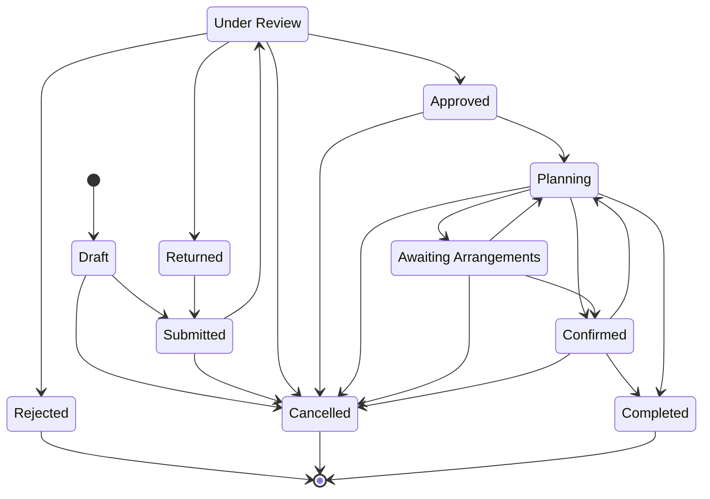

# Event

The plannable record of a confirmed-or-confirmable occasion at [[connectsphere-event-services]], created when an [[event-request]] is approved. Carries the requirements, arrangements, assignments and status that the rest of the system (session, booking, equipment-reservation, registration) attaches to. Process detail lives in [[event-request-workflow]], [[event-lifecycle]], [[event-readiness]] and [[change-impact-management]]; this page is the structural reference.

## Attributes

| Field                                | Meaning                                                                                                                                          | Status           | Ref                |
| ------------------------------------ | ------------------------------------------------------------------------------------------------------------------------------------------------ | ---------------- | ------------------ |
| Name                                 | Event title                                                                                                                                      | ✅ Specified      | [[event-planning-venue-booking-system\|brief §4]]           |
| Description                          | Free-text description                                                                                                                            | ✅ Specified      | [[event-planning-venue-booking-system\|brief §4]]           |
| Purpose                              | Why the event is being held                                                                                                                      | ✅ Specified      | [[connectsphere-event-services\|brief §2]]           |
| Category / type                      | Conference, workshop, training session, exhibition, meeting, seminar, networking event, or another ConnectSphere-defined type                    | ✅ Specified      | [[event-planning-venue-booking-system\|brief §4]]           |
| Preferred date & time                | Date/time as originally requested; may diverge from what is ultimately arranged                                                                  | ✅ Specified      | [[connectsphere-event-services\|brief §2]]           |
| Start time / end time                | Event timing                                                                                                                                     | ✅ Specified      | [[event-planning-venue-booking-system\|brief §4]]           |
| Expected attendance                  | Organiser's stated attendance estimate                                                                                                           | ✅ Specified      | [[connectsphere-event-services\|brief §2]]           |
| Event capacity                       | Capacity ceiling used to gate registration                                                                                                       | ✅ Specified      | [[event-planning-venue-booking-system\|brief §4]]           |
| Programme / agenda                   | Sessions, breaks, presentations, scheduled activities                                                                                            | ✅ Specified      | [[event-planning-venue-booking-system\|brief §4]]           |
| Room-layout preference               | Classroom, theatre, boardroom, banquet, exhibition, other                                                                                        | ✅ Specified      | [[event-planning-venue-booking-system\|brief §4]]           |
| Accessibility requirements           | Organiser-stated accessibility needs                                                                                                             | ✅ Specified      | [[connectsphere-event-services\|brief §2]]           |
| Equipment requirements               | Organiser-stated equipment needs                                                                                                                 | ✅ Specified      | [[connectsphere-event-services\|brief §2]]           |
| Registration-enabled flag            | Whether Attendees may register for this event                                                                                                    | ⚠️ Partial       | [[event-planning-venue-booking-system\|brief §4]]           |
| Special arrangements                 | Any other planning need not otherwise captured                                                                                                   | ✅ Specified      | [[connectsphere-event-services\|brief §2]]           |
| Venue requirements                   | Capacity, layout, accessibility, facilities the venue must satisfy                                                                               | ✅ Specified      | [[event-planning-venue-booking-system\|brief §4]]           |
| Technical-support flag + description | Whether the event needs technical support, and what is required                                                                                  | ✅ Specified      | [[event-planning-venue-booking-system\|brief §4]]           |
| Assigned Event Coordinator           | The [[user-account]] acting as main internal point of contact                                                                                    | ✅ Specified      | [[event-planning-venue-booking-system\|brief §4]]           |
| Owning Event Organiser               | The [[user-account]] responsible for the event on the client side                                                                                | ✅ Specified      | [[connectsphere-event-services\|brief §2]]           |
| Client organisation                  | The [[client-organisation]] the Event Organiser represents                                                                                       | ✅ Specified      | [[event-planning-venue-booking-system\|brief §4]]           |
| Status                               | Current lifecycle stage — see States below                                                                                                       | ✅ Specified      | [[event-planning-venue-booking-system\|brief §4]]           |
| Registration open / close dates      | Registration period, separate from the event date, set by the Event Coordinator                                                                  | ✅ Specified      | [#30](https://github.com/SinYang13/IS212-2026/discussions/30)                |
| Essential-arrangement set            | Which arrangements (venue, equipment, technical support, programme, registration, etc.) are required for *this* event before it can be confirmed | 🔶 Team decision | [#80](https://github.com/SinYang13/IS212-2026/discussions/80)                |
| Reused-from / template source        | Reference to a previous event this one was seeded from, when created via reuse                                                                   | ⚠️ Partial       | [#75](https://github.com/SinYang13/IS212-2026/discussions/75)                |
| Comments                             | Thread of comments, questions and updates retained with the event record                                                                         | ✅ Specified      | [[event-planning-venue-booking-system\|brief §4]]           |
| Supporting documents                 | Attached files (programmes, floor plans, presentation requirements, other materials)                                                             | ✅ Specified      | [[event-planning-venue-booking-system\|brief §4]]           |
| Outstanding actions                  | Planning matters incomplete or requiring action before confirmation/delivery                                                                     | ✅ Specified      | [[event-planning-venue-booking-system\|brief §4]]           |
| Operational notes                    | Notes recorded at/after completion                                                                                                               | ✅ Specified      | [[event-request-workflow\|brief §5]] (step 14) |
| Decision record                      | Retained record of an approve/reject/return decision                                                                                             | ✅ Specified      | [[event-request-workflow\|brief §5]] (step 5)  |

> [!info] No versioning on supporting documents
> Documents are not legal documents, so the system does not need to keep versions ([#21](https://github.com/SinYang13/IS212-2026/discussions/21)).

The comment-thread model (threaded vs flat) and document size/type limits are UI/UX and constraint decisions the customer left open — see Open modelling questions.

## States

Cancellation is reachable from every non-terminal state, reflecting that only the assigned Event Coordinator may cancel "at any stage" ([#68](https://github.com/SinYang13/IS212-2026/discussions/68)). The `Confirmed → Planning` edge represents a major post-confirmation change and is not customer-confirmed as a formal transition — see Open modelling questions.

| State | Meaning | Entry / exit rule | Ref |
|---|---|---|---|
| Draft | Request saved before submission; incomplete information may be completed later | Entry: Organiser creates. Exit: submit | [[event-planning-venue-booking-system\|brief §4]] |
| Submitted | Sent to ConnectSphere, awaiting coordinator assignment | Entry: Organiser submits. Exit: coordinator reviews | [[event-request-workflow\|brief §5]] |
| Under review | Assigned Event Coordinator reviewing; clarification may be requested | Entry: review begins. Exit: approve / reject / return | [[event-request-workflow\|brief §5]] |
| Approved | Sufficient information exists for planning to proceed; commits ConnectSphere to nothing | Entry: Coordinator approves. Exit: planning begins | [#80](https://github.com/SinYang13/IS212-2026/discussions/80) |
| Planning | Venue, equipment, technical support and programme work in progress | Entry: from Approved. Exit: essential arrangements complete, or event cancelled | [[event-planning-venue-booking-system\|brief §4]] |
| Awaiting arrangements | One or more essential arrangements for this event remain incomplete | Entry: an essential arrangement is identified and not yet done. Exit: arrangement completed | [#80](https://github.com/SinYang13/IS212-2026/discussions/80) |
| Confirmed | Every arrangement essential to this event is complete; arrangements visible to the Event Organiser | Entry: Coordinator confirms — **blocked** while any essential arrangement is incomplete. Exit: completion, cancellation, or (🔶) return to Planning on major change | [#80](https://github.com/SinYang13/IS212-2026/discussions/80) |
| Completed | Event has taken place and been closed | Entry: Coordinator marks complete, or system **may** automatically mark it completed 7 days after end date if still open | [#71](https://github.com/SinYang13/IS212-2026/discussions/71) |
| Cancelled | Event will not proceed | Entry: assigned Event Coordinator only, at any stage. Terminal | [#68](https://github.com/SinYang13/IS212-2026/discussions/68) |
| Rejected | Request declined at review; decision record retained | Entry: Coordinator rejects. Terminal, unless resubmission is permitted (🔶) | [[event-request-workflow\|brief §5]] |
| Returned | Sent back to the Event Organiser for amendment or clarification | Entry: Coordinator requests amendment. Exit: Organiser resubmits | [[event-request-workflow\|brief §5]] |

> [!warning] No Postponed status
> There is no separate *postponed* state. Postponement with a new date/time is treated as a reschedule and routed through the ordinary change-impact process; postponement with no known date releases the current venue/equipment bookings but retains the event record until a new date is provided ([#69](https://github.com/SinYang13/IS212-2026/discussions/69)).

## Relationships

| Related object | Cardinality | Rule | Ref |
|---|---|---|---|
| [[event-request]] | 1 : 0..1 | An approved Event Request converts into a plannable Event; modelled as separate records because approval commits ConnectSphere to nothing | [#80](https://github.com/SinYang13/IS212-2026/discussions/80) |
| [[session]] | 1 : many | Multi-session events decompose into sessions, each with its own venue, equipment requirements, timing and attendance limit | [#74](https://github.com/SinYang13/IS212-2026/discussions/74) |
| [[booking]] | 1 : 0..many | Venue booking is requested for the event (directly, or per session for multi-session events — see [[session]]) | [[event-planning-venue-booking-system\|brief §4]] |
| [[equipment-reservation]] | 1 : many | Equipment reserved against the event's (or a session's) equipment requirements | [[event-planning-venue-booking-system\|brief §4]] |
| [[support-request]] | 1 : 0..many | Technical support requested and tracked against the event | [[event-planning-venue-booking-system\|brief §4]] |
| [[registration]] | 1 : many | Attendee registrations, when registration is enabled for the event | [[event-planning-venue-booking-system\|brief §4]] |
| [[change-request]] | 1 : many | Organiser-requested changes filed against the event | [[event-planning-venue-booking-system\|brief §4]], [#4](https://github.com/SinYang13/IS212-2026/discussions/4) |
| [[client-organisation]] | many : 1 | The client organisation the owning Event Organiser belongs to | [[event-planning-venue-booking-system\|brief §4]] |
| [[user-account]] | many : 1 (×2) | Assigned Event Coordinator and owning Event Organiser are both user accounts | [[connectsphere-event-services\|brief §2]] |
| [[audit-record]] | 1 : many | Activity-history and change-history entries for the event | [[non-functional-requirements\|brief §8f]] |

## Binding rules

- Approval commits ConnectSphere to nothing — it is not confirmation ([#80](https://github.com/SinYang13/IS212-2026/discussions/80)).
- Confirmation is **blocked** while any arrangement essential to this event is incomplete ([#80](https://github.com/SinYang13/IS212-2026/discussions/80)).
- Confirmation is **allowed** with non-essential items still outstanding ([#80](https://github.com/SinYang13/IS212-2026/discussions/80)).
- The essential-arrangement set is determined **per event** — there is no single fixed list that applies to every event ([#80](https://github.com/SinYang13/IS212-2026/discussions/80)).
- Only the assigned Event Coordinator may cancel the event, and may do so at any stage ([#68](https://github.com/SinYang13/IS212-2026/discussions/68)).
- If not closed manually, the system **may** automatically mark the event completed 7 days after its end date — this is a discretionary system behaviour, not a hard rule ([#71](https://github.com/SinYang13/IS212-2026/discussions/71)).
- There is no Postponed status: postponement with a new date is a reschedule; postponement without one releases bookings and retains the event record ([#69](https://github.com/SinYang13/IS212-2026/discussions/69)).
- All event times are Singapore time only — ConnectSphere's venues are all in Singapore ([#36](https://github.com/SinYang13/IS212-2026/discussions/36)).
- There is no change cut-off period before the event date; changes remain possible up to delivery ([#8](https://github.com/SinYang13/IS212-2026/discussions/8)).
- Supporting documents are not versioned, as they are not legal documents ([#21](https://github.com/SinYang13/IS212-2026/discussions/21)).

## Open modelling questions

> [!question]- Team decision required — formal Confirmed → Planning transition
> Whether a major post-confirmation change moves the event back to a formal `Planning` (or `Awaiting arrangements`) state, or is represented some other way (e.g. a "pending revalidation" flag while the event stays `Confirmed`), is unspecified. The customer confirmed only that arrangements "may require... to be reviewed again," and left the transition design to the team ([#70](https://github.com/SinYang13/IS212-2026/discussions/70)).

> [!question]- Team decision required — fields copied on event reuse
> When a new event is created by reusing a previous or recurring event, which fields are copied is left to the team; the only constraint is that the new event must still be able to have different dates and requirements ([#75](https://github.com/SinYang13/IS212-2026/discussions/75)).

> [!question]- Team decision required — resubmission after rejection
> Whether a `Rejected` event can be resubmitted, or whether rejection is terminal, was left to the team ("Please propose an appropriate approach if needed") ([#67](https://github.com/SinYang13/IS212-2026/discussions/67)).

> [!question]- Team decision required — comment threading model
> Whether comments are threaded (reply-to-comment) or flat (chronological) is a UI/UX decision; the only fixed requirement is that comments, questions and updates are retained with the event record ([#15](https://github.com/SinYang13/IS212-2026/discussions/15)).

> [!question]- Team decision required — supporting document size/type limits
> No document size or file-type limit is specified; the team should propose constraints if the solution requires them ([#18](https://github.com/SinYang13/IS212-2026/discussions/18)).

See [[domain-model]] for the full object catalogue.
