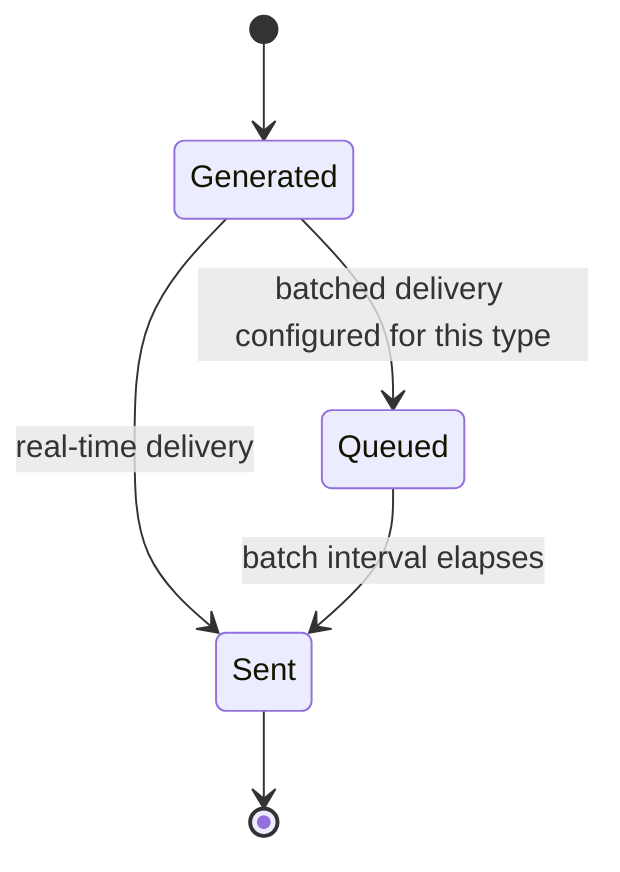

# Notification

A message sent to a user when something relevant to them changes: either **event-driven** (fired by one of fourteen named trigger scenarios, [[notifications|brief §6]]) or **time-driven** (a Reminder, [[event-planning-venue-booking-system|brief §4]] — see below). Delivered in-app and/or by email, with channel and delivery timing configurable per notification type. Process detail and the evolution of the channel/timing answers live in [[notifications]] (the concept-level narrative — not to be confused with this page, the structural reference for the object itself).

**Release 1 scope** ([[release-1-scope]]): the event-driven Notification object described here — trigger scenarios, channels, delivery timing — is 🎯 Release 1, core feature 20. The Reminders (time-driven) section below is `📋 Backlog` — not named in the core 20; the confirmed incomplete-arrangements reminder ([#47](https://github.com/SinYang13/IS212-2026/discussions/47)) remains a documented requirement, not a built one, in Release 1.

## Attributes

| Field            | Meaning                                                                                                                                                     | Status      | Ref                         |
| ---------------- | ----------------------------------------------------------------------------------------------------------------------------------------------------------- | ----------- | --------------------------- |
| Trigger scenario | Which of the fourteen §6 scenarios (or which reminder condition) generated the notification                                                                 | ✅ Specified | [[notifications\|brief §6]] |
| Recipient        | The [[user-account]] the notification is addressed to                                                                                                       | ⚠️ Partial  | [[notifications\|brief §6]] |
| Channel          | In-app, email, or both                                                                                                                                      | ✅ Specified | [#37](https://github.com/SinYang13/IS212-2026/discussions/37)                         |
| Related object   | The [[event]] (or the [[event-request]], [[booking]], [[equipment-reservation]], [[registration]], [[change-request]] beneath it) the notification concerns | ✅ Specified | [[notifications\|brief §6]] |
| Message content  | Description of what changed, generated per trigger scenario                                                                                                 | ⚠️ Partial  | [[notifications\|brief §6]] |
| Delivery timing  | Real-time or batched at a configurable interval; no hard delivery-time SLA either way                                                                       | ✅ Specified | [#55](https://github.com/SinYang13/IS212-2026/discussions/55)                         |

Recipient is marked ⚠️ Partial: §6 names situations that "may generate a notification" but never names *who* receives each one — see Trigger scenarios, below, and Open modelling questions. Message content is likewise ⚠️ Partial: the brief establishes that a notification exists per scenario, not its wording or template.

## Trigger scenarios

The brief's full list of situations that "may generate a notification" ([[notifications|brief §6]]) — illustrative examples, not stated to be exhaustive. All fourteen, in source order:

| # | Trigger ([[notifications\|brief §6]]) | Likely audience | Ref |
|---|---|---|---|
| 1 | A new event request is submitted | Internal staff responsible for coordinator assignment; the assigned Event Coordinator once assigned | [[notifications\|brief §6]] |
| 2 | An Event Coordinator is assigned | Assigned Event Coordinator; Event Organiser | [[notifications\|brief §6]] |
| 3 | Additional information or amendment is requested | Event Organiser | [[notifications\|brief §6]] |
| 4 | An event request is approved, rejected, or returned | Event Organiser | [[notifications\|brief §6]] |
| 5 | A venue booking is requested, approved, rejected, or changed | Venue Staff; Event Coordinator | [[notifications\|brief §6]] |
| 6 | Requested equipment is confirmed or found to be unavailable | Event Coordinator | [[notifications\|brief §6]] |
| 7 | An event becomes confirmed | Event Organiser; assigned Event Coordinator | [[notifications\|brief §6]] |
| 8 | The Event Organiser requests a significant change | Event Coordinator | [[notifications\|brief §6]] |
| 9 | An event is rescheduled, postponed, or cancelled | Event Organiser; Event Coordinator; registered Attendees, where applicable | [[notifications\|brief §6]] |
| 10 | Registration opens or closes | Attendees; Event Organiser | [[notifications\|brief §6]] |
| 11 | Registration reaches capacity or a waiting-list status changes | Attendees, incl. waitlisted; Event Coordinator | [[notifications\|brief §6]] |
| 12 | A registered Attendee withdraws where that affects availability | Event Coordinator; next waitlisted Attendee | [[notifications\|brief §6]] |
| 13 | An upcoming event still has incomplete arrangements | Assigned Event Coordinator | [[notifications\|brief §6]]; [#47](https://github.com/SinYang13/IS212-2026/discussions/47) |
| 14 | A venue or equipment availability change affects an upcoming event | Assigned Event Coordinator | [[notifications\|brief §6]]; [#54](https://github.com/SinYang13/IS212-2026/discussions/54) |

> [!info] Audience column is this wiki's inference, not customer text
> Brief §6 names the trigger only, in every one of the fourteen rows. No recipient matrix is given. The "Likely audience" values above are inferred from the role responsibilities described in [[connectsphere-event-services|brief §2]], §3 and §5 (e.g. the Event Coordinator is "the main internal point of contact," Venue Staff review booking requests) — they are a structural proposal, not a specified data model. See Open modelling questions.

Rows 13 and 14 carry a second citation because they are also separately confirmed in Q&A, not only listed in §6: [#47](https://github.com/SinYang13/IS212-2026/discussions/47) confirms incomplete-arrangement reminders exist (see Reminders, below — note row 13 in §6 is the *notification* framing of the same underlying condition that [#47](https://github.com/SinYang13/IS212-2026/discussions/47)'s *reminder* answers), and [#54](https://github.com/SinYang13/IS212-2026/discussions/54) confirms that a venue availability change affecting an upcoming event "is a notification scenario," with the Event Coordinator responsible for acting on it.

## Reminders (time-driven)

Distinct from the event-driven notifications above: the brief's Reminder System feature is that the system "may remind relevant users about upcoming events, incomplete arrangements, registration deadlines, preparation activities, or other time-sensitive matters" ([[event-planning-venue-booking-system|brief §4]]).

| Reminder type | Confirmed | Frequency / lead time | Ref |
|---|---|---|---|
| Incomplete arrangements / pending approval (nags the Coordinator) | ✅ Specified — required. "Yes, reminders for incomplete arrangements." | Batched, configurable frequency | [#47](https://github.com/SinYang13/IS212-2026/discussions/47) |
| Upcoming events | ✅ Specified as a candidate reminder category | Not separately confirmed | [[event-planning-venue-booking-system\|brief §4]] |
| Registration deadlines | ✅ Specified as a candidate reminder category | Not separately confirmed | [[event-planning-venue-booking-system\|brief §4]] |
| Preparation activities | ✅ Specified as a candidate reminder category | Not separately confirmed | [[event-planning-venue-booking-system\|brief §4]] |
| Lead time (how far in advance / how often reminders fire) | 🔶 Team decision — "The timing and configurability are for you to propose." | N/A | [#40](https://github.com/SinYang13/IS212-2026/discussions/40) |

Of the four reminder categories [[event-planning-venue-booking-system|brief §4]] lists, only the incomplete-arrangements variant received a direct Q&A confirmation ([#47](https://github.com/SinYang13/IS212-2026/discussions/47), "Yes... The frequency would be by batch and should also be configurable"); the other three are stated in the brief's feature description without a corresponding Q&A answer confirming scope or behaviour.

## States

Neither source specifies a notification/reminder status field. Given delivery timing is itself either real-time or batched ([#55](https://github.com/SinYang13/IS212-2026/discussions/55)), a minimal lifecycle is structurally implied by that requirement rather than customer-specified — this diagram is this wiki's structural proposal, not a confirmed state machine:

| State | Meaning | Entry / exit rule | Ref |
|---|---|---|---|
| Generated | A trigger scenario (event-driven) or reminder condition (time-driven) has fired | Entry: one of the fourteen §6 scenarios, or a reminder condition above | [[notifications\|brief §6]] |
| Queued | Held pending the next configurable batch interval | Entry: batched delivery is configured for this notification type. Exit: interval elapses | [#55](https://github.com/SinYang13/IS212-2026/discussions/55) |
| Sent | Delivered to the recipient via in-app and/or email | Entry: immediate (real-time path), or batch interval elapsed | [#55](https://github.com/SinYang13/IS212-2026/discussions/55); [#37](https://github.com/SinYang13/IS212-2026/discussions/37) |

Whether a sent notification is further tracked as read/unread, acknowledged, or dismissed is not addressed by either source and is not modelled here.

## Relationships

| Related object | Cardinality | Rule | Ref |
|---|---|---|---|
| [[user-account]] | many : 1 | Every notification is addressed to a recipient account | [[notifications\|brief §6]] |
| [[event]] | many : 0..1 | Most triggers concern a specific event, directly or via a related record beneath it | [[notifications\|brief §6]] |
| [[event-request]] | many : 0..1 | Submission, assignment, amendment-request, and approve/reject/return triggers | [[notifications\|brief §6]] |
| [[booking]] | many : 0..1 | Venue booking requested/approved/rejected/changed trigger | [[notifications\|brief §6]] |
| [[equipment-reservation]] | many : 0..1 | Equipment confirmed/unavailable trigger | [[notifications\|brief §6]] |
| [[registration]] | many : 0..1 | Registration opens/closes, capacity/waiting-list, and withdrawal triggers | [[notifications\|brief §6]] |
| [[change-request]] | many : 0..1 | Significant-change-requested trigger | [[notifications\|brief §6]] |

## Binding rules

- Both **in-app and email** channels are supported, configurable **per notification type** — not per user and not mass-configured across all types ([#37](https://github.com/SinYang13/IS212-2026/discussions/37)).
- Delivery is **batch**: notifications need not be delivered in real time, may be grouped and sent at a configurable interval, and real-time delivery is also acceptable if technically simpler. The underlying requirement is that **there is no hard delivery-time SLA** — this is a floor requirement (either implementation satisfies it), not a mandate to build a queueing system ([#55](https://github.com/SinYang13/IS212-2026/discussions/55)).
- Reminders for incomplete arrangements and pending approvals are required, batched, and configurable in frequency ([#47](https://github.com/SinYang13/IS212-2026/discussions/47)).
- A venue or equipment availability change affecting an upcoming event is itself a notification scenario, not merely an internal record update ([#54](https://github.com/SinYang13/IS212-2026/discussions/54); [[notifications|brief §6]]).
- Email is a **notification-channel requirement**, not a general system-integration requirement: "No integration with existing external applications or services is required for the current scope. However, the notification requirements may include sending email notifications. This should be treated as a notification-channel requirement rather than a general integration requirement." ([#79](https://github.com/SinYang13/IS212-2026/discussions/79), point 3).
- 🔶 Reminder lead time and its configurability model are left to the team to propose ([#40](https://github.com/SinYang13/IS212-2026/discussions/40)).

## Open modelling questions

> [!question]- Team decision required — recipient matrix per trigger scenario
> Which role(s) receive each of the fourteen §6 trigger scenarios, and whether recipients are derived automatically from relationship to the event or configured separately. §6 lists triggers only; no recipient matrix is given.

> [!question]- Team decision required — per-user vs per-type channel preference
> [#37](https://github.com/SinYang13/IS212-2026/discussions/37) fixes channel configurability at the notification-**type** level. The brief separately lists "communication preferences" as user-profile data ([[event-planning-venue-booking-system|brief §4]]). Whether and how a per-user preference interacts with, or overrides, the per-type configuration is not reconciled by either source.

> [!question]- Team decision required — reminder lead time and configurability
> How far in advance and how often reminders fire, and the configuration surface for that timing, are left to the team: "The timing and configurability are for you to propose." ([#40](https://github.com/SinYang13/IS212-2026/discussions/40)).

> [!question]- Team decision required — availability-change automation mechanism
> The mechanism linking a venue or equipment availability change to the affected upcoming event(s) — how affected events are detected, and whether anything beyond raising the notification happens automatically — is left to the team to propose "if required" ([#54](https://github.com/SinYang13/IS212-2026/discussions/54)).

See [[domain-model]] for the full object catalogue.
