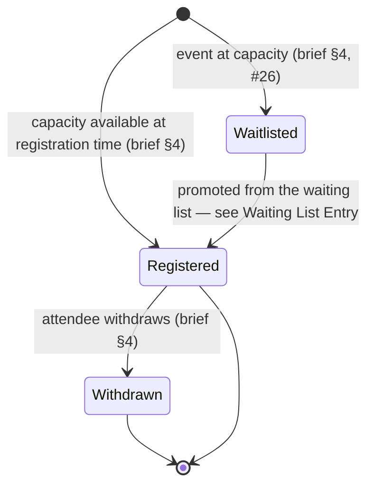

# Registration

The record of a [[user-account]] (Attendee)'s registration for a confirmed [[event]] with registration enabled. Carries a Waiting List Entry when the event is at capacity. Registration is conceptually distinguishable from the Attendance information recorded at check-in, though whether that means a separate record or a field on this one is open — see Attendance / check-in. Process detail lives in [[attendee-registration]]; this page is the structural reference.

## Attributes

| Field | Meaning | Status | Ref |
|---|---|---|---|
| Attendee | The [[user-account]] who registered | ✅ Specified | [[event-planning-venue-booking-system\|brief §4]] |
| Event | The [[event]] registered for | ✅ Specified | [[event-planning-venue-booking-system\|brief §4]] |
| Status | Registered / waitlisted / withdrawn — see States | ✅ Specified | [[event-planning-venue-booking-system\|brief §4]] |
| Waiting-list position | Position in the FIFO queue, while waitlisted | ✅ Specified | [#26](https://github.com/SinYang13/IS212-2026/discussions/26) |
| Attendance flag | Whether the Attendee ultimately attended; [[event-planning-venue-booking-system\|brief §4]] requires this be distinguishable from registration status, though whether it is a field here or on a separate record is open — see Attendance / check-in | ✅ Specified | [[event-planning-venue-booking-system\|brief §4]] |
| Registration period (open / close) | Not owned by the Registration record — set on the Event by the Event Coordinator, separate from the event dates | ✅ Specified | [#30](https://github.com/SinYang13/IS212-2026/discussions/30) |
| Event capacity / attendance limit | Not owned by the Registration record — the cap on the Event (or session, for multi-session events) that gates how many registrations may hold "registered" status | ✅ Specified | [[event-planning-venue-booking-system\|brief §4]]; [#74](https://github.com/SinYang13/IS212-2026/discussions/74) |
| Registration information fields | What an Attendee must supply when registering (name, dietary needs, accessibility, etc.) | 🔶 Team decision | [#22](https://github.com/SinYang13/IS212-2026/discussions/22) |

A record-creation timestamp is not named as a field by either source; it is a structural necessity common to any record type (e.g. for FIFO ordering, auditability), not a customer-specified attribute, and is omitted from the table above on that basis.

## States

### Registration status

| State | Meaning | Entry / exit rule | Ref |
|---|---|---|---|
| Registered | Holds a confirmed place | Entry: registers while capacity remains, or promoted from the waiting list. Exit: withdraws | [[event-planning-venue-booking-system\|brief §4]]; [#26](https://github.com/SinYang13/IS212-2026/discussions/26) |
| Waitlisted | Queued because the event was at capacity at registration time | Entry: registers while event full. Exit: promoted to Registered (see Waiting List Entry) | [[event-planning-venue-booking-system\|brief §4]]; [#26](https://github.com/SinYang13/IS212-2026/discussions/26) |
| Withdrawn | Attendee released their place | Entry: attendee withdraws "where permitted." Terminal | [[event-planning-venue-booking-system\|brief §4]] |

Whether a Waitlisted registration can be withdrawn directly (removing it from the queue before a spot is offered) is not stated by either source and is left to the team (🔶 [[event-planning-venue-booking-system|brief §4]]).

### Waiting List Entry

```mermaid
stateDiagram-v2
    [*] --> Waiting
    Waiting --> Offered : a spot opens; FIFO order, subject to manual override (#26)
    Offered --> Accepted : attendee accepts within the 3-day window (#44)
    Offered --> Expired : 3-day window lapses without acceptance (#44)
    Accepted --> [*]
    Expired --> [*]
```

| State | Meaning | Entry / exit rule | Ref |
|---|---|---|---|
| Waiting | In the FIFO queue for this event | Entry: registers while event full. Exit: offered a spot | [[event-planning-venue-booking-system\|brief §4]]; [#26](https://github.com/SinYang13/IS212-2026/discussions/26) |
| Offered | A freed spot has been offered to this entry | Entry: FIFO turn is reached, or a manual override selects this entry ahead of the queue. Exit: accepted, or the 3-day window lapses | [#26](https://github.com/SinYang13/IS212-2026/discussions/26); [#44](https://github.com/SinYang13/IS212-2026/discussions/44) |
| Accepted | Attendee accepted within the acceptance window; the entry converts to a Registered registration | Entry: attendee accepts. Terminal for the entry | [#44](https://github.com/SinYang13/IS212-2026/discussions/44) |
| Expired | 3-day acceptance window lapsed without a response | Entry: window lapses. Terminal for the entry | [#44](https://github.com/SinYang13/IS212-2026/discussions/44) |

Promotion order is FIFO with manual override permitted ([#26](https://github.com/SinYang13/IS212-2026/discussions/26)); the acceptance window is a fixed **3 days** ([#44](https://github.com/SinYang13/IS212-2026/discussions/44)). What happens to the freed spot once an offer expires — whether it passes automatically to the next queued entry, returns this entry to the back of the queue, or is removed outright — is not specified by either source (🔶 [#44](https://github.com/SinYang13/IS212-2026/discussions/44)).

### Attendance / check-in

Attendance information is conceptually distinguishable from Registration status ([[event-planning-venue-booking-system|brief §4]]: "allowing registration and attendance information to be distinguished"). Whether it is modelled as a field on this record or as a fully separate linked record is not specified by either source — see below.

| State | Meaning | Entry rule | Ref |
|---|---|---|---|
| Not checked in | No attendance record yet exists for this registration | Default, from event start | [[event-planning-venue-booking-system\|brief §4]]; [#38](https://github.com/SinYang13/IS212-2026/discussions/38) |
| Checked in | Attendee has been checked in on-site | Entry: manual check-in at the counter, by QR-code scan or by staff — **not** self-reported and **not** auto-marked | [#38](https://github.com/SinYang13/IS212-2026/discussions/38) |

Whether attendance is modelled as a field on the Registration record or as a fully separate linked object is not specified by either source; both are consistent with "registration and attendance information to be distinguished" ([[event-planning-venue-booking-system|brief §4]]) — 🔶 team decision.

## Relationships

| Related object | Cardinality | Rule | Ref |
|---|---|---|---|
| [[user-account]] | many : 1 | Each registration belongs to exactly one Attendee account; an Attendee account may hold many registrations, with no stated limit | [[event-planning-venue-booking-system\|brief §4]]; [#48](https://github.com/SinYang13/IS212-2026/discussions/48) |
| [[event]] | many : 1 | Each registration is for exactly one event; an event has many registrations, when registration is enabled | [[event-planning-venue-booking-system\|brief §4]] |
| [[session]] | many : 1 (0..1) | Multi-session events may set a different attendance limit per session; whether a Registration attaches to the event as a whole or to a specific session is not specified | [#74](https://github.com/SinYang13/IS212-2026/discussions/74) |
| [[user-account]] (Event Coordinator) | many : 1 | Attendees who do not self-register (e.g. VIPs) are supplied as a list to the Event Coordinator for processing, rather than added directly by the Event Organiser | [#33](https://github.com/SinYang13/IS212-2026/discussions/33) |

## Binding rules

- Registration is available only for a **confirmed** event with registration enabled ([[event-planning-venue-booking-system|brief §4]], §5 step 11).
- The registration period (open/close dates) is set by the Event Coordinator and is separate from the event dates ([#30](https://github.com/SinYang13/IS212-2026/discussions/30)).
- The registration period may be extended after closing ([#42](https://github.com/SinYang13/IS212-2026/discussions/42)'s answer: "We will allow the extension of the registration period"). ⚠️ Partial: the question also asked about re-opening after a full close, but the answer confirms only extension — whether a fully closed period can be reopened outright is not addressed ([#42](https://github.com/SinYang13/IS212-2026/discussions/42)).
- No limit is specified on how many events one Attendee may register for; the customer invites a proposal only if the solution requires one ([#48](https://github.com/SinYang13/IS212-2026/discussions/48)).
- For attendees who do not self-register (e.g. VIPs), the attendee list must be provided to the Event Coordinator for processing — the Event Organiser cannot add them directly ([#33](https://github.com/SinYang13/IS212-2026/discussions/33)).
- Waiting-list promotion is FIFO with manual override ([#26](https://github.com/SinYang13/IS212-2026/discussions/26)); the acceptance window is a fixed 3 days ([#44](https://github.com/SinYang13/IS212-2026/discussions/44)).
- Attendance is manual check-in at the counter, by QR-code scan or by staff — not self-reported and not auto-marked ([#38](https://github.com/SinYang13/IS212-2026/discussions/38)).
- Registration status and attendance information must be kept distinguishable ([[event-planning-venue-booking-system|brief §4]]); whether that is implemented as separate records or as fields on one record is left to the team — see Open modelling questions.

## Open modelling questions

> [!question]- Team decision required — registration information fields
> What information an Attendee must supply when registering. Asked directly — "Name only? Dietary needs? Accessibility requirements?" — and returned in full: "Please propose an appropriate set of information based on the event needs" ([#22](https://github.com/SinYang13/IS212-2026/discussions/22)).

> [!question]- Team decision required — waiting-list offer expiry
> What happens to a Waiting List Entry's freed spot once its 3-day acceptance window lapses without a response: automatic pass to the next queued entry, return of this entry to the back of the queue, or removal ([#44](https://github.com/SinYang13/IS212-2026/discussions/44)).

> [!question]- Team decision required — attendance as a field vs a separate record
> Whether attendance is a field on the Registration record or a fully separate linked Attendance record. Both readings are consistent with the customer's statement that registration and attendance information should be distinguishable ([[event-planning-venue-booking-system|brief §4]]); neither source specifies the data model.

> [!question]- Team decision required — registration scope for multi-session events
> Whether a Registration is scoped to the event as a whole or to an individual session, given that sessions may carry their own attendance limits ([#74](https://github.com/SinYang13/IS212-2026/discussions/74)).

See [[domain-model]] for the full object catalogue.
