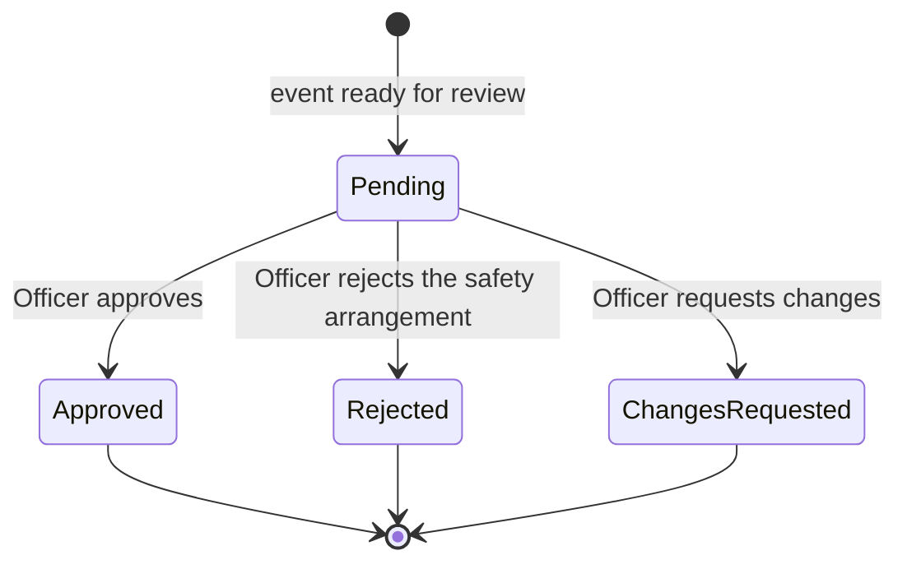

# Safety Check

One **review round** by a Safety Officer on one [[event]]: the record of an Operational Safety Check and its outcome. An event may have several rounds, because a rejected or change-requested event returns to planning and is reviewed again ([[week-7-customer-changes|Week 7 C6]]). This page is the **record**; the **process** it belongs to is [[operational-safety-check]].

> [!info] Proposed, not deployed
> No `safety_check` table exists in the deployed [[schema]]. The structure below is the team's proposal in [[week-7-change-impact-review]] (migration 03, **not applied**). The customer stated that a check happens, who does it, its factors and its outcomes. Every other field or constraint here is a team reading and is marked 🔶.

**Release 1 scope** ([[release-1-scope]]): 🎯 Release 1, made mandatory by [[week-7-customer-changes|Week 7 C6]]. The customer describes it as "a new role and requirement due to regulation" ([#128](https://github.com/SinYang13/IS212-2026/discussions/128)), so the check is regulation-driven; it is one of the "26 core".

## Attributes

`Scope` is the Release 1 marker from [[release-1-scope]].

| Field | Meaning | Status | Scope | Ref |
|---|---|---|---|---|
| Event | The [[event]] under review | ✅ Specified | 🎯 Release 1 | [[week-7-customer-changes\|Week 7 C6]] |
| Outcome | `Pending`, `Approved`, `Rejected` or `Changes Requested`. The customer states three Officer responses: approve, reject the safety arrangement, or request changes. `Pending` (not yet answered) is the team's addition. How a reject differs from a change request is unstated (Q5) | ⚠️ Partial | 🎯 Release 1 | [[week-7-customer-changes\|Week 7 C6]] |
| Decided by | The [[user-account]] holding the Safety Officer role who recorded the outcome; empty while `Pending`. The notice says the Officer "will always give a response", so no timeout or escalation path is modelled | ✅ Specified | 🎯 Release 1 | [[week-7-customer-changes\|Week 7 C6]] |
| Requested at | When the event became ready for review and the round opened | 🔶 Team decision | 🎯 Release 1 | [[week-7-customer-changes\|Week 7 C6]]; [#96](https://github.com/SinYang13/IS212-2026/discussions/96) |
| Decided at | When the Officer answered; empty exactly while `Pending` | 🔶 Team decision | 🎯 Release 1 | [[week-7-customer-changes\|Week 7 C6]]; [#96](https://github.com/SinYang13/IS212-2026/discussions/96) |
| Affected arrangements | For `Rejected` or `Changes Requested`: which venue or technical arrangements must be reviewed again. The notice says affected arrangements "may need to be reviewed again" but not how they are named. Free text in the proposal; a link to a [[booking]] or [[equipment-reservation]] is an alternative | ⚠️ Partial | 🎯 Release 1 | [[week-7-customer-changes\|Week 7 C6]] |
| Notes | The Officer's reasoning. Emergency access and crowd movement have no data in the model, so the proposal holds them as judgement recorded here | 🔶 Team decision | 🎯 Release 1 | [[week-7-customer-changes\|Week 7 C6]]; [#96](https://github.com/SinYang13/IS212-2026/discussions/96) |
| Factors considered | Expected attendance, venue capacity and layout, emergency access, accessibility requirements, equipment placement, crowd movement and known venue restrictions. **Not stored on this record**: they are read from the [[event]], [[venue]] and [[equipment-reservation]], or recorded in Notes. The list is "such as", so not closed | ✅ Specified | 🎯 Release 1 | [[week-7-customer-changes\|Week 7 C6]] |
| One round per review, history kept | A new row per round; earlier rounds stay readable. The customer implies repeat review ("reviewed again") but not how it is kept | 🔶 Team decision | 🎯 Release 1 | [[week-7-customer-changes\|Week 7 C6]]; [#96](https://github.com/SinYang13/IS212-2026/discussions/96) |
| At most one `Pending` per event | A second open round on the same event is refused (a partial unique index in the proposal) | 🔶 Team decision | 🎯 Release 1 | [[week-7-customer-changes\|Week 7 C6]]; [#98](https://github.com/SinYang13/IS212-2026/discussions/98) |
| Gate rule | The event cannot proceed to preparation, and so cannot be confirmed, until the Officer has approved it. The proposal reads this as "the event's **latest** check is `Approved`" | ✅ Specified | 🎯 Release 1 | [[week-7-customer-changes\|Week 7 C6]]; [#98](https://github.com/SinYang13/IS212-2026/discussions/98) |
| Gate mechanism | How the gate is enforced: refused status transitions plus a check in SPM-50 "Confirm an event", or a derivation from this table alone. See [[event]] | 🔶 Team decision | 🎯 Release 1 | [[week-7-customer-changes\|Week 7 C6]]; [#98](https://github.com/SinYang13/IS212-2026/discussions/98) |

> [!warning] Fields that decide nothing yet
> Five open questions touch this record and none has been put to the customer: Q5 (reject versus request changes), Q6 (which earlier planning stage), Q7 (fresh check after a significant change), Q8 (Organiser visibility) and what "technical arrangements confirmed" means for an event with no equipment lines. See [[operational-safety-check]] and [[open-questions]].

## States

A round is created `Pending`, then takes exactly one decided outcome. A decided round never changes; a return to planning produces a **new** round. All states are 🔶 team structure, except the three Officer responses, which the customer names.

| State | Meaning | Entry / exit rule | Ref |
|---|---|---|---|
| Pending | A round is open and the Officer has not yet answered | Entry: the event's venue bookings are confirmed and its equipment reserved. At most one per event. Exit: the Officer records an outcome. The Officer always responds | [[week-7-customer-changes\|Week 7 C6]]; [#98](https://github.com/SinYang13/IS212-2026/discussions/98) |
| Approved | The Officer approved the event | Terminal for this round. Unlocks preparation (Step 9) and, after it, confirmation (Step 10). Approval may later be withdrawn by a significant change — open (Q7) | [[week-7-customer-changes\|Week 7 C6]] |
| Rejected | The Officer rejected the safety arrangement | Terminal for this round. Does not cancel the event ([#68](https://github.com/SinYang13/IS212-2026/discussions/68)). The proposal returns the event to planning; whether it differs from `Changes Requested` is open (Q5) | [[week-7-customer-changes\|Week 7 C6]]; [#68](https://github.com/SinYang13/IS212-2026/discussions/68) |
| Changes Requested | The Officer requires changes. "The event returns to the relevant earlier planning stage" | Terminal for this round. Customer-stated return; which stage is open (Q6). A new round opens once the affected arrangements are confirmed again | [[week-7-customer-changes\|Week 7 C6]] |

The matching event-status proposal (`Safety Review`, `Preparation`) is on [[event]].

## Relationships

| Related object | Cardinality | Rule | Ref |
|---|---|---|---|
| [[event]] | many : 1 (event has 1 : many checks) | One row per review round per event. The gate reads the latest. At most one `Pending` per event | [[week-7-customer-changes\|Week 7 C6]]; [#98](https://github.com/SinYang13/IS212-2026/discussions/98) |
| [[user-account]] (Safety Officer) | many : 0..1 | The deciding Officer. Empty while `Pending`, required once decided. Which events an Officer may see rests on a legitimate relationship and a need for the role ([#125](https://github.com/SinYang13/IS212-2026/discussions/125)); the team reading is only events that have reached the check | [[week-7-customer-changes\|Week 7 C6]]; [#125](https://github.com/SinYang13/IS212-2026/discussions/125) |
| [[booking]] | indirect | Affected venue arrangements, named in Affected arrangements. An event may hold several live bookings ([[week-7-customer-changes\|Week 7 C3]]), so a round may name some and not others | [[week-7-customer-changes\|Week 7 C6]] |
| [[equipment-reservation]] | indirect | Affected technical arrangements, named in Affected arrangements. Equipment placement is a safety factor | [[week-7-customer-changes\|Week 7 C6]] |
| [[notification]] | 1 : 0..many | A round opening and a round deciding are proposed triggers — see [[notifications]] | [[week-7-customer-changes\|Week 7 C6]] |
| [[audit-record]] | 1 : many | Where history is kept, a decided outcome is a materially significant action. No DDL needed, since the reference is polymorphic | [#96](https://github.com/SinYang13/IS212-2026/discussions/96); [[non-functional-requirements\|brief §8f]] |

## Binding rules

- The event cannot proceed to preparation until the Safety Officer has approved it; the Officer always gives a response ([[week-7-customer-changes|Week 7 C6]]).
- The check follows confirmation of the venue and technical arrangements and precedes preparation (Step 9), so it also precedes confirmation (Step 10). The gate SPM-50 must enforce is the notice's rule; the mechanism is the team's ([[week-7-customer-changes|Week 7 C6]], [#98](https://github.com/SinYang13/IS212-2026/discussions/98)).
- A safety reject cannot cancel the event: only the assigned Event Coordinator may cancel, at any stage ([#68](https://github.com/SinYang13/IS212-2026/discussions/68)).
- 🔶 The check is a gate for **every** event, not an arrangement type that could be marked non-essential ([[week-7-customer-changes|Week 7 C6]], [#128](https://github.com/SinYang13/IS212-2026/discussions/128), [#80](https://github.com/SinYang13/IS212-2026/discussions/80)). The regulatory basis strengthens this reading but does not state it. It is separate from the essential-arrangement gate in [[event-readiness]].

See [[domain-model]] for the full object catalogue.
